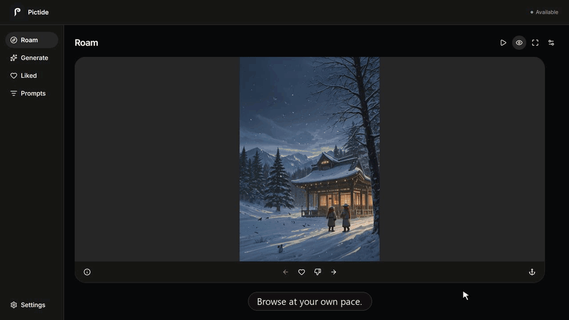

#  Pictide

[简体中文](docs/zh-CN/README.md)

**A world of images unfolds as you roam.**

New images are generated along the way, guided by your feedback and anchors.

Pictide is a local generative image exploration app that gradually adapts to your preferences through feedback. Easily generate images whose elements fit naturally together, without writing prompts by hand. You don't need a specific creative goal to get started—browse, express what you like, and guide what comes next. Images and preferences are both saved locally. [About Pictide](docs/guides/about.md).

## User guide

> [!IMPORTANT]
> Pictide's current experience depends on how well your image generation model supports Danbooru tag prompts. Support for natural-language prompts is planned.

### Quick start

1. Download and extract the portable package for your system from [GitHub Releases](https://github.com/Lykr/pictide/releases).
2. Launch Pictide and follow the in-app tour to start roaming.

On Windows, first-launch setup can install ComfyUI and a recommended model. On macOS and Linux, have ComfyUI or another image generation API ready.

Startup help: [Windows](docs/guides/setup/windows.md#portable-edition) · [Linux](docs/guides/setup/linux.md#portable-edition) · [macOS](docs/guides/setup/macos.md#portable-edition).

### Feature overview

| Section | Purpose | Guide |
| --- | --- | --- |
| Roam | Discover images you enjoy and guide what comes next | [Roam](docs/guides/roam.md) |
| Generate | Turn a specific idea into images | [Generate](docs/guides/generate.md) |
| Liked | Revisit favorites and find the images you want | [Liked](docs/guides/liked.md) |
| Prompts | Keep a favorite style and adjust image concepts | [Prompts](docs/guides/prompts.md) |
| Settings | Connect a generation service and manage preferences and data | [Settings and cleanup](docs/guides/settings.md) |

### More help

- [LAN access and Home Screen app](docs/guides/access.md): mobile access and PWA support.
- [Backup and recovery](docs/guides/backup.md): data locations, backup, and restoration.
- [User documentation](docs/README.md#user-documentation): find a guide by task.

Pictide is a proof of concept. See the [setup guide](docs/guides/getting-started.md) for current service and platform support.

## Developer documentation

- [Development workflow](docs/dev/development.md): source setup, builds, verification, and releases.
- [Architecture and module boundaries](docs/dev/architecture.md): responsibilities, dependencies, and call flows.
- [Corpus tools](docs/dev/corpus.md): vocabulary processing and release data preparation.
- [HTTP API reference](docs/dev/api.md): endpoints, request parameters, and responses.
- [UI design system](docs/dev/design-system.md): components, visuals, and interactions.
- [Developer documentation index](docs/dev/README.md): data layout, code entry points, and further reference.

## License

Pictide's original source code and documentation are licensed under the [Apache License 2.0](LICENSE). See [NOTICE](NOTICE) for project attribution. Third-party components, fonts, model weights, datasets, and generated images retain their applicable licenses and rights; the project license does not grant additional rights to those materials.
