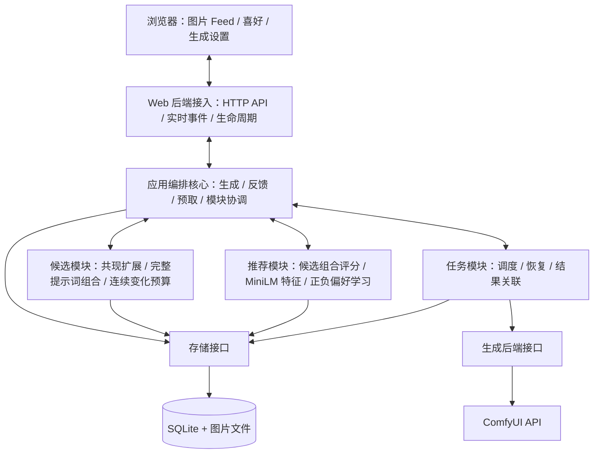

# 架构与模块边界

[文档导航](README.md)。本页只说明模块、职责和依赖；具体调用顺序见[调用和数据流](architecture/flows.md)，推荐内部见[推荐模块](architecture/recommendation.md)。

Pictide 是前后端分离的本地 Web 应用。`web/` 是唯一浏览器入口，`backend/` 提供业务 API；部署时由同一 Python 进程提供已编译前端与 API，正常运行不需要 Node 服务。

## 架构图

当前模块职责如下。Web 后端中的应用编排层是交互核心，统一传递候选、评分、生成请求与反馈；候选、推荐、任务模块之间不直接调用或互相依赖。HTTP 宿主是独立 Web 服务；ComfyUI 只承担生成 API。




## 目录映射

```text
pictide/
  web/                         唯一前端，npm 包名 pictide-web
    index.html                 单一 HTML 入口
    src/main.tsx               React 应用入口与视图导航
    src/                       页面、交互控制器、共享组件与主题
    dist/                      Vite 发布资源
  backend/
    host.py                    HTTP API、SSE、静态资源、启动与关闭
    application.py             生成、候选、评价、清理等应用编排
    domain.py                  公共输入校验及错误
    paths.py                   数据路径与本进程运行环境
    candidate/                 只读共现词库、预设、连续变化预算与离线导入
    recommand/                 组合特征、MiniLM、贝叶斯评分与学习；沿用目录拼写
    task/                      调度、恢复、取消与结果关联
    generation/                生图接口、ComfyUI 接入与工作流
    store/                     SQLite、图片/JSON、清理策略及回收
  data/                        可替换的数据根目录
  docs/                        文档入口与主题概览
    guides/                    使用指南
    architecture/              架构与流程细节
    reference/                 API、数据与设计参考
    issues/                    需求设计、功能变更与交付记录
  tests/
  start.cmd
  start.ps1
```

| 图中模块 | 实际位置 | 职责与边界 |
| --- | --- | --- |
| UI | `web/` | 展示、草稿、键盘与交互；通过 HTTP/SSE 与宿主通信 |
| Host | `backend/host.py` | 请求与响应、来源检查、错误映射、静态资源、事件与生命周期；调用应用编排 |
| App | `backend/application.py` | 连接候选、推荐、任务与存储，编排漫游缓冲、设置版本与暂停条件 |
| Rules | `backend/candidate/` | 只读词库、共现预设与候选生成、序列预算；不调用生图服务 |
| Rec | `backend/recommand/` | 完整组合评分、标签特征编码与正负偏好学习；不生成候选或调用 ComfyUI |
| Jobs | `backend/task/` | 任务状态、幂等、恢复、取消与产物关联；依赖生图及存储接口 |
| Backend / Comfy | `backend/generation/` | 隔离 ComfyUI 请求、校验、提交、查询、图片读取与工作流差异 |
| Store / DB | `backend/store/` | SQLite 与文件存储、原子反馈、图片提示词关联及懒清理 |

## 依赖规则

- Host 负责传输、来源检查和生命周期，通过 App 执行用例；不承载候选求解、推荐算法或 SQL。
- App 是候选、推荐、任务之间的唯一交互核心。它获取完整候选池、请求组合评分、选择组合并提交任务；评分不会回传候选进行重新抽取。
- Candidate、Recommendation、Task 不直接相互调用或导入。共享推荐请求/结果位于 `backend/contracts/recommendation.py`，候选快照位于 `backend/candidate/contracts.py`。
- Candidate 通过 Host 注入的存储接口读取在线词库和预设，不导入 SQLite 适配器；离线下载、导入工具独立使用 SQLite，不放入在线启动或请求链。
- Task 依赖 Generation 和 Store，负责确定任务的提交、事件核实、恢复、取消与结果关联；Generation 隔离 ComfyUI 差异。
- 浏览器通过 HTTP/SSE 管理展示、输入和草稿，不直接读写配置或数据库。提示词页是同一前端中的视图，没有额外站点或 iframe。
- Store 持久化任务、图片、反馈、快照和学习状态。反馈学习依据实际生成快照，不用当前词库覆盖历史语义。

## 继续阅读

| 要了解的内容 | 主题 |
| --- | --- |
| 生成、预取与反馈的模块调用 | [调用和数据流](architecture/flows.md) |
| 推荐内部职责、特征和当前能力 | [推荐模块](architecture/recommendation.md) |
| 所有 HTTP 字段与状态码 | [API 参考](api.md) |
| 数据文件、备份与表的归属 | [数据目录](data-layout.md)、[存储参考](reference/storage.md) |
| 如何新增前端或生图适配器 | [开发流程](development.md)、[页面设计规范](design-system.md) |
| 当时的设计决定与验证 | [需求记录](issues/README.md) |
