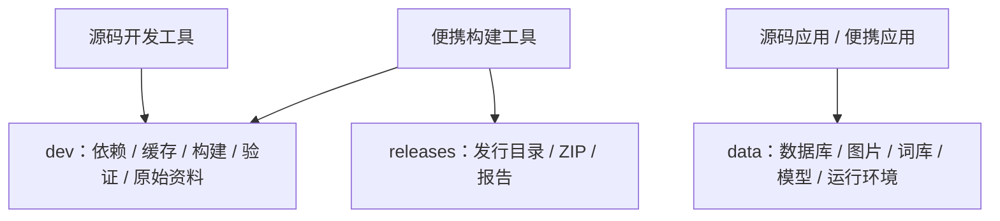
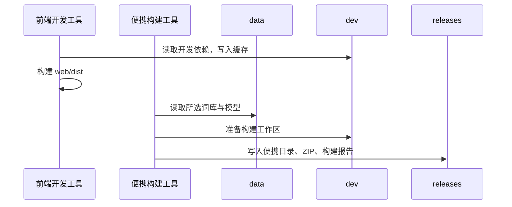

# 开发资料与发行产物分离

## 概述

开发资料归入根目录 dev，发行产物归入根目录 releases，data 与便携包保持运行数据职责一致。

## 架构

## 职责边界

- 前端开发工具：依赖使用 dev/runtime/frontend，缓存使用 dev/cache。
- 便携构建工具：工作区使用 dev/build，各系统示例输出到 releases。
- 运行路径：DataPaths 专注所选 data；移除未被业务调用的 dev 属性。
- 本次目录整理：移动开发资料、离线导入环境、前端依赖及其缓存，保留运行数据与既有发行包内容。

## 调用和数据流

## 重点关注

- 移动前保留运行数据库备份和目录清单，移动后核对文件数量、大小及发行 ZIP 校验值。
- 更新 Git 忽略规则、开发入口、各系统指南；历史记录保留当时路径并注明新位置。
- 少量路径、前端类型检查和构建、离线导入环境与便携资源导出冒烟。

交付记录（2026-10-19）：

- 已完成 15 项目录移动；原始数据、验证资料、前端依赖、离线导入环境与开发缓存归入 dev，现有便携包归入 releases。
- 便携构建默认输出到 releases/<版本-平台-时间>，构建工作区使用 dev/build。各系统指南和 Git 忽略规则同步更新。
- 路径冒烟、前端类型检查与构建、锁文件离线安装、移动后的 PyArrow 环境检查通过；个人数据库各表记录数与移动前备份一致，现有发行 ZIP 的 SHA-256 保持。
- 移动清单与核对记录位于 dev/maintenance/development-directories-20261019.json；数据库备份位于 data/backups/before-development-directories-20261019。
- 保留既有便携包内容，本次完成目录与开发工具路径验证；真实 GPU 生图与重新打包未执行。
