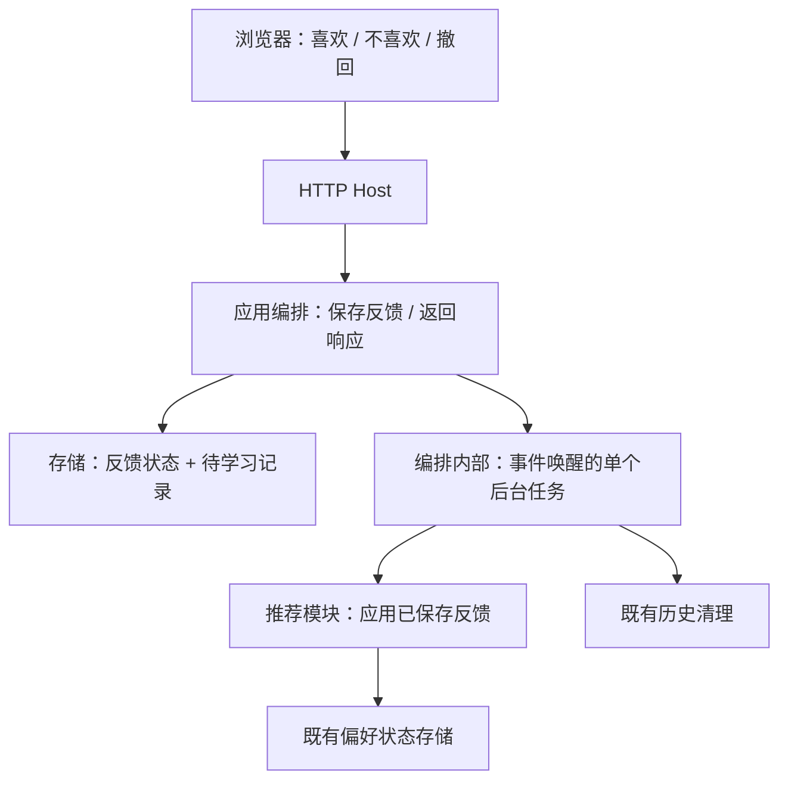
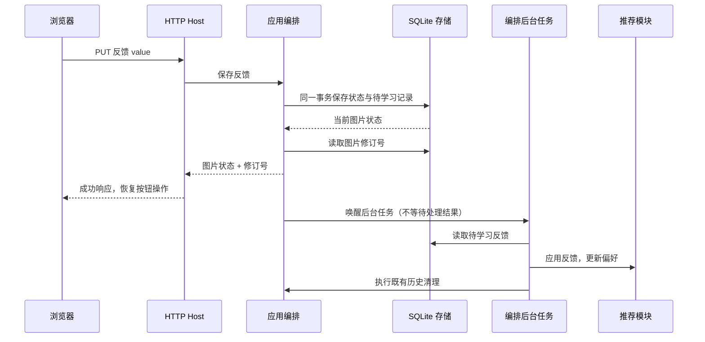

# 反馈快速返回与后台偏好学习

## 概述

喜欢、不喜欢和撤回反馈保存到 SQLite 后返回，推荐学习与本次反馈触发的历史清理由应用编排后台执行。

## 架构

## 职责边界

- `PUT /api/artifacts/{id}/feedback` 的请求和返回字段保持不变；成功响应表示反馈状态及可学习记录已提交，不表示推荐模型已更新。复用 `Storage.rate()` 在同一事务内取得的图片状态快照，再读取图片修订号，发布既有 feedback 事件并返回。
- 应用编排内部维护单个事件唤醒任务，调用现有推荐同步逻辑处理持久待学习记录；处理过程中收到新反馈时再执行一轮，连续唤醒合并。不逐次创建并发学习任务，不新增队列服务、定时器或数据库表。
- 推荐接口、反馈正负含义和撤回逻辑不变；仍按记录版本处理同一图片的最新有效反馈。候选、推荐、任务模块仍只与应用编排交互。
- 评分入口不再强制同步处理全部待学习记录，改为唤醒后台并使用已完成的偏好状态评分；启动与关闭由既有应用生命周期管理后台任务。

## 调用和数据流

## 重点关注

- 新偏好稍后生效，已有预取图片保持；仅取消客户端等待学习和清理，不对保存失败做成功反馈。
- 不喜欢或取消喜欢的图片可能在响应后按既有规则清理，通过既有 artifacts 事件更新界面。
- 复用持久记录处理失败与重启恢复，失败后等待后续反馈或评分入口再次唤醒；关闭时等待正在处理的一轮，未处理记录保留。
- 验证重点：模拟慢学习时 HTTP 已返回；连续喜欢／不喜欢／撤回最终状态正确；待处理反馈可在重启后学习；少量冒烟即可。

## 实现与验证

编排内部 `_request_learning()` 唤醒单个 `_learn_feedback()` 任务，线程评分通过事件循环线程安全投递唤醒；处理中收到的新反馈保留下一轮唤醒。`stop()` 停止新唤醒并等待正在处理的轮次，未处理记录保持持久化。推荐模块本身的锁仍会使评分等待当前单条学习提交，评分入口不再主动清空全部待学习反馈。

`Storage.rate()` 在反馈写事务内取得响应快照，避免事务提交后恰逢后台清理而把成功反馈误报为不存在。图库修订号继续用于删除／隐藏后的前端缓存失效，未改为图片反馈 CAS。

使用隔离数据和模拟编码器验证慢学习阻塞时 HTTP 已返回、连续反馈只学习最新状态、失败及启动重放、清理发生在提交后仍返回保存快照；抽验既有正负反馈与重置链路，不提交真实 GPU 生图任务。验证记录位于 data/verification/feedback-background-20261018。
