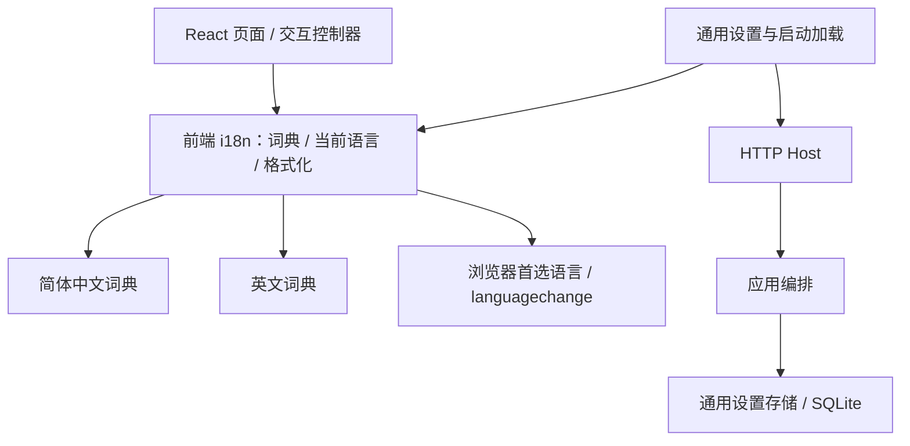
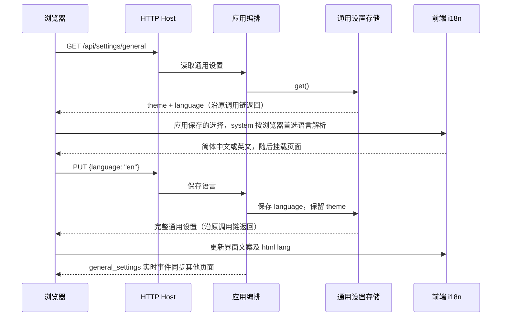

# 简体中文与英文国际化

## 概述

将界面文案集中管理，在「设置 → 通用」提供跟随系统／简体中文／English，默认跟随系统，不支持的系统语言使用英文。

## 架构

## 职责边界

- 前端 `i18n` 提供 `t(key, params)`、保存的语言选择、解析后的界面语言及订阅能力；React 组件和现有 DOM 控制器共用词典，负责标题、菜单、按钮、说明、占位、无障碍名称、状态反馈，以及日期和数字格式化。
- 通用设置接口仍为 `GET/PUT /api/settings/general`，增加 `language: "system" | "zh-CN" | "en"`，完整返回例如 `{"theme":"system","language":"system"}`。PUT 允许单独提交 theme 或 language，未提交项保持原值。
- Host 转交请求；应用编排协调保存并发布既有 `general_settings` 事件；Store 保存主题与语言，默认语言选择为 `system`，具体显示语言由各浏览器解析。候选、推荐、任务的业务接口不变。

## 调用和数据流

## 重点关注

- 语言选项为「跟随系统／简体中文／English」。跟随系统依据浏览器首选语言（navigator.language）；zh、zh-CN、zh-SG、zh-Hans 及其地区变体映射简体中文，其他语言包括繁体中文回退英文。订阅 languagechange，仅 system 状态重新解析；手动选择优先。
- SQLite 保存 system 这一选择，不保存解析结果；局域网各设备在跟随系统时可显示不同语言。
- 覆盖漫游、生成、喜欢、提示词、设置，以及弹窗、分页、悬浮提示和移动端／沉浸模式；统一维护中英文术语，漂流／顺流／停泊对应 Drift／Flow／Anchor。
- 切换不刷新页面、不重建业务状态，保留未保存表单、图片位置及播放状态；启动时加载语言，既有实时事件同步同一应用的其他页面。
- 只翻译产品界面：标签原名、实际正负提示词、用户自定义名称、模型与工作流参数标识保留原文；后端／ComfyUI 原始错误作为诊断详情保留，前端操作提示按所选语言显示。
- 实施前备份应用数据库；验证词典键完整、系统语言解析与英文回退、设置独立保存、前端类型检查和构建，以及中英文主要页面的少量真实界面冒烟。

## 维护入口与验证

已实现的共享入口为 web/src/i18n/index.mjs，语言选项和词典注册在此维护；英文词典按 common / feed / controllers / editor / components 分类，messages/en/index.mjs 合并。简体中文原文作为稳定消息键，无需维护一份内容相同的中文副本；修改文案时同时更新对应翻译。t(key, params) 支持具名变量，tr 模板使用 {0}、{1} 等位置变量。用户内容不传入翻译函数。

新增语言时添加对应词典及合并入口，在共享入口注册显示名称、字典和系统语言匹配规则，并更新 backend/store/general_settings.py 的语言允许值。SQLite 的语言列存字符串，不将语言列表重复固化进数据库约束；无需新增 API 或修改页面业务逻辑。添加英文长度相近的语言主要检查翻译和布局，RTL 语言需另行处理方向布局。

语言更新订阅沿用 React 根树和现有控制器，更新文字而不重新挂载业务页面；动态状态保存其文案计算入口以便重新渲染。较早发出的设置 GET 不覆盖保存中的新选择。验证使用 tests/i18n.test.mjs、tests/theme.test.mjs 和 tests/test_general_settings.py，以及独立数据实例中的双语页面、下拉菜单、刷新保留、表单草稿和跨页面同步冒烟；记录保存在 data/verification/i18n-20261018。
