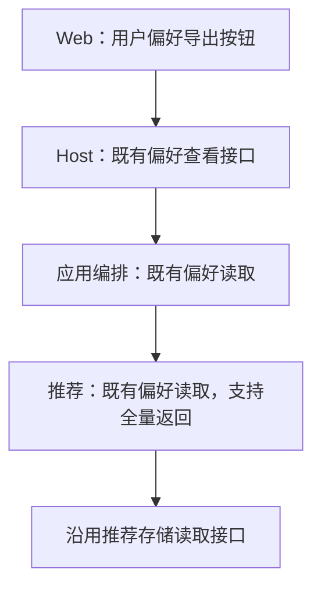
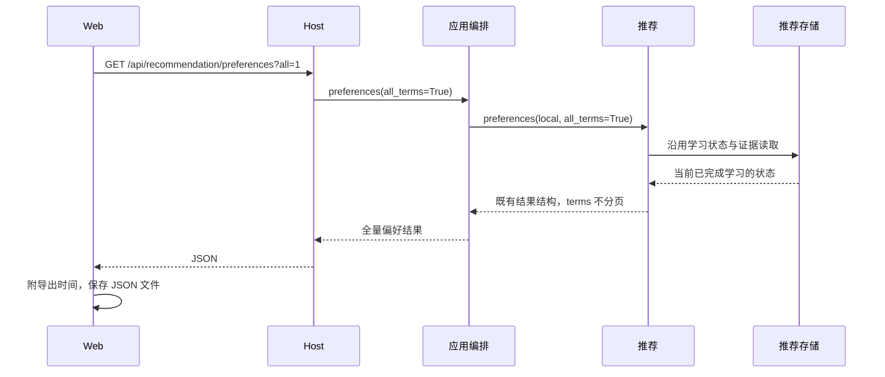

# 用户偏好导出

## 概述

设置 → 漫游 → 用户偏好增加导出按钮，复用查看偏好的接口，一次下载全部已学习标签的 JSON 报告。

## 架构

## 职责边界

| 组成 | 变更与接口 |
| --- | --- |
| Web | 在查看和重置按钮之间增加「导出用户偏好」图标按钮；请求全量数据后下载带时间的 JSON 文件，加载和失败反馈保留在当前操作区，中英文同步。 |
| Host | 沿用 GET /api/recommendation/preferences，增加可选 all=1 查询参数，返回原 JSON 结构；默认仍按每页 15 项查看。不新增路由或附件接口。 |
| 应用编排 | 既有 preferences(page, all_terms=False) 转交全量标志，不新增导出方法。 |
| 推荐 | 既有 preferences(user_id, page=1, *, all_terms=False) 在全量模式返回全部 terms；沿用现有权重计算和 PreferencesResult。 |
| 存储 | 沿用 load_policy / load_evidence / get_reset_state，不新增表或存储接口。 |

导出内容复用查看结果中的 feature_version、state_revision、reset_revision、reset_at、evidence_count、term_count 和全部 terms。每项仍为 text、channel、weight、evidence_count，按现有权重排序。浏览器附加 exported_at 并保存为 JSON，不额外定义导出 DTO 或重复计算权重。

## 调用和数据流

## 重点关注

- 本版导出可读标签偏好报告，包含正负向权重及有效学习次数；权重不是喜欢概率。
- 这不是完整学习状态备份：不包含精度矩阵 M、奖励向量 b、语义权重或反馈原始快照，本版不实现导入和恢复。
- 导出当前已完成学习的状态，不等待或触发后台学习，不改变用户偏好、图片评分缓存或漫游预取。
- 复用现有接口，一次全量返回；不在浏览器逐页下载，避免重复计算以及拼接不同学习修订的结果。
- 无法读取时沿用现有 available/error，不下载不完整报告；不编码文本、不提交生图任务。
- 用少量样例验证默认分页不变、超过 15 项的全量返回、下载及失败反馈；执行类型检查、构建和隔离界面下载验证。

状态：已实现；默认分页／全量读取／只读语义冒烟、类型检查与构建通过。隔离界面实际下载 26 项 JSON，确认正负方向、权重、学习次数与版本字段；不可用时显示错误而不导出。