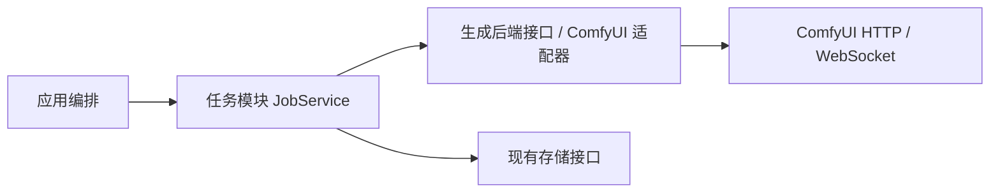

# 生图任务事件通知（已确认、已实现）

## 范围

新提交任务通过 ComfyUI WebSocket 感知结束，HTTP 查询核实结果。提交窗口和占位恢复见 [两个在途任务](task-window.md)；本页定义每项任务的事件机制。前端、候选、推荐、存储 schema 与 Pictide HTTP/SSE 接口不变；复用 aiohttp，不增加依赖、常驻进程、UI 配置或定时投喂循环。

## 架构



- JobService 管理当前任务、调度等待和订阅生命周期，为每项在途任务保留独立适配器实例，确认该项结束或停止服务时关闭订阅。
- ComfyUI 适配器负责 client_id、WebSocket 连接、事件解析和过滤，向 JobService 发送无业务数据的唤醒通知。JobService 不解析 ComfyUI 消息，不调用候选或推荐。
- WebSocket 只通知状态可能发生变化；结果仍由 inspect() 通过 HTTP 核实，再由既有图片缓存与 Store.complete() 保存。

## 调用与数据流

1. JobService 按现有队列顺序取得任务及配置快照，为该任务持有一个生成适配器。
2. 对新提交任务，先调用 start_events(request_id, notify)，连接 /ws?clientId=... 并开始接收；notify 只设置现有 wake Event。
3. 调用既有 submit(plan, request_id)。适配器在 POST /prompt 中加入与订阅一致的 client_id，保留 extra_data.pictide_request_id 和现有提交不确定性处理。
4. 接收 execution_success / execution_error / execution_interrupted，以及 executing 且 node=null 的结束消息，唤醒工作线程。按该任务专用 client_id 隔离，并在已知 prompt_id 后核对消息归属；忽略进度、图片预览二进制和其他任务事件，避免逐步触发 HTTP 查询。
5. 唤醒后调用 inspect(prompt_id)。只有确认完成或失败才处理结果；完成后释放该项提交窗口，先补位，再继续图片下载、落盘与入库。
6. 当前任务确认结束或确认已从队列删除，以及应用停止时释放 WebSocket；每项新任务独立建立订阅。不增加跨后端共享连接池。

### 等待、断线与恢复

- 新任务成功订阅且连接健康：主要等待 wake，最长 30 秒做一次低频状态核对，以处理漏事件；不再每 2 秒查询。
- 无事件支持、连接建立失败、连接关闭或状态查询失败：回到原 2 秒查询节奏。连接关闭立即唤醒；在已有任务处理入口尝试恢复连接，成功后立即再核对状态。没有后台独立重连定时器。
- 首次连接设置短超时（1 秒），失败后照常尝试 HTTP 提交；连接成功仅表示通知通道可用，HTTP 仍决定任务提交是否成功。
- 应用启动时已经提交到后端的任务，先沿用 2 秒状态核对直到结束；当前进程新提交的任务使用事件机制。不假定历史任务的 client_id 已正确绑定；窗口占用由 task-window.md 定义的持久标记恢复。
- 空队列等待现有任务入队通知；有不确定提交需要复核时保留约 30 秒的兜底核对。连接与查询失败保留错误状态和既有不重提语义，不把断线当作生成失败。
- 每轮处理前消费旧唤醒信号，保留提交和状态查询期间到达的新信号，防止完成事件在进入等待前被清除。30 秒兜底按实际时间管理，不再按循环次数推算。

## 模块接口

扩展 backend/generation/base.py 的 GenerationBackend：

```python
from typing import Callable

async def start_events(self, request_id: str, notify: Callable[[], None]) -> bool: ...
# 建立当前任务的通知订阅；返回是否已连接。暂不可用或不支持返回 False。

@property
def events_connected(self) -> bool: ...
# 当前订阅连接是否健康；Task 用它选择等待时长。

async def stop_events(self) -> None: ...
# 停止接收并关闭当前订阅；不关闭应用共用的 HTTP ClientSession。
```

- 其他既有方法 submit / inspect / reconcile / cancel / image 的参数和结果保持。
- client_id 在适配器内根据 request_id 确定；同一任务连接恢复时使用相同标识。现有提交记录标识不变，敏感请求内容和认证数据不写日志。
- 模拟后端实现同一接口；不支持通知的实现返回 False，继续查询核对。不会引入第二种任务状态模型。
- 事件通知不新增 Task 与应用编排、浏览器之间的接口；Store 调度接口见 [提交窗口](task-window.md)。事件触发既有任务状态写入，继续通过现有 on_change → SSE 更新页面与按需预取。

## 验证与发布

少数隔离冒烟，不提交真实 GPU 任务：

1. 本地模拟 ComfyUI 验证连接先于提交、两端 client_id 一致；完成事件立即触发 inspect → 补位 → 保存，且事件早于提交响应时不会丢失。
2. 重复/无关/进度消息不重复提交或重复入库；手动优先与提前准备机制保留。
3. 断线恢复、订阅不可用和应用恢复中的旧任务可用 HTTP 核对完成；停止服务释放连接；空队列没有持续热循环。

使用 aiohttp 模拟 WebSocket + 临时 SQLite，比较事件结束到确认/交接的时间与 HTTP 查询次数。上线前备份、核对运行任务并提前告知后端重启；不覆盖前端构建和用户数据。模拟结果不等于真实 GPU 性能。

## 依据

- [ComfyUI 服务器消息](https://docs.comfy.org/zh/development/comfyui-server/comms_messages)：终止事件及 executing(node=null) 的含义。
- [官方 WebSocket 示例](https://github.com/Comfy-Org/ComfyUI/blob/master/script_examples/websockets_api_example.py)：先连接 /ws、提交时关联 client_id，再读取 history 和图片。

实现验证：11 个相关隔离冒烟通过，覆盖适配器终止事件过滤、早到事件、Task 查询期间唤醒、重复事件不重复处理、断线及不可用回退、重启后的旧任务轮询、手动优先、提前准备与提交不确定时不重试。

首次单窗口事件实现的三次相同模拟流程对比（aiohttp HTTP/WebSocket、独立 SQLite、PNG 缓存落盘）中，从模拟完成到下一项提交的平均时间为：2 秒轮询 1962ms，事件通知 36ms。两种模式每项均查询两次 history；真实长任务的健康连接每 30 秒兜底，不再每 2 秒查询。生产 ComfyUI 只读 WebSocket 握手已通过，未提交真实 GPU 测试任务。该结果衡量调度响应，不代表 GPU 出图加速；报告在 data/verification/task-events-20261018。