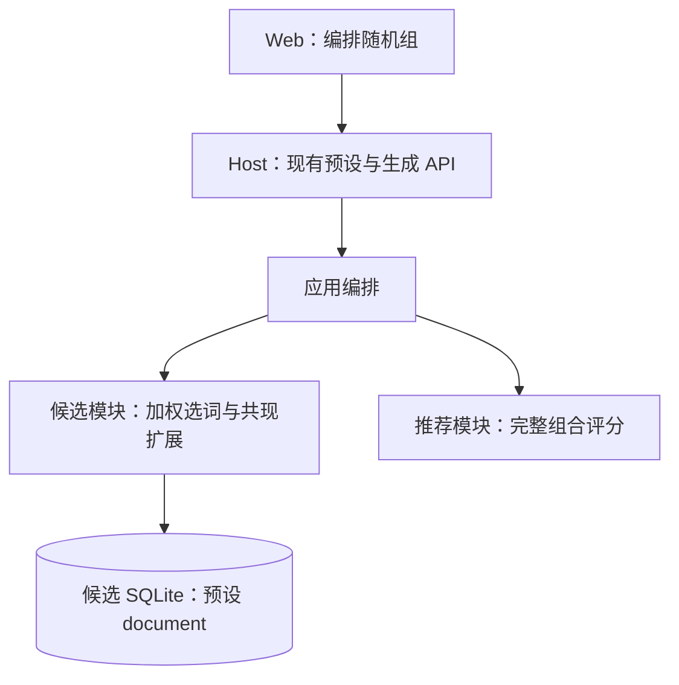
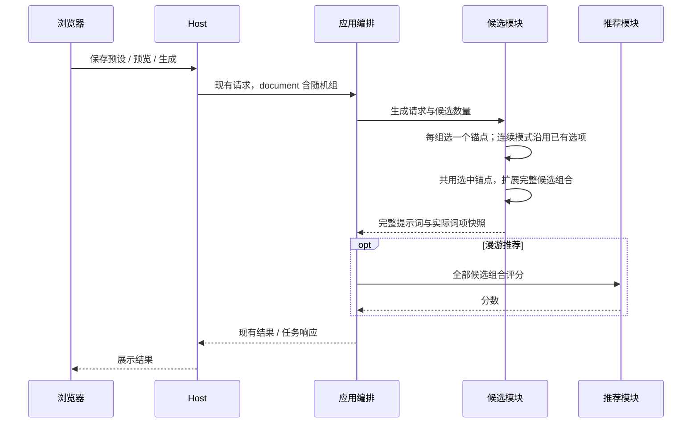

# 加权随机正向锚点

## 概述

待确认：在「提示词 → 编排」增加正向随机组，每组按权重选一个词，作为本轮共现扩展的固定锚点。

## 架构



## 职责边界

- 沿用预设读写和生成接口，预设 document 新增 `weighted_positive_groups`，默认空列表。无需新增 HTTP 路由或数据库表。
- 每组结构为 `{id, name, options:[{text, weight}]}`；id 标识组，name 用于界面展示，text 是完整词项，weight 为有限非负数，每组至少一个正权重选项。同组词项及不同组的选项不重复，按忽略大小写、空格/下划线等价识别。
- 候选负责抽签、种子复现、连续保持和输出；一次 provider.generate 只为每组选一次，同池所有候选共用选中锚点。单次预览和手动生成的每轮也各抽一次；每次数量产生的多张图共用该轮提示词。
- 原固定词、漫游手动锚点优先：如果已指定某组选项，该组直接沿用它；同时显式指定一组多个不同选项时提示冲突。其余组内选项不进入自动扩展，保证组内只出现一个。
- 推荐继续接收完整组合和现有词项快照，不接收权重、不负责抽签；最终选中词照常参与评分和学习。

示例预设字段：

```json
{
  "weighted_positive_groups": [
    {
      "id": "rating",
      "name": "评级",
      "options": [
        {"text": "general", "weight": 4},
        {"text": "sensitive", "weight": 3},
        {"text": "questionable", "weight": 2},
        {"text": "explicit", "weight": 1}
      ]
    }
  ]
}
```

## 调用和数据流



## 重点关注

- 权重 4:3:2:1 对应抽取概率 40% / 30% / 20% / 10%；0 表示不随机抽取。组内恰选一个，本版不增加「都不选」概率，不扩展负向随机组。
- 「固定正向词」下增加「随机组」区域，可创建、删除组和编辑各选项及权重，沿用词库匹配与自由输入。选中项顺序为固定正向词、漫游手动锚点、随机组选中词、共现扩展词；每个组计一个标签。
- 已知选中词参与 PMI 约束，自定义词保留输出、不参与 PMI；各显式锚点之间沿用现有固定词语义。随机组按本次固定锚点处理，不因关键词屏蔽或负向同名词而改写；自动扩展仍遵守原排除规则。
- 漂流每轮重新抽签；固定种子可复现。连续序列用序列种子确定初始选项并保持；顺流从当前实际组合继承选项，首次没有参考时抽一次；停泊保持整组提示词。随机组选项在连续模式中固定，不占变化预算。
- 同池共用选项避免推荐在多个评级之间择优而扭曲配置比例；概率描述的是重新抽签的轮次，短期图片数量、预取和用户浏览行为不保证相同比例。
- 改动预设先备份候选 SQLite；第一版不迁移历史记录，只保存新图实际输出，现有词库保持只读。
