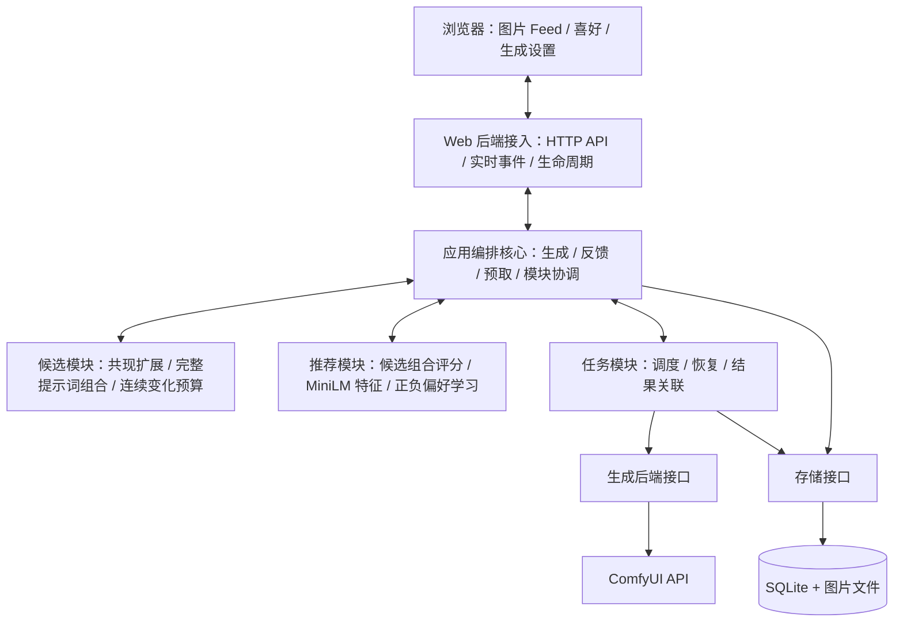
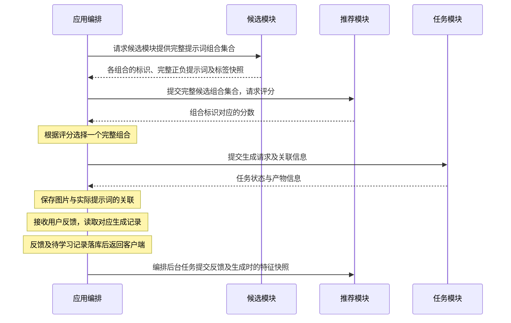
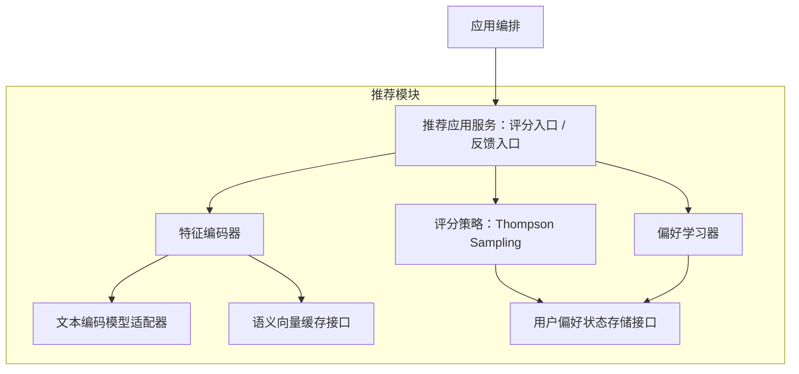
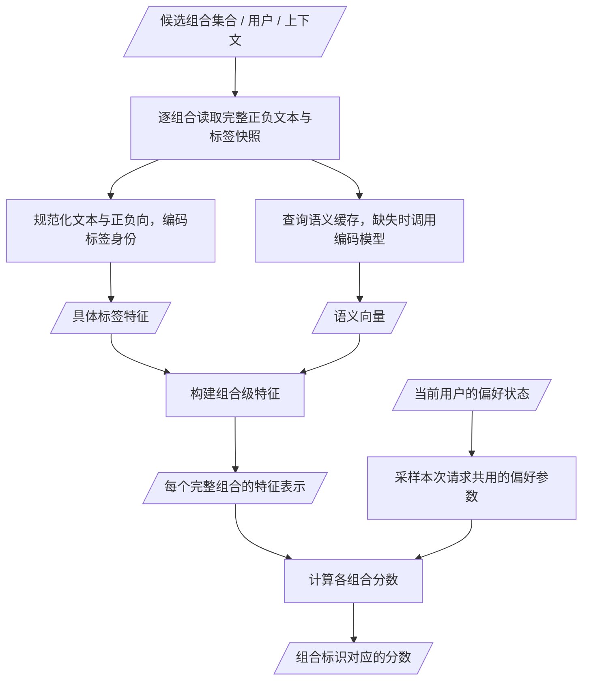

# 架构与模块边界

Pictide 是前后端分离的本地 Web 应用：`web/` 是唯一浏览器入口，`backend/` 提供 API 与业务模块。默认由同一进程提供已编译静态资源和 API，保持单条启动命令；源码与职责分别维护，前端不导入 Python 后端源码。

## 架构图

以下为目标架构。Web 后端中的应用编排层是交互核心，统一传递候选、评分、生成请求与反馈；候选、推荐、任务模块之间不直接调用或互相依赖。HTTP 宿主是独立 Web 服务；ComfyUI 只承担生成 API。



### 候选评分与生成流程（目标）



- 候选模块先根据标签库与规则提供本次请求的全部候选提示词组合，每个候选都是可提交生成的完整正负提示词，包含组合标识、标签快照及版本；PMI/最低共现次数阈值、数量及连续变化预算在生成候选组合时已满足。
- 推荐模块对 App 提供的完整组合评分，返回组合标识与分数，不逐词打分后交回抽取，不新增、修改或删除组合。Thompson Sampling 的探索体现在组合评分中。
- App 获取候选组合集合，交给推荐模块评分，再根据评分选择一个完整组合并提交任务；不将评分交回候选模块重新组装提示词。任务模块只接收确定的生成请求。推荐不可用时，由 App 在既有合法组合中按默认策略选择。
- 生成记录保存所选组合及实际标签内容与版本；反馈由 App 关联历史记录后交给推荐模块，不以最新标签库重新解释历史，也不把一次点赞直接视为喜欢全部标签。撤回喜欢不等同于不喜欢。

### 推荐模块内部架构（目标）

推荐模块只通过 App 接收完整候选提示词组合及反馈，评分单位是一个组合。类目属于候选模块的管理、筛选与槽位，不进入推荐特征、向量缓存键或用户偏好学习；类目修改可以改变候选组合集合，但不改变同一内容的特征。

架构图只表达逻辑组件及调用依赖，箭头表示调用或依赖，不表示数据先后流动。这些是模块内部职责划分，不要求拆成独立进程或服务。



推荐应用服务协调内部编码、评分与学习：评分时取得组合特征并调用评分策略；反馈时取得实际生成组合的特征，并将特征、反馈及记录标识一起交给偏好学习器。两条用例分别触发，推荐内部不调用候选或任务模块，也不直接读取它们的实现或标签库文件。模型适配器封装固定版本的文本编码模型；缓存和偏好状态存储接口由持久化适配器实现。

### 推荐评分的数据处理流程（目标）

流程图表达一次评分请求的数据与处理步骤。标签内容特征、语义向量和组合级特征是数据产物；内容编码、语义编码和特征组合是处理步骤。上图的特征编码器负责这些步骤，具体算法仍待验证。



学习入口走独立流程：读取实际生成组合快照 → 使用同版本特征编码器 → 将组合特征与用户反馈关联 → 更新偏好状态。一次评分请求不执行这条学习流程。上文的时序图负责说明 App 与候选、推荐、任务模块的调用顺序，不代替静态架构图。

- 组合标识用于将分数交回 App；标签内容身份用于在不同组合间学习和共享经验。规范化文本与正负向定义标签内容身份，同文不同 ID 可复用内容特征；近义或反义词仍保留各自的具体标签特征，语义向量不自动合并偏好。
- 组合级特征由具体标签的稀疏特征与分正负向聚合的语义向量构成，对外只返回完整组合分数；第一版为线性模型，不声明已学习复杂搭配关系，具体约定见 [推荐模块设计](issues/recommendation-v1.md)。
- 同一请求的所有组合使用同一组采样偏好参数进行比较。推荐返回评分后，由 App 选择组合并调用 Task，不再调用 Candidate 按分数抽词。
- 冻结的 MiniLM 按基础标签编码，向量缓存包含文本、模型文件、运行依赖与预处理版本。用户点赞更新偏好状态，不训练文本编码模型。
- 学习输入为 App 提供的实际生成组合及反馈，使用当时的文本、正负向与特征版本，不采用最新类目或标签内容替代历史。整张图片的喜欢/不喜欢按组合学习 +1/-1，不直接转换为每个标签独立的反馈；未评价保持未知，撤回应撤销对应贡献或重放有效反馈，不当作负反馈。
- 用户偏好状态按用户及特征版本隔离。更换编码器时重新编码并基于历史有效反馈重建状态，不混用不同向量空间；缓存与策略状态通过存储接口保存在应用数据目录。具体学习算法及反馈归因需要后续实现与验证。

### 当前实现与目标的差异

第一版已实现 MiniLM CPU 离线标签编码、完整组合评分、贝叶斯线性后验采样、有效点赞学习、撤回和重启恢复。App 先接收候选组合集合，传给推荐服务 `score`，再选择组合提交任务；旧 `choose` 接口和推荐对候选模块的类型导入已移除，中立契约位于 `backend/contracts/recommendation.py`。

学习使用显式正负反馈的组合关联，未评价保持未知；评分不是点赞概率，也未实现曝光/未转化学习、复杂搭配或图像特征。模型缺失或不可用时报告状态，App 保留既有默认候选处理，不把降级称为学习。bootstrap 的 `recommendation` 返回可用状态与版本，`preference_learning` 根据实际可用状态报告；学习通知未成功应用时保留重试，用户反馈不回滚。偏好查看与重置复用 Web → Host → App → Recommendation → Store 链路；查看只读当前学习状态，重置原子清除全部特征版本偏好并记录反馈事件分界，保留图片和反馈。详见 [第一版推荐设计](issues/recommendation-v1.md) 、[偏好查看与重置](issues/recommendation-preferences.md) 与 [不喜欢反馈](issues/dislike-feedback.md)。

## 目录映射

```text
pictide/
  web/                         唯一前端，npm 包名 pictide-web
    index.html                 单一 HTML 入口
    src/main.tsx               React 应用入口与视图导航
    src/                       页面、交互控制器、共享组件与主题
    dist/                      Vite 发布资源
  backend/
    host.py                    HTTP API、SSE、静态资源、启动与关闭
    application.py             生成、候选、评价、清理等应用编排
    domain.py                  公共输入校验及错误
    paths.py                   数据路径与本进程运行环境
    candidate/                 只读共现词库、预设、连续变化预算与离线导入
    recommand/                 组合特征、MiniLM、贝叶斯评分与学习；沿用目录拼写
    task/                      调度、恢复、取消与结果关联
    generation/                生图接口、ComfyUI 接入与工作流
    store/                     SQLite、图片/JSON、清理策略及回收
  data/                        可替换的数据根目录
  docs/                        长期架构、开发、设计与数据约定
    issues/                    需求设计、功能变更与交付记录
  tests/
  start.cmd
  start.ps1
```

| 图中模块 | 实际位置 | 职责与边界 |
| --- | --- | --- |
| UI | `web/` | 展示、草稿、键盘与交互；通过 HTTP/SSE 与宿主通信 |
| Host | `backend/host.py` | 请求与响应、来源检查、错误映射、静态资源、事件与生命周期；调用应用编排 |
| App | `backend/application.py` | 连接候选、推荐、任务与存储，编排漫游缓冲、设置版本与暂停条件 |
| Rules | `backend/candidate/` | 标签库和规则合法性、编辑持久化、候选生成与序列约束；不调用生图服务 |
| Rec | `backend/recommand/` | 完整组合评分、标签特征编码与正负偏好学习；不生成候选或调用 ComfyUI |
| Jobs | `backend/task/` | 任务状态、幂等、恢复、取消与产物关联；依赖生图及存储接口 |
| Backend / Comfy | `backend/generation/` | 隔离 ComfyUI 请求、校验、提交、查询、图片读取与工作流差异 |
| Store / DB | `backend/store/` | SQLite 与文件存储、原子反馈、图片提示词关联及懒清理 |

## 依赖规则

- HTTP 路由通过 App 调用用例；业务校验、生成规则、任务和存储逻辑不堆入 Host。
- App 可以调用 `candidate`、`recommand`、`task` 和 `store`；Task 调用 `generation` 与 `store`。候选、推荐、任务之间不得直接调用、相互导入或通过事件隐式互调，跨模块数据由 App 传递。共享输入输出契约放在中立位置，不通过导入另一个业务模块复用类型。这些模块不反向依赖 Host 或 App。当前遗留差异见上文，不把目标约定描述为已完成。
- 纯业务模块不导入 aiohttp 的服务器/请求对象或浏览器代码。`generation` 可使用 HTTP 客户端实现远端适配，这属于接入边界。
- Candidate 不依赖任务、SQLite、生图接口或 HTTP。`CandidateService` 统一管理列表、读取、保存、创建、草稿检查和生成；CLI 与 HTTP 用例复用同一内部实现。
- 前端只通过 API 处理标签库、生成、任务和反馈；保存前校验及修订冲突由后端执行，客户端校验不能替代它们。
- 推荐与任务不依赖前端。候选契约保留稳定标签库身份、标签 ID 和历史文本/类目快照；漫游预取保存所选候选快照并关联任务和产物，手动文本任务不伪造标签归因。

## 单一页面与事件

浏览器只有 web/src/main.tsx 一个入口。提示词页以 React 管理只读词库、预设草稿与预览，通过 HTTP → App → Candidate 访问后端，保存变更沿用 SSE candidate 事件。Feed 控制器继续使用同一主题与组件。离线 download/importer 是独立数据工具，可以直接操作其导入 SQLite，不由在线候选服务导入；在线候选仍通过 Host 注入的存储接口访问数据。

HTTP 候选端点与请求字段见 [共现候选接口](issues/cooccurrence-candidates-v1.md#3-接口)，不保留旧 JSON 配置 API。

## 生成批次与图片来源

生成页使用每次数量 `count` 与生成次数 `repetitions`（均 `1`–`10`）准备一份最多 100 个任务的计划。App 调用 Candidate 的轮次用例冻结标签库并逐轮求解，按种子/帧号控制推进；每轮的 `count` 个任务共用该轮文本。手动文本各轮保持不变。App 校验后端快照与全部轮次输入，交给存储一次写入；Task 复用原有调度与恢复顺序执行，不增加浏览器生图循环。随机图像种子逐任务独立抽取，固定种子跨轮按全局任务序号递增。没有种子绑定时，不覆盖工作流本身的种子。

批次的幂等检查、容量检查和全部任务写入在同一存储事务中完成；剩余容量不足时整批拒绝，不留下部分任务。重试同一请求返回原批次，批次内容不一致时报告冲突。任务失败、取消和恢复仍按独立任务处理，不把一个失败结果重提为新的批次。

`POST /api/jobs` 接受 `backend_id`、`request_id`、`positive`、`negative`、`seed`、可选整数 `count` 与 `repetitions`（均 `1`–`10`，默认 `1`）。自动抽取时附 `candidate`：`preset_id`、`mode`、`seed`、`max_steps`、`sequence_step`、`seed_control`、`step_control`，正负文本由候选模块生成。返回首项 `job`、完整 `jobs`、`next_seed`、最后一轮 `candidate_result` 和 `next_candidate`（`seed`、`sequence_step`）；手动计划的规则结果为空。固定图像种子使用 `(seed + index) % 2**53`，`index` 为跨轮从 `0` 开始的全局序号。

新计划的待处理队列容量为 100，检查包含已有排队、提交中与运行中的任务；没有传 `repetitions` 或 `candidate` 的旧请求及漫游沿用 10 的入队门槛。原始文本、规则与两种数量均参与幂等身份，相同 ID 不同输入返回 409。重试先找原计划，不再次求解，仍返回原任务和下次计数，即使原配置已被删除。浏览器只在收到确认回复后更新计数，事件中出现任务不会提前丢弃不确定请求。旧单任务请求在 `count=1` 时仍可幂等找回。

图片来源由任务归属决定，不在浏览器内推断：`roam_jobs` 中的任务为 `roam`，其余任务为 `generate`。旧版手动任务自然归入生成区，无需移动或删除原图片。喜欢和历史清理仍共用同一套图片、反馈与存储。

`GET /api/artifacts` 的 `source=generate` 用于生成页，`source=roam` 用于漫游；不带来源或使用 `source=all` 查询所有来源。「喜欢」不限定来源。来源过滤同时用于分页、列表总数和游标，不只过滤当前页展示；任务和产物响应均带 `source`，全局 `counts` 保留原字段并增加 `roam`、`generate` 数量。初始 bootstrap 返回 `roam_view`、其附近的漫游 `artifacts` 与对应 `artifact_page` 分页信息；未保存位置时读取最新窗口。自定义工作流每次的全部输出继续入库，因此生成数量表示执行次数，不强行裁剪输出张数。

`GET /api/artifacts?source=roam&around=<图片 ID>` 按 `(created_at,id)` 降序返回以锚点为中心的窗口，默认 200 张；靠近边界时从另一侧补足。`around` 不能与 `before` 或喜欢筛选并用，其他来源不可使用。返回 `anchor_id`（可能为清理后的邻图）、`has_newer`（窗口外是否还有较新图）及原有较旧侧 `has_more`、`next_cursor`；前端据此加载相邻窗口，不将窗口边界误判为图库边界。未知 ID 回退到最新图片，清理后保留墓碑的 ID 优先回退最近较旧图片，无较旧时用最近较新图片。

## 漫游预取调用链

漫游 API 通过 App 编排，契约如下；`epoch` 为服务端内部设置版本，不由客户端提交。

| 请求 | 输入与返回 |
| --- | --- |
| `GET /api/settings/roam` | 返回 `prefetch_count`、`max_history_images`、`backend_id`、`preset_id`、`playback_interval_seconds`（整数 1–600，默认 5）、`paused`、`artifact_revision`、`preference_learning`（实际可用状态）；暂停原因存在时附 `error`。 |
| `PUT /api/settings/roam` | 输入必填整数 `prefetch_count`（`0`–`20`），可选 `max_history_images`（`0`–`100000`）、`backend_id`、`preset_id`；未传的选项保留当前值，空字符串自动选择。开启预取时检查显式选择存在，`0` 关闭预取时跳过存在性检查。保存立即检查清理，返回同 GET，并发布 `roam_settings` 事件。 |
| `GET /api/roam/view` | 返回 `artifact_id`（图片 ID 或 `null`）和 `viewed_at`（最后保存的毫秒时间戳，未保存时为 `0`）。清理后的图片返回邻近可用漫游图片，无可用图返回 `null`。 |
| `PUT /api/roam/view` | 必填 `artifact_id`（未清理的漫游图片 ID 或 `null`）及 `viewed_at`（非负安全整数毫秒时间戳）；只有严格较新时间戳更新，旧/相等请求忽略。返回同 GET，纯位置更新不发布 SSE；触发清理时发布产物变化事件。 |
| `POST /api/roam/ensure` | 输入 `anchor_id`（图片 ID 或 `null`），可选布尔值 `demand` 表示主动请求下一张。返回 `enabled`、`prefetch_count`、`target`、`ready`、`pending`、`roam_pending`、`paused`、`preference_learning`（实际可用状态），按实际情况附 `job`、`error`、已解析的 `backend_id`、`preset_id`。 |

`PUT /api/settings/roam` 也支持只提交 `playback_interval_seconds`，保存到同库 `roam_playback_settings`，保留原设置 epoch 和暂停状态，不触发历史清理；原完整设置保存保留间隔，可显式附带间隔。播放状态和一次性计时在浏览器管理，不新增服务端调度。详见 [漫游自动播放](issues/roam-autoplay.md)。

设置默认缓冲数量为 `0`，不自动补图。开启时，有 anchor 的目标 `target=N`，无 anchor 为 `N+1`；关闭时普通检查目标为 `0`，`demand: true` 则至少请求一张可前进的图片，不修改已保存缓冲数量。`max_history_images`（`1`–`100000`，`0` 关闭）只限制当前观看位置之前全部可见漫游历史，不调整上述预取目标。`ready` 只计未删除且未隐藏的漫游图片（有 anchor 时只数较新漫游图片），生成页图片不计入缓冲；将生成图片作为 anchor 会返回 404。`pending` 为全局排队、提交中及运行中的任务数，`roam_pending` 只统计这些状态中的漫游任务（含旧设置版本）。设置保存在数据目录的 主 SQLite 的 `roam_settings` 表，保存生成新版本以区分旧任务与当前暂停状态。

App 保存漫游设置后只执行漫游数量规则，不强制触发全局时间清理；保存观看位置后也调用已有懒清理。设置响应返回全局产物修订，清理事件通知前端重读观看窗口。`LazyCleanup` 将时间规则与漫游数量规则组合，存储接口 `trim_roam_artifacts` 读取已保存 `roam_view` 锚点，只对严格较旧的可见漫游图片统计总量，超限未喜欢图片标记墓碑，喜欢图片标记 `roam_hidden_at` 隐藏；当前和较新图片不计，无锚点时不进行数量清理，文件回收继续使用原安全队列；HTTP、任务与候选模块不执行清理 SQL。时间检查保留节流，开启的数量规则随已有请求触发检查，没有新增定时任务。默认关闭与文件损坏时不进行新的数量清理，待删除队列可继续重试。

进入漫游、切图和状态更新时，前端调用 `POST /api/roam/ensure`，传入当前 `anchor_id`；空图库传 `null`。App 依据权威数据库状态计算当前图右侧较新图片的缺口，空图库先满足首图再补缓冲。每次至多提交一个预取任务，最多保留两个未完成漫游任务，让上一张出图与下一张候选生成/推荐评分重叠。`ready + roam_pending` 达到目标、漫游未完成任务达到 2 或全局未完成任务达到原创建容量 10 时等待后续事件；手动任务不占漫游额度。入队发布既有 jobs 事件以继续准备，不另设定时器或后台投喂循环。任务模块使用全应用最多两个在途任务的 [提交窗口](issues/task-window.md)，提前把下一项交给 ComfyUI 排队。

App 按已保存漫游设置解析后端和标签库，沿用 `CandidateProvider` 以 `random_each_run` 提供的合法组合池。App 在评分前重试已持久化的学习通知，将完整组合传给推荐服务 `score`，校验评分覆盖每个组合且数值有效后选择组合，再将实际正负文本提交到既有任务队列。模型不可用时保留默认候选并返回降级原因，不调用 GPU 做推荐。候选与当时标签快照通过 `roam_jobs` 持久关联，任务产物继续由原有任务/图片关系管理；批量结果按真实产物数计入缓冲。

任务调度先恢复已经被后端接受的任务，其余排队任务中手动任务优先于漫游预取，避免补图挤占用户主动提交。

锁与数据库状态检查共同防止并发补图重复提交。当前版本的漫游任务进入 `failed`、`unknown` 或 `cancelled` 时，通过 `roam_runs` 持久暂停该版本；显式保存完整漫游设置重置暂停；保存当前漫游实际使用的后端配置成功时，若已暂停，也复用现有设置保存创建新版本并发布 roam_settings 事件。已有图片、任务、漫游选项和播放状态保留，旧失败任务不重提。保存未使用的后端、保存失败或未暂停时不重置。详见 [后端修正后恢复预取](issues/roam-backend-recovery.md)。旧版本漫游任务和手动任务取消不影响新版本。关闭页面或离开漫游只停止新的页面触发，不取消已经提交的任务。此缓冲机制不修改标签库抽取权重；推荐学习独立保存用户偏好状态。

## 实现状态与扩展

已实现只读词库、共现生成预设、三种生成模式与标签变化预算、手动批次生图、生成与漫游结果分区、按需漫游预取、任务恢复、反馈、默认及自定义工作流、SQLite/图片 JSON 持久化和 24 小时懒清理。目录整理不改变这些数据语义。

推荐第一版已接入漫游，按实际生成快照和有效点赞学习；进一步的曝光学习、搭配交互、图像特征与状态压缩需另行设计确认。版本切换按历史文本重编码，不用最新标签库重解释历史，类目不参与学习。

新的生图服务实现 `generation` 的统一接口；Task 及浏览器继续使用统一任务与产物模型。新增页面复用单前端及 [设计规范](design-system.md)。运行、构建与测试命令见 [README](../README.md)，数据与环境变量见 [数据目录](data-layout.md)。

## 生成任务批量取消

`POST /api/jobs/cancel-pending` 接收空 JSON 对象 `{}`，返回 `{"cancelled_count": N}`。调用链为浏览器 → Host → App.cancel_pending_jobs → Jobs.cancel_pending → Storage.cancel_pending_jobs，保留既有模块边界。任务模块通过存储接口执行单次条件更新，仅将 `queued`、无 `backend_prompt_id`、且不属于 `roam_jobs` 的全部任务改为 `cancelled`；与任务领取使用互斥的条件写入，先领取的任务保留，先取消的任务无法再领取。不调用 ComfyUI 取消或中断接口，也不删除历史记录、图片或提示词。任务状态变更沿既有实时事件发布；重复调用无新增副作用，返回当次实际取消数量，后来新提交的任务由下一次点击处理。

## 共现候选替换

候选模块用数据集共现统计扩展固定正向锚点，所有组合仍通过 App 交给推荐评分。筛选后的 general 原名词库、词频、PMI/共现次数、预设存于 candidate.sqlite3，SQLite 适配器由 Host 注入，不在候选域导入存储实现。离线导入完整本地 Parquet，不放入请求或启动调用链。连续模式保留种子＋帧重放和标签增删预算；旧槽位、可编辑词库与 JSON 配置接口删除，不做迁移兼容。新的接口、流程和停止语义见 [共现候选](issues/cooccurrence-candidates-v1.md)。漫游预设与设置使用主 SQLite 的 roam_settings 表。

## 漫游方式

偏好范围限定候选词池；漂流、顺流、停泊控制完整提示词组合的生成方式。Application 从 Store 获取实际参考组合，再交 Candidate 生成完整候选，由 Recommendation 评分；Task 只执行选定组合。顺流池内各候选来自同一个已选参考，不串接未选中的候选。设置切换与旧预取失效由 Store 同事务保存，迟到结果直接隐藏。接口、参考顺序与界面约定见 [漫游方式](issues/roam-modes.md)。
