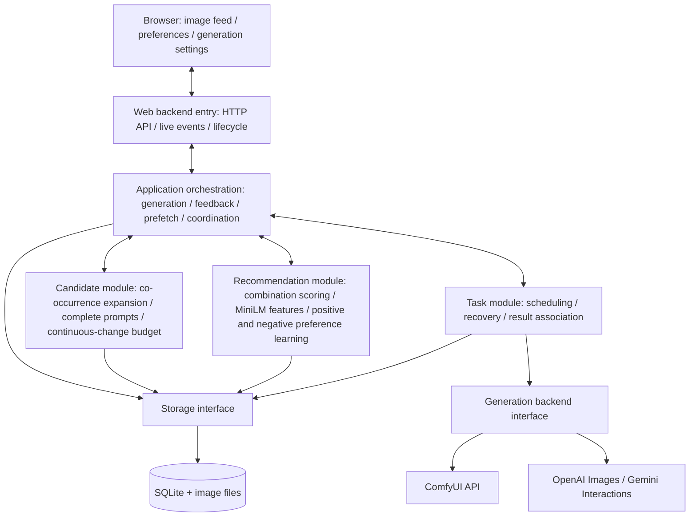

# Architecture and Module Boundaries

[简体中文](architecture.zh-CN.md)

[Documentation navigation](README.md). This page describes modules, responsibilities, and dependencies. See [Calls and Data Flow](architecture/flows.md) for call sequences and [Recommendation Module](architecture/recommendation.md) for recommendation internals.

Pictide is a local web application with a separate frontend and backend. `web/` is the only browser entry point, and `backend/` provides the business API. In deployment, one Python process serves both the compiled frontend and the API; normal operation requires no Node server.

## Architecture Diagram

The diagram shows the current module responsibilities. The application orchestration layer in the web backend is the interaction hub, passing candidate combinations, scores, generation requests, and feedback between modules. Candidate, Recommendation, and Task do not call or depend on one another directly. The HTTP host is a standalone web service; ComfyUI, OpenAI Images, and Gemini provide only image generation; cloud prompts leave the local application.



## Directory Mapping

```text
pictide/
  web/                         Only frontend; npm package pictide-web
    index.html                 Single HTML entry point
    src/main.tsx               React application entry and view navigation
    src/                       Pages, interaction controllers, shared components, and theme
    dist/                      Vite distribution assets
  backend/
    host.py                    HTTP API, SSE, static assets, startup, and shutdown
    application.py             Application orchestration: generation, candidates, feedback, cleanup
    domain.py                  Shared input validation and errors
    paths.py                   Data paths and this process's runtime environment
    candidate/                 Read-only co-occurrence libraries, presets, continuous-change budget, offline import
    recommand/                 Combination features, MiniLM, Bayesian scoring and learning; existing spelling retained
    task/                      Scheduling, recovery, cancellation, and result association
    generation/                Generation interface, ComfyUI workflows, OpenAI Images, and Gemini
    store/                     SQLite, image/JSON storage, cleanup policies, and reclamation
  data/                        Configurable data root
  docs/                        Documentation entry points
    guides/                    User guides
    dev/                       Developer documentation and topic overviews
      architecture/            Architecture and flow details
      reference/               API, data, and design references
      issues/                  Requirement designs, feature changes, and delivery records
  tests/
  start.cmd
  start.ps1
```

| Diagram module | Location | Responsibilities and boundaries |
| --- | --- | --- |
| UI | `web/` | Presentation, drafts, keyboard controls, and interactions; communicates with the host through HTTP/SSE |
| Host | `backend/host.py` | Requests and responses, origin checks, error mapping, static assets, events, and lifecycle; calls application orchestration |
| App | `backend/application.py` | Connects Candidate, Recommendation, Task, and Store; orchestrates the roam buffer, settings versions, and pause conditions |
| Rules | `backend/candidate/` | Read-only libraries, co-occurrence presets and candidate generation, sequence budgets; does not call generation services |
| Rec | `backend/recommand/` | Complete-combination scoring, tag feature encoding, and positive/negative preference learning; does not generate candidates or call generation services |
| Jobs | `backend/task/` | Task state, idempotency, recovery, cancellation, and artifact association; depends on generation and storage interfaces |
| Backend / Comfy / Cloud | `backend/generation/` | Registers adapters and capabilities; prepares requests, submits, queries when supported, and reads image outputs |
| Store / DB | `backend/store/` | SQLite and file storage, atomic feedback, image–prompt associations, and lazy cleanup |

## Dependency Rules

- Host handles transport, origin checks, and lifecycle, executing use cases through App. Candidate solving, recommendation algorithms, and SQL belong elsewhere.
- App is the only interaction hub between Candidate, Recommendation, and Task. It obtains the complete candidate pool, requests combination scores, selects a combination, and submits tasks. Scores are not sent back to Candidate for resampling.
- Candidate, Recommendation, and Task do not call or import one another directly. Shared recommendation requests/results live in `backend/contracts/recommendation.py`; candidate snapshots live in `backend/candidate/contracts.py`.
- Candidate reads online libraries and presets through storage interfaces injected by Host, without importing SQLite adapters. Offline download/import tools use SQLite independently and stay outside online startup and request paths.
- Task depends on Generation and Store, handling submission of determined tasks, event verification, recovery, cancellation, and result association. Generation isolates protocol differences. ComfyUI returns a remote task reference; OpenAI Images and Gemini return completed outputs from one HTTP request. Unknown cloud submissions are not automatically retried.
- The browser manages presentation, input, and drafts through HTTP/SSE, without reading or writing configuration or databases directly. The prompt page is a view in the same frontend, with no additional site or iframe.
- Store persists tasks, images, feedback, snapshots, and learning state. Feedback learning uses the actual generation snapshot; the current library does not overwrite historical meaning.

## Further Reading

| Topic | Documentation |
| --- | --- |
| Module calls for generation, prefetch, and feedback | [Calls and Data Flow](architecture/flows.md) |
| Recommendation responsibilities, features, and current capabilities | [Recommendation Module](architecture/recommendation.md) |
| All HTTP fields and status codes | [API Reference](api.md) |
| Data files, backups, and table ownership | [Data Layout](data-layout.md), [Storage Reference](reference/storage.md) |
| Adding frontend features or generation adapters | [Development Workflow (Chinese)](development.md), [Page Design Guidelines (Chinese)](design-system.md) |
| Design decisions and validation at the time | [Issue Records (Chinese)](issues/README.md) |
