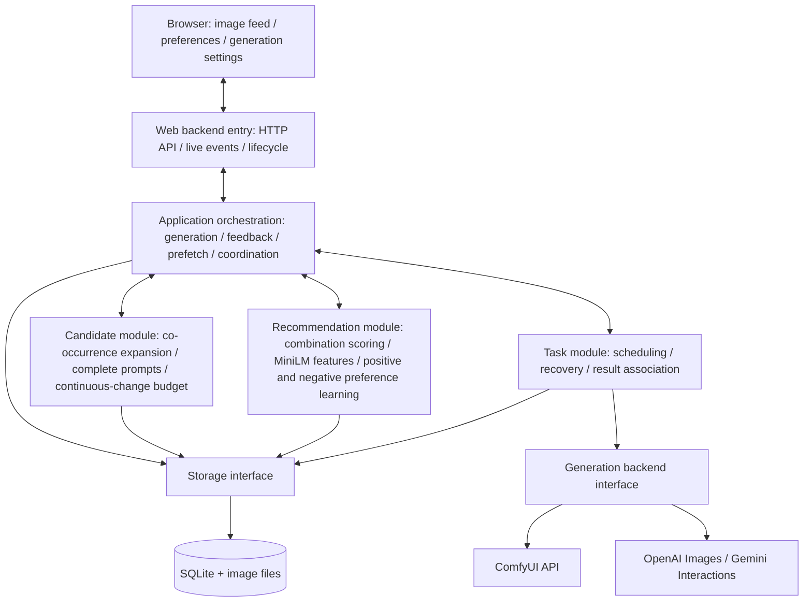

# Architecture and Module Boundaries

[简体中文](architecture.zh-CN.md)

[Documentation navigation](README.md). This page describes modules, responsibilities, and dependencies. See [Calls and Data Flow](architecture/flows.md) for call sequences and [Recommendation Module](architecture/recommendation.md) for recommendation internals.

Pictide is a local web application with a separate frontend and backend. `web/` is the only browser entry point, and `backend/` provides the business API. In deployment, one Python process serves both the compiled frontend and the API; normal operation requires no Node server.

## Architecture Diagram

The diagram shows the current module responsibilities. The application orchestration layer in the web backend is the interaction hub, passing candidate combinations, scores, generation requests, and feedback between modules. Candidate, Recommendation, and Task do not call or depend on one another directly. The HTTP host is a standalone web service; ComfyUI, OpenAI Images, and Gemini provide only image generation; cloud prompts leave the local application.



## Directory Mapping

```text
pictide/
  web/                         Only frontend; npm package pictide-web
    index.html                 Single HTML entry point
    src/main.tsx               React application entry and view navigation
    src/                       Pages, interaction controllers, shared components, and theme
    dist/                      Vite distribution assets
  backend/
    host.py                    HTTP API, SSE, static assets, startup, and shutdown
    desktop.py                 Windows desktop session, single-instance lock, and tray lifecycle
    desktop_launcher.py        Desktop port reservation, Windows progress launcher, and worker parent lifetime
    windows_tray.py            Native Windows notification area and owned-console handling
    windows_setup_ui.py        Standard-library first-run choices and download progress
    windows_hardware.py        Read-only Windows adapter/VRAM and installed-RAM detection
    local_generation.py        Pinned resources, model recipes, hardware gates, and installation
    local_generation_session.py Setup state/lock, owned ComfyUI process, and automatic connection
    desktop_text.py            System-language startup and tray messages
    application.py             Application orchestration: generation, candidates, feedback, cleanup
    domain.py                  Shared input validation and errors
    paths.py                   Data paths and this process's runtime environment
    runtime_logging.py         Bounded logs, exception capture, and startup output cleanup
    candidate/                 Read-only co-occurrence libraries, presets, continuous-change budget, offline import
    recommand/                 Combination features, MiniLM, Bayesian scoring and learning; existing spelling retained
    task/                      Scheduling, recovery, cancellation, and result association
    generation/                Generation interface, ComfyUI workflows, OpenAI Images, and Gemini
    store/                     SQLite, image/JSON storage, cleanup policies, and reclamation
  data/                        Configurable data root
  docs/                        Documentation entry points
    guides/                    User guides
    dev/                       Developer documentation and topic overviews
      architecture/            Architecture and flow details
      reference/               API, data, and design references
      issues/                  Requirement designs, feature changes, and delivery records
  scripts/
    macos_launcher.swift       System AppKit launcher: preparation, menu bar, and service lifecycle
  tests/
  start.cmd
  start.ps1
```

| Diagram module | Location | Responsibilities and boundaries |
| --- | --- | --- |
| UI | `web/` | Presentation, drafts, keyboard controls, and interactions; communicates with the host through HTTP/SSE |
| Host | `backend/host.py` | Requests and responses, origin checks, error mapping, static assets, events, and lifecycle; calls application orchestration |
| App | `backend/application.py` | Connects Candidate, Recommendation, Task, and Store; orchestrates the roam buffer, settings versions, and pause conditions |
| Rules | `backend/candidate/` | Read-only libraries, co-occurrence presets and candidate generation, sequence budgets; does not call generation services |
| Rec | `backend/recommand/` | Complete-combination scoring, tag feature encoding, and positive/negative preference learning; does not generate candidates or call generation services |
| Jobs | `backend/task/` | Task state, idempotency, recovery, cancellation, and artifact association; depends on generation and storage interfaces |
| Backend / Comfy / Cloud | `backend/generation/` | Registers adapters and capabilities; prepares requests, submits, queries when supported, and reads image outputs |
| Store / DB | `backend/store/` | SQLite and file storage, atomic feedback, image–prompt associations, and lazy cleanup |

## Dependency Rules

- Host handles transport, origin checks, and lifecycle, executing use cases through App. Candidate solving, recommendation algorithms, and SQL belong elsewhere.
- App is the only interaction hub between Candidate, Recommendation, and Task. It obtains the complete candidate pool, requests combination scores, selects a combination, and submits tasks. Scores are not sent back to Candidate for resampling.
- Candidate, Recommendation, and Task do not call or import one another directly. Shared recommendation requests/results live in `backend/contracts/recommendation.py`; candidate snapshots live in `backend/candidate/contracts.py`.
- Candidate reads online libraries and presets through storage interfaces injected by Host, without importing SQLite adapters. Offline download/import tools use SQLite independently and stay outside online startup and request paths.
- Task depends on Generation and Store, handling submission of determined tasks, event verification, recovery, cancellation, and result association. Generation isolates protocol differences. ComfyUI returns a remote task reference; OpenAI Images and Gemini return completed outputs from one HTTP request. Unknown cloud submissions are not automatically retried.
- The browser manages presentation, input, and drafts through HTTP/SSE, without reading or writing configuration or databases directly. The prompt page is a view in the same frontend, with no additional site or iframe.
- Store persists tasks, images, feedback, snapshots, and learning state. Feedback learning uses the actual generation snapshot; the current library does not overwrite historical meaning.

## Frontend guide

The first-run guide lives in `web/src/onboarding/`: a generic observable state machine, pure Pictide flow rules, and a state adapter. Business controllers and components publish confirmed facts through `shared/ui-state.mjs` and register semantic element refs through `shared/ui-targets.ts`; they do not import guide steps. The React presentation in `components/onboarding/` measures these elements as layout changes and places hints beside their targets, with arrows and a spotlight. Its geometry helper keeps the hints clear of controls.

The guide observes successful tests, saves, feedback, anchor changes, and actual image loading. A new tour starts at `roam-start` when bootstrap contains an image API; otherwise it starts with API configuration. Windows local preparation uses this existing rule by saving and selecting its complete model workflow before HTTP/bootstrap, without an installation-specific onboarding API or marker. Navigation uses the existing UI intent path; generation and mutations remain user actions on normal controls. Only guide progress and necessary image IDs are stored in browser local storage. See the [guide design and validation](issues/first-run-guide.md).

## Startup Preparation

Every default local model declares required dedicated VRAM, physical RAM and supported environments. The Windows TUI blocks model selection when requirements are unmet or unknown; the installer rechecks before downloading any resources for that model. DXGI supplies per-adapter dedicated VRAM; shared memory and capacities from different cards are not combined. Without an execution-card binding, matching cards are checked conservatively using the smallest capacity. See [model hardware requirements (Chinese)](issues/model-hardware-requirements.md).

Source and portable startup share `PictideApplication.prepare_startup()` in `backend/application.py`. It initializes bundled vocabulary when present, then asks `backend/recommand/resources.py` to verify or download the fixed MiniLM files into the selected runtime data directory. Host starts HTTP/SSE and opens the browser only after preparation succeeds. Failure terminates startup, preserving partial downloads for the next attempt. The encoder reads the prepared local files; offline corpus tools remain outside the startup path. See [Recommendation Dependency Preparation](architecture/recommendation.md#recommendation-dependency-preparation).

Windows first-run local generation preparation is implemented and verified with the current NVIDIA portable package; AMD, Intel, and CPU paths have configuration/simulated coverage without hardware verification. Before runtime initialization, the interactive desktop entry confirms the resolved data location and remembers it beside the Windows executable; the hidden worker receives the final root explicitly. It then offers an existing API, local ComfyUI preparation, or later configuration. See [data location selection (Chinese)](issues/setup-data-directory.md). `--setup` reopens it explicitly; CLI and no-browser startup stay noninteractive by default. The standard-library TUI selects a pinned official Windows portable environment and optional model recipe, confirms downloads, then reports download, verification, extraction, and startup progress. Each recommended recipe includes all model files, a complete default API workflow, and prompt/seed/output bindings. With a model prepared, Host starts the owned ComfyUI process, saves and selects its connection through existing application methods, then exposes HTTP/bootstrap: Roam and Generate can use it immediately. Existing configurations remain intact. ComfyUI-only preparation keeps the manual connection path. Host owns process shutdown; the installer does not write business databases or change Candidate, Recommendation, Task, or the generation protocol. See the [Windows setup design and validation record (Chinese)](issues/windows-first-run-tui.md).

Windows launchers select `--desktop`: a temporary progress process starts the service with `CREATE_NO_WINDOW`, relays startup output and exits after tray registration. This also closes startup terminals hosted by Windows Terminal. `backend/desktop.py` owns a data-directory lock and reserves the HTTP port before resource preparation. Once HTTP is ready, it registers the native tray and opens the browser. A failed startup stays visible; unavailable tray support falls back to the original terminal. The tray thread uses Per-Monitor V2 DPI awareness and loads the icon at the taskbar's DPI, without changing system settings. The tray requests normal Host shutdown or opens the browser/application log; it owns no business state. Startup progress and tray messages follow the system display language, using Simplified Chinese or English. `--cli` and `--no-browser` keep terminal operation; Linux retains its terminal launcher. See the [desktop lifecycle design](issues/desktop-launcher.md).

The macOS `.app` uses a small native launcher compiled from `scripts/macos_launcher.swift` with system AppKit. `Contents/MacOS/Pictide` owns the preparation window, menu bar, data-directory session lock, and child process; `PictideService` runs the existing Host with `--cli --no-browser`. Preparation output updates the window, and HTTP readiness gates opening the browser. Quitting sends a normal stop signal to the owned service and waits for it to exit. CLI arguments delegate to the engine. No additional business API or GUI runtime is introduced. `backend/paths.py` resolves the bundled macOS default to the user’s Application Support directory; explicit paths and environment variables retain precedence. Windows packages expose the existing desktop lifecycle directly through their top-level `Pictide.exe`. See the [desktop distribution design and verification status (Chinese)](issues/desktop-distribution.md).

## Further Reading

| Topic | Documentation |
| --- | --- |
| Module calls for generation, prefetch, and feedback | [Calls and Data Flow](architecture/flows.md) |
| Recommendation responsibilities, features, and current capabilities | [Recommendation Module](architecture/recommendation.md) |
| All HTTP fields and status codes | [API Reference](api.md) |
| Data files, backups, and table ownership | [Data Layout](data-layout.md), [Storage Reference](reference/storage.md) |
| Adding frontend features or generation adapters | [Development Workflow (Chinese)](development.md), [Page Design Guidelines (Chinese)](design-system.md) |
| Design decisions and validation at the time | [Issue Records (Chinese)](issues/README.md) |
