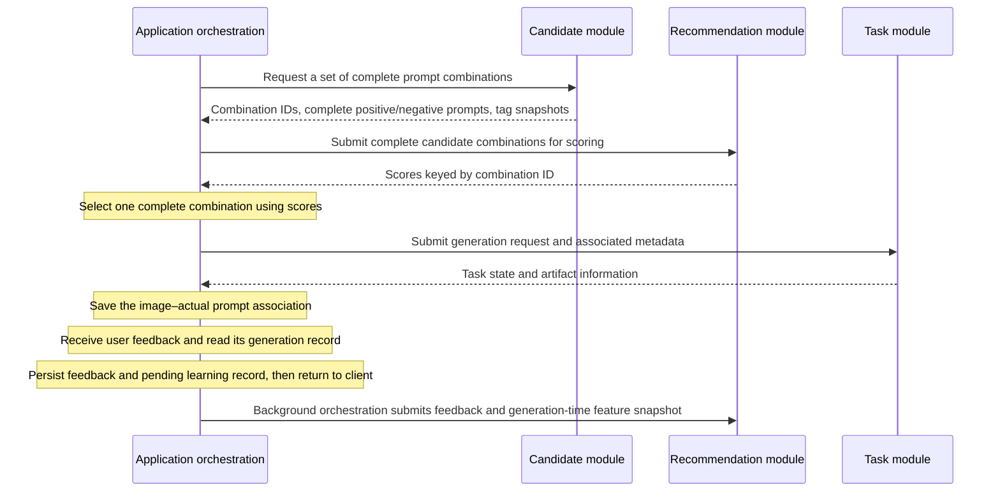
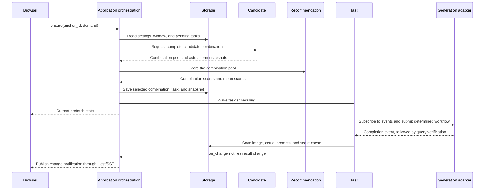
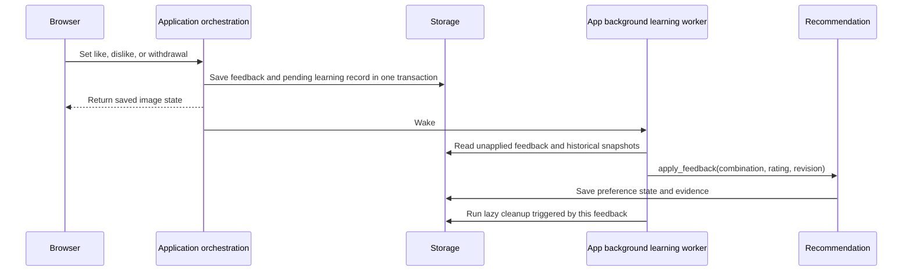

# Calls and Data Flow

[简体中文](flows.zh-CN.md)

[Architecture Overview](../architecture.md) · [API Entry Point](../api.md)

This page describes the call sequence and data associations between existing modules. The architecture overview defines their static responsibilities.

## Candidates, Scoring, and Generation

- Candidate first provides all candidate prompt combinations for this request using the tag library and rules. Each candidate contains complete positive and negative prompts ready for generation, together with its combination ID, tag snapshot, and version. Candidate handles co-occurrence thresholds and the continuous-change budget; insufficient co-occurrence may produce combinations shorter than the target length.
- Recommendation scores the complete combinations supplied by App and returns combination IDs and scores. It does not score individual terms for subsequent sampling or add, modify, or remove combinations. Thompson Sampling exploration is reflected in combination scores.
- App obtains the candidate set, requests recommendation scores, selects a complete combination, and submits a task. It does not return scores to Candidate to rebuild prompts. Task receives only a determined generation request. If recommendation is unavailable, App selects from existing valid combinations using the default policy.
- Generation records preserve the selected combination, actual tag content, and versions. App associates feedback with the historical record before passing it to Recommendation. The latest tag library does not reinterpret history, and a like does not directly mean that every tag is liked. Withdrawing a like is distinct from a dislike.

## Manual Generation Batches

App receives the count per round and number of rounds, calls Candidate to produce complete text for each round when needed, then validates and saves the whole batch at once. Task executes determined generation requests without resampling tags. Prompts are shared within a round; image seeds are independently random per task or incremented in sequence.

Batch idempotency and capacity checks run within the storage transaction; insufficient capacity rejects the whole batch. Retrying the same request_id restores the original plan without resampling. A new plan allows at most 100 pending tasks. Legacy submissions without repetitions/candidate retain the 10-task queue threshold. See [Task API](../reference/api/jobs.md) for fields.

## Roam Prefetch and Image Generation

The browser checks for gaps when entering roam, switching images, receiving task state updates, and at similar entry points, with no separate feeding loop. Each ensure creates at most one task, with at most two unfinished roam tasks, overlapping prompt preparation with the previous image's generation. At most two tasks across the application can be in flight at the backend; manual tasks have priority for newly available slots. After a completion event, Task verifies state, fills the slot, and saves results. It falls back to polling when events are unavailable.

When the preference scope, roam mode, or anchor changes, App saves settings and prefetch invalidation state through Store; late artifacts are hidden. Flow continues from the actually selected combination; Anchor reuses the full prompt set. Candidate, Recommendation, and Task never interact directly.

A failure, uncertain state, or cancellation in the current settings version pauses prefetch. Saving the complete roam settings clears the pause; correcting and saving the current roam backend can also resume it. Historical images and tasks remain, and old failed tasks are not automatically resubmitted. See the [Roam Guide](../../guides/roam.md), [Prefetch API](../reference/api/roam.md), and [Event Design](../issues/task-events.md).

## Feedback and Background Learning

Learning uses the actual text, polarity, and combination associations at generation time, without reinterpreting history using the current library. Unrated remains unknown; withdrawal removes the original contribution. A successful feedback request means the feedback was saved, not that recommendation learning has completed. Records are retained when the model is temporarily unavailable, and later operations wake processing. See the [Background Learning Record](../issues/feedback-background-learning.md).

## Further Reading

- [Generation Submission Window Design](../issues/task-window.md)
- [Storage and Image Sources](../reference/storage.md)
- [Recommendation Feature Flow](recommendation.md)
