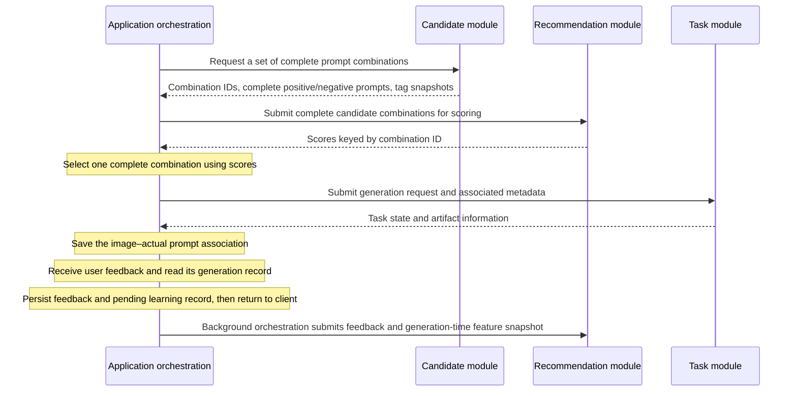
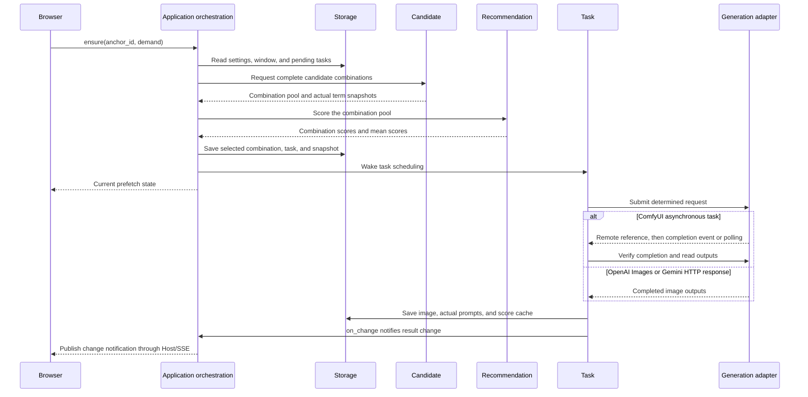
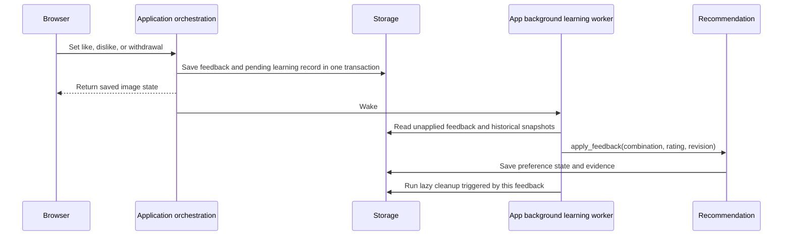

# Calls and Data Flow

[简体中文](../../zh-CN/dev/architecture/flows.md)

[Architecture Overview](../architecture.md) · [API Entry Point](../api.md)

This page describes the call sequence and data associations between existing modules. The architecture overview defines their static responsibilities.

## Candidates, Scoring, and Generation

- Candidate first provides all candidate prompt combinations for this request using the tag library and rules. Each candidate contains complete positive and negative prompts ready for generation, together with its combination ID, tag snapshot, and version. Candidate handles co-occurrence thresholds and the continuous-change budget; insufficient co-occurrence may produce combinations shorter than the target length.
- Recommendation scores the complete combinations supplied by App and returns combination IDs and scores. It does not score individual terms for subsequent sampling or add, modify, or remove combinations. Thompson Sampling exploration is reflected in combination scores.
- App obtains the candidate set, requests recommendation scores, selects a complete combination, and submits a task. It does not return scores to Candidate to rebuild prompts. Task receives only a determined generation request. If recommendation is unavailable, App selects from existing valid combinations using the default policy.
- Generation records preserve the selected combination, actual tag content, and versions. App associates feedback with the historical record before passing it to Recommendation. The latest tag library does not reinterpret history, and a like does not directly mean that every tag is liked. Withdrawing a like is distinct from a dislike.

## Pixel-size Pools

Host composes `store/canvas_pools.py` beside the other configuration stores. App exposes its CRUD use cases and validates `canvas_pool_id` references from image APIs. Generation owns size capability/filtering rules and explicit ComfyUI width/height bindings; Store owns persistence and reference protection.

For Roam pool mode, App obtains the selected API's usable pixel pairs, draws one uniformly, then includes `width,height` in the determined task. Natural-language preparation completes before this choice. SQLite persists the pair with the job and its backend revision. Task forwards the stored pair to Generation: ComfyUI injects only the bound inputs, and OpenAI sets `size=WIDTHxHEIGHT`. Recovery uses that same pair. Roam fixed mode and Generate without an explicit size retain saved workflow/API dimensions. Generate can choose a concrete pool entry and pass optional `width,height` through the existing generation request; App validates support before LLM preparation, and every job in the batch stores the same pair. Pool definitions do not participate in durable replay of those explicit requests. Candidate, Recommendation and Prompting do not depend on pools.

## Natural-language Preparation

Each image backend selects `danbooru` (default) or `natural_language` and a saved `llm_id`. App still scores complete tag combinations. For natural language, it sends only the selected combination to `PromptPreparation`, which resolves the selected LLM configuration, serializes conversions through `backend/prompting/` and saves successful text before creating an image task. Task and image adapters receive final strings and never call the LLM.

The text service uses [Chat Completions](https://developers.openai.com/api/reference/python/resources/chat/subresources/completions/methods/create) with `stream:false` and `response_format:{type:"json_object"}`. It must return `positive` and `negative` strings with `finish_reason:stop`. Transport uses shared proxy/TLS behavior, a 120-second timeout, no redirects, a bounded response, and no automatic retries. Provider error bodies and credentials are not exposed.

ChatGPT connections instead use the official [open-source sign-in flow](https://developers.openai.com/siwc/token-sharing-open-source/sign-in). Host exposes local control endpoints; the Prompting adapter owns short-lived loopback listeners, authorization and provider transport; `store/chatgpt.py` owns protected credential files. PyJWT with cryptography verifies RS256 signatures, issuer, audience, expiry and nonce. Refreshes serialize across processes. Responses requests use `store:false`, `stream:true`, developer instructions and JSON output, accepting success only at `response.completed`. Failures never switch to API-key billing. Account model discovery filters `visibility:list` and preserves provider ordering.

Drift has no previous-text context. Flow supplies the previous tags and text and asks for minimal wording changes; identical tags reuse compatible text. Anchor reuses exact text when its tag inputs and image/LLM configuration signature match; otherwise it initializes once. References come from the latest selected combination in the prefetch chain, falling back to the current image. LLM instructions encourage semantic fidelity and stable structure; validation checks shape and size, not actual meaning.

Roam prepares asynchronously outside its settings lock and reports `preparing_prompt:true`. Repeated ensures share the same active preparation. Before enqueueing, App checks the epoch and image configuration again. Failure pauses that epoch; saving the full Roam settings explicitly starts a fresh epoch and allows another attempt, even when the submitted values are unchanged. Normal saves that preserve a healthy epoch continue to retain its preparation and prefetch. A persisted attempted conversion without a result is not automatically repeated after restart. Completed conversion results can be recovered without calling the service again.

Generate prepares all rounds before committing any image jobs. It saves the selected rounds and each completed conversion so an explicit retry of the same request can resume without redrawing completed work. Images within one round share text; candidate rounds get separate conversions. A supplied preview ID must match the tag strings and current configuration. Preparation results are bounded disposable history, so an expired preview returns a conflict. Completed batches use the existing durable batch replay mechanism.

Image/job prompt fields hold the actual submitted text. `source_prompts` holds the original positive/negative concepts; Roam's candidate snapshot also retains its structured terms and rendered text. Anchors, liked-tag filters, scoring validation, and feedback use those historical tags. Existing records without a separate source snapshot keep their original behavior. Natural-language text is read-only in the UI; users edit tags and anchors.

## Manual Generation Batches

App receives the count per round and number of rounds, calls Candidate to produce complete text for each round when needed, then validates and saves the whole batch at once. Task executes determined generation requests without resampling tags. Prompts are shared within a round; image seeds are independently random per task or incremented in sequence when the backend supports seeds. Cloud adapters reject nonempty negative prompts and explicit image seeds; candidate seeds remain local prompt-selection controls.

Batch idempotency and capacity checks run within the storage transaction; insufficient capacity rejects the whole batch. Retrying the same request_id restores the original plan without resampling. A new plan allows at most 100 pending tasks. Legacy Danbooru submissions without repetitions/candidate retain the 10-task queue threshold. Natural-language submissions also preflight capacity before conversion and recheck LLM configuration before committing. See [Task API](../reference/api/jobs.md) for fields.

## Roam Prefetch and Image Generation

The browser checks for gaps when entering roam, switching images, receiving task state updates, and at similar entry points, with no separate feeding loop. Each ensure creates at most one task, with at most two unfinished roam tasks, overlapping prompt preparation with the previous image's generation. At most two tasks across the application can be in flight at the backend; manual tasks have priority for newly available slots. After a completion event, Task verifies state, fills the slot, and saves results. ComfyUI falls back to polling when events are unavailable. OpenAI Images and Gemini complete synchronously over asynchronous HTTP I/O and save returned Base64 or downloaded URL images locally. They have no remote recovery reference; a timeout or interrupted submission stays uncertain and is not automatically sent again. Newly selected cloud Roam backends start with prefetch disabled until the user explicitly enables it.

ComfyUI connection establishment failures are definitive submission failures and release the dispatch slot. Uncertain jobs are never resubmitted: Task checks the backend queue and history by request ID. A successful lookup with no match releases the slot while retaining the uncertain record for later recovery; a failed lookup retains the slot.

When the preference scope, roam mode, or anchor changes, App saves settings and prefetch invalidation state through Store; late artifacts are hidden. Flow continues from the actually selected combination; Anchor reuses the full prompt set. Candidate, Recommendation, and Task never interact directly.

A failure, uncertain state, or cancellation in the current settings version pauses prefetch. Saving the complete roam settings clears the pause; correcting and saving the current roam backend can also resume it. Historical images and tasks remain, and old failed tasks are not automatically resubmitted. See the [Roam Guide](../../guides/roam.md) and [Prefetch API](../reference/api/roam.md).

## Feedback and Background Learning

Learning uses the actual text, polarity, and combination associations at generation time, without reinterpreting history using the current library. Unrated remains unknown; withdrawal removes the original contribution. A successful feedback request means the feedback was saved, not that recommendation learning has completed. Records are retained when the model is temporarily unavailable, and later operations wake processing.

## Further Reading

- [Storage and Image Sources](../reference/storage.md)
- [Recommendation Feature Flow](recommendation.md)
