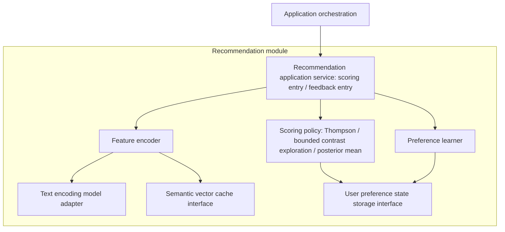
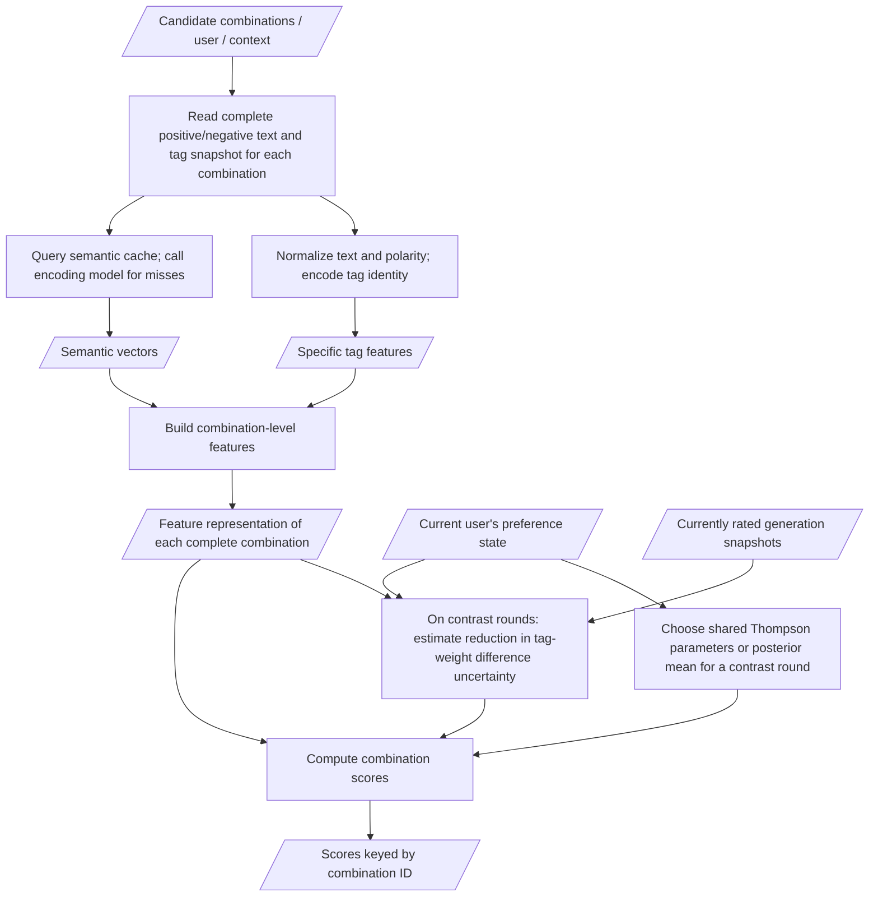

# Recommendation Module

[简体中文](../../zh-CN/dev/architecture/recommendation.md)

[Architecture Overview](../architecture.md) · [Recommendation HTTP API](../reference/api/preferences.md)

Recommendation receives complete candidate combinations and returns scores. It does not generate candidates or call Task. Start with responsibilities, then read the feature flow and model preparation as needed.

## Internal Recommendation Architecture

Recommendation receives complete candidate prompt combinations and feedback only through App. Its scoring unit is a combination. Library IDs and categories do not form part of recommendation content identity; identical text with the same positive/negative polarity uses the same content features.

The architecture diagram shows logical components and call dependencies only. Arrows indicate calls or dependencies, not the temporal order of data flow. These are internal responsibilities, without a requirement for separate processes or services.

The recommendation application service coordinates encoding, scoring, and learning internally. For scoring, it obtains combination features and calls the scoring policy. For feedback, it obtains features for the actual generated combination and passes them, the feedback, and record identifiers to the preference learner. These use cases are triggered separately. Recommendation does not call Candidate or Task, or directly read their implementations or tag library files. The model adapter encapsulates a fixed version of the text encoding model; persistence adapters implement the cache and preference state storage interfaces.

## Data Processing for Recommendation Scoring

The diagram below uses Standard strength to illustrate the data and processing steps in a scoring request. Tag content features, semantic vectors, and combination-level features are data products; content encoding, semantic encoding, and feature combination are processing steps. The feature encoder above handles these steps, implemented in `backend/recommendation/features.py` and `policy.py`.

The learning entry follows a separate flow: read the actual generated combination snapshot → use the same feature encoder version → associate combination features with user feedback → update preference state. A scoring request does not run this learning flow. [Module Call Sequence](flows.md#candidates-scoring-and-generation) describes the order of App's calls to Candidate, Recommendation, and Task; it complements the static architecture diagram.

- Combination IDs associate returned scores with App's combinations. Tag content identity supports learning and sharing experience across combinations. Normalized text and polarity define tag content identity; identical text under different IDs can reuse content features. Synonyms and antonyms retain their own specific tag features, and semantic vectors do not automatically merge preferences.
- Combination-level features comprise sparse features for specific tags and semantic vectors aggregated separately by positive/negative polarity. Only complete-combination scores are returned externally. Version 1 is a linear model and does not claim to have learned complex interactions.
- At Standard strength, ordinary rounds compare all combinations using the same sampled preference parameters; a small fraction of rounds use the posterior mean with a bounded tag-contrast bonus. Strong uses only the posterior mean. After Recommendation returns scores, App selects a combination and calls Task, without calling Candidate again to sample tags by score.
- Frozen MiniLM encodes base tags. The vector cache includes text, model files, runtime dependencies, and preprocessing versions. User likes update preference state without training the text encoding model.
- Learning input is the actual generated combination and feedback supplied by App, using the text, polarity, and feature version at that time. Current categories or tag content do not replace history. A whole-image like/dislike learns +1/-1 for the combination, without directly turning it into independent feedback for every tag. Unrated remains unknown; withdrawal removes the corresponding contribution or replays valid feedback, rather than counting as negative feedback.
- User preference state is isolated by user and feature version. Changing encoders requires re-encoding and rebuilding state from valid historical feedback, without mixing vector spaces. The cache and policy state persist through storage interfaces in the application data directory. Current algorithms and boundaries are described below; replacing the encoding model requires separate design approval.

## Current Capabilities and Limitations

Version 1 implements offline MiniLM tag encoding on CPU, complete-combination scoring, Bayesian linear posterior sampling, explicit positive/negative feedback learning, withdrawal, and restart recovery. App first receives the candidate set, passes it to the recommendation service's `score`, then selects a combination and submits a task. The old `choose` interface and Recommendation's type imports from Candidate have been removed; recommendation owns its framework-independent contracts in `backend/recommendation/contracts.py`.

Learning associates explicit positive/negative feedback with combinations; unrated remains unknown. Scores are not like probabilities. Exposure/non-conversion learning, complex interactions, and image features are not implemented. Missing or unavailable models are reported as status; App retains its existing default candidate handling, and fallback is not called learning. Bootstrap's `recommendation` reports availability and version, while `preference_learning` reflects actual availability. Unapplied learning notifications remain pending for retry without rolling back user feedback. Preference inspection and reset reuse Web → Host → App → Recommendation → Store. Inspection reads current learning state only. Reset atomically clears preferences for all feature versions and records a feedback-event boundary, retaining images and feedback.

## Scoring and Feedback at Runtime

Standard combines Thompson Sampling with the bounded contrast rounds described below; Strong uses deterministic posterior means. Both share user preferences. App selects the highest-scoring complete combination without returning scores to Candidate for reassembly. Specific tag identities and semantic features both participate in linear scoring; synonymous or antonymous tags do not automatically merge.

Feedback and pending learning records are saved in the same transaction before returning immediately. App's single background learning worker processes persisted records. Scoring uses only completed preference state and does not wait for the current feedback to be learned. When the model is unavailable, feedback remains for later processing; a new feedback event does not invalidate existing prefetch.

Preference scores in image information reuse a deterministic raw-score cache; an existing cache is recomputed only by manual refresh. The UI's 0–100 scale is relative to the historical score range, not a probability of liking. See the [Scoring API](../reference/api/images.md#like-filters-and-image-preference-scores).

### Tag-contrast exploration

`backend/recommendation/exploration.py` works entirely inside Recommendation. Standard requests independently attempt a contrast round with probability 0.2, using a stream derived from `sampling_seed`. Ordinary and fallback rounds retain the original Thompson draw. A contrast round uses `score = mean_score + 0.2 * bonus`, without adding Thompson noise. `mean_score` remains the unmodified posterior mean, including in image information and historical score ranges. Because the bonus is between 0 and 1, the chosen candidate's predicted mean is at most 0.2 below the pool's highest mean; this is a model-score bound, not a bound on actual user satisfaction.

The evidence index includes only currently rated images from the current user and feature version, using historical positive-channel term snapshots. Likes and dislikes both count as observations; withdrawals do not. Each image contributes at most once per term. The in-memory index is keyed by user, feature version, reset revision, and policy revision, and is invalidated by learning or reset. No additional persistent state or storage interface is introduced.

Pair search considers at most 32 learned positive terms that vary in the current candidate pool. A pair needs at least three joint observations and an existing candidate containing only one of its terms. Its priority combines historical joint-presence ratio, how much the sum's variance has decreased from its unit-prior baseline of 2, and how much uncertainty remains in the difference. The eight highest-priority pairs are considered. For each full candidate x and pair difference direction d, the expected variance reduction is `(d.T @ P^-1 @ x)^2 / (1 + x.T @ P^-1 @ x)`. Each candidate's bonus is the maximum priority-weighted relative reduction across those pairs, rather than a sum over overlapping pairs.

All semantic and positive/negative term axes participate in this calculation. It reuses a Cholesky factor and bounded triangular solves, without constructing the full covariance inverse. A cold start, unavailable separating candidates, or identical bonuses falls back to Thompson. Strong scoring bypasses evidence indexing and contrast solves and keeps its existing bounded mean cache. Fixed terms, anchors, candidate generation, task submission, and feedback learning retain their existing ownership. The public strategy name remains `thompson` for Standard; `policy_version` identifies the new mixed policy. Feature identity, saved P/b buffers, and user preferences are unchanged.

The attempt rate and bonus cap are initial parameters. Synthetic checks establish numerical behavior and bounded scoring; they do not establish better recommendations for every user. The linear Gaussian model does not identify image-level causes, and its fixed noise can shrink uncertainty even under conflicting binary feedback.

## Recommendation Dependency Preparation

Recommendation depends on [MiniLM](https://huggingface.co/Qdrant/all-MiniLM-L6-v2-onnx) for text embeddings, using offline FastEmbed-format ONNX files. `backend/recommendation/model.json` is the single catalog for the fixed source revision, five required files, byte sizes, and SHA-256 values. `backend/recommendation/resources.py` prepares and verifies these files in the selected data directory's `models/minilm/`. It resumes partial downloads and preserves existing invalid files in a backup before replacing them successfully.

Source and portable startup share `PictideApplication.prepare_startup()` in `backend/application.py`: initialize any bundled library, then prepare the model. Host creates the HTTP service and opens the page only after preparation succeeds. A model download or verification failure stops startup; restarting retries with retained `.part` files. Valid local files allow offline startup. See [startup and offline model preparation](../../guides/getting-started.md#recommendation-dependency-preparation) for user instructions.

Portable builds carry the catalog and CPU inference dependencies (FastEmbed, ONNX Runtime, and tokenizers), without model weights or build-time model downloads. The encoder remains an offline reader; runtime encoder availability is reported through bootstrap's `recommendation` and roam responses. Python 3.12 has been validated; installers select compatible dependencies for older Python versions.

## Further Reading

- [User Preference Inspection, Export, and Reset API](../reference/api/preferences.md)
