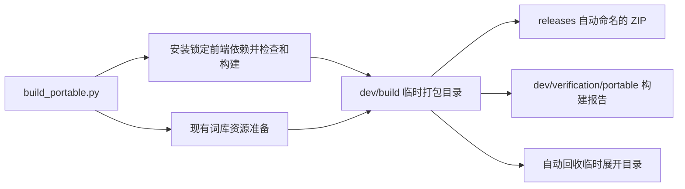
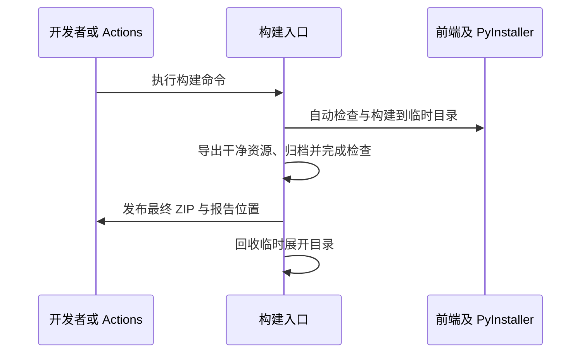

# 自动化构建与最终发行目录

## 概述

一条构建命令自动准备前端、词库和便携包，`releases/` 只保存最终发行包，临时展开目录自动回收，诊断报告归入 `dev/verification/`。

## 架构

## 职责边界

- `scripts/build_portable.py`：统一编排现有前端命令、资源准备和原生构建；默认输出目录为 `releases/`，最终文件沿用 `pictide-版本-平台-架构.zip`。重复本地构建自动替换同名本地 ZIP，其他版本保留。
- `web/scripts/frontend.mjs`：沿用现有 Vite 构建，允许指定独立输出目录；开发服务使用的 `web/dist/` 保持当前内容。
- 临时工作目录位于 `dev/build/`，构建成功或失败后回收；报告放在 `dev/verification/portable/版本-平台-架构/build-report.json`，失败报告保留错误信息。
- Actions 沿用版本标签触发、原生四平台矩阵、资源锁校验和独立启动冒烟；调整路径以复用同一构建命令，保持远端 Release 附件种类。
- 本次调整构建内部编排与目录职责，应用模块接口和运行数据结构保持现状；`.app`、单文件 EXE 与 AppImage 仍为讨论方案。

## 调用和数据流

## 重点关注

- 用户已明确要求构建自动化与 `releases/` 仅留最终发行包；沿用现有工具及模块边界。
- 构建环境依赖按平台指南安装一次，日常构建无需手工构建前端或命名输出目录。MiniLM 仍由用户启动时下载，不打包模型权重。
- 归档完成全部检查后再替换本地同名最终包；失败不会留下半成品或覆盖已有最终包。远端发布版本和标签保持原有不可覆盖规则。
- 本地旧验证包中已有数据库、推荐依赖和词库，整体保留到 `dev/legacy/release-builds/`；整理前核对进程，保留数据备份及文件清单。验证 JSON 移到 `dev/verification/`，不删除历史个人数据。
- 当前 macOS 加载问题仍待本机诊断，未发布的 `codex/macos-portable-archive` 变更本次不集成。

## 验证与整理结果

- 4 项资源与发行检查通过：已有收集目录可重复构建、同名 ZIP 替换、失败时保留已有最终包和错误报告、临时打包目录回收；资源初始化与个人记录保留沿用原用例。
- Windows 真实构建一次完成锁定前端依赖准备、类型检查、独立前端构建和 PyInstaller 打包，最终 ZIP 约 66 MiB。解压后使用校验过的本地 MiniLM 做隔离启动冒烟，通过 HTTP、前端资源、词库初始化与 SQLite 完整性检查；未启动浏览器或提交生图任务。
- Actions 的 Python 步骤语法与标签触发条件检查通过，真实 ZIP 和两份报告按新目录完成附件收集；本次未触发远端四平台构建，未发布新版本。
- 本地旧目录整体迁至 `dev/legacy/release-builds/windows-tray-dpi-20261019/`，731 个文件移动前后哈希一致；个人数据备份在 `data/backups/portable-relocation-20261020/`，清单位于 `dev/maintenance/release-output-20261020/relocation.json`。词库验证 JSON 已迁至 `dev/verification/vocabulary-editions/`。
