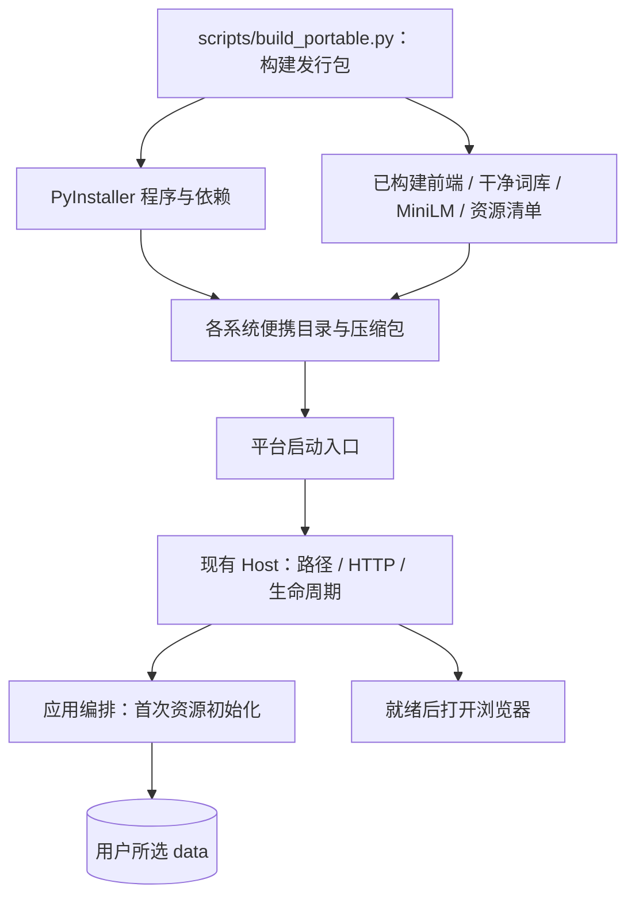
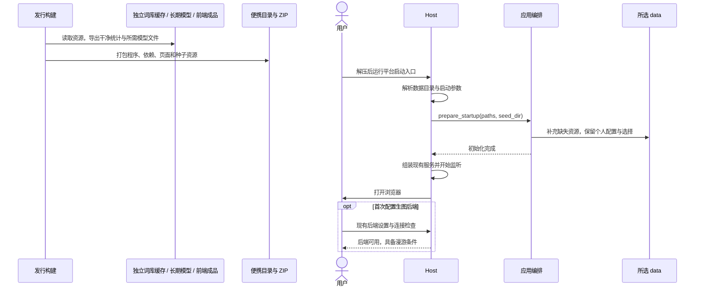

# 开箱即用的便携发行包

## 概述

将程序、运行依赖、前端、精简词库和 MiniLM 一起交付，让用户解压后双击启动，达到能够完整漫游的就绪状态。

目录式便携发行方案已实施。发行资源准备现采用[独立发行资源与构建缓存](portable-build-cache.md)，由固定源版本和处理配置生成词库、准备 MiniLM；下文的运行时初始化约定继续适用。词库上传与选择详见[词库管理](library-selection.md)。

## 架构



## 职责边界

| 组成 | 接口及职责 |
| --- | --- |
| 发行构建 `scripts/build_portable.py` | `python scripts/build_portable.py`：从独立 datasets、长期 models 与构建缓存准备干净词库和固定 MiniLM，打包已构建前端与后端，生成便携目录及 ZIP。支持 `--dataset-dir`、`--cache-dir`、`--models-dir`、`--profile` 与 `--output-dir`；目录与缓存规则见[发行资源准备](portable-build-cache.md)。 |
| 平台启动入口 | Windows 双击 `start.cmd`；Linux 执行 `start.sh`；macOS 双击 `start.command`。入口仅运行随包程序并传递参数。 |
| Host 启动 | 沿用 `--port`、`--data-dir`、`--host`；增加 `--lan` 作为局域网入口、`--no-browser` 用于验证。便携启动默认就绪后打开浏览器，源码入口保留现有默认行为。 |
| 应用编排初始化 | 新增 `PictideApplication.prepare_startup(paths, seed_dir)`：在服务组装前补齐所选数据目录中缺失的默认词库和模型；预设复用候选模块现有默认值。已有个人预设、所选词库、模型和业务数据保留。 |
| 数据路径 `DataPaths` | 便携程序默认使用发行目录下的 `data/`，与当前工作目录无关；显式路径和环境变量继续按[数据目录约定](../data-layout.md#data-location)生效。 |
| 资源清单 | 记录种子资源的相对路径、大小、SHA-256 与来源版本，供构建校验和定位资源问题；启动检查所需文件齐备。 |

Windows 发行目录示意：

```text
Pictide/
  start.cmd
  data/
    runtime/pictide/
      Pictide.exe
      _internal/                  Python 与运行依赖
        web/dist/                 前端成品
        resources/                默认词库、固定版本 MiniLM、资源清单
    libraries/                    首次启动生成，可替换词库
    models/minilm/               首次启动生成，离线 MiniLM
    db/candidate.sqlite3          首次启动生成，个人预设与选择
    db/pictide.sqlite3             首次启动生成，业务数据
```

- 随包词库仅含 `tags/correlations/dataset` 和索引，默认按 `corpus/profiles/compact.json` 构建；推荐依赖只导出当前编码器实际需要的 ONNX、tokenizer 配套文件。
- 发行资源与个人数据分开，包内种子用于首次初始化和指定新数据目录；后续启动沿用用户已有资源。压缩包包含种子，个人运行副本在首次启动时生成。
- 前端依赖安装、构建和 PyInstaller 安装属于开发构建流程；所需打包依赖统一列在 `backend/requirements-release.txt`。
- 构建仅使用独立发行资源，不读写开发运行目录；随包个人预设在首次启动时初始化。
- HTTP 接口保持现有契约；候选、推荐与任务继续由应用编排协调。ComfyUI 和生图模型由用户配置。

## 调用和数据流



## 重点关注

- 验收终点是应用、前端、词库和推荐依赖就绪，连接可用 ComfyUI 后能够开始完整漫游。
- Windows 优先验证真实产物：从新的解压目录运行程序，确认随包依赖、候选生成、离线 MiniLM 编码和页面资源可用；记录 ZIP 体积、解压占用与启动耗时。
- 少数冒烟覆盖首次启动、再次启动、带空格的移动路径、自定义数据目录和已有个人配置保留；验证实例使用独立端口与数据。
- Linux/macOS 按系统与 CPU 架构在本机构建；分别维护启动说明，原生运行结果按实际验证状态记录。
- 发行依赖的第三方许可证与现有前端声明随包保留。用户操作集中在获取、解压、启动和首次后端配置。
- 源码启动脚本继续用于开发，发布完成后同步 [README](../../../README.md) 与各系统[安装路径](../../guides/getting-started.md)。

参考：[PyInstaller 打包方式](https://pyinstaller.org/en/stable/operating-mode.html)。

交付与验证（2026-10-19）：

- Windows x64 目录式程序及 ZIP 已构建，产物位于 `data/dev/releases/portable-compact-20261019/`。ZIP 为 154,793,286 B（147.6 MiB），解压目录为 257,461,991 B（245.5 MiB）；首次运行另生成约 110 MiB 的词库与模型工作副本。
- 三项冒烟通过：干净资源导出与已有数据保留、便携默认路径、服务就绪后打开浏览器；实际解压程序通过页面资源、候选、MiniLM 编码与推荐评分验证。
- 在本机已缓存磁盘条件下，新数据目录初始化至 bootstrap 响应约 1.04 秒，再次启动约 0.62 秒，移动目录后约 1.13 秒；该时间包含资源准备和服务就绪，浏览器展示及首次模型推理另计。
- 验证采用独立数据和端口，只配置测试生图地址；真实 GPU 生图和 Linux/macOS 原生运行未执行。报告与日志保存在 `data/dev/verification/portable-startup-20261019/`。


当前目录约定见[开发资料与发行产物分离](development-release-directories.md)：历史 data/dev 下的开发材料现位于根目录 dev，发行包现位于根目录 releases。 旧 portable-compact-20261019 包已按用户确认删除，个人数据保留在 data/backups/old-portable-personal-20261019；当前包为 releases/portable-library-floor-20261019。

新用户默认配置交付（2026-10-19）：

- 漫游默认预取 2 张、历史数量上限 20 张、展示时间 8 秒、候选组合 10 组；新预设默认标签数量 10–30。
- 默认文生图为 832×1216、16 步、CFG 2.5；已保存的个人设置、预设与自定义工作流继续使用原值。
- Windows x64 便携包位于 releases/portable-new-user-defaults-20261019，ZIP 约 147.7 MiB。真实便携程序通过首次运行默认值、默认预设和模拟后端模板核对；发行包个人数据隔离检查通过，验证记录在 dev/verification/new-user-defaults-20261019/report.json。验证实例已关闭，正在使用的旧包保留。

词库下限版本（2026-10-19）：最新包为 releases/portable-library-floor-20261019；词库自带最低共现次数，新用户默认预设与编排输入下限随库设置。实施及验证见[词库最低共现次数约束](library-cooccurrence-floor.md)。
