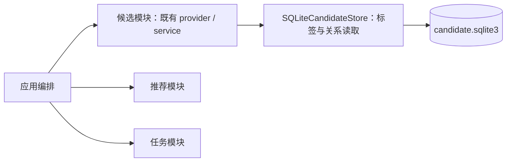
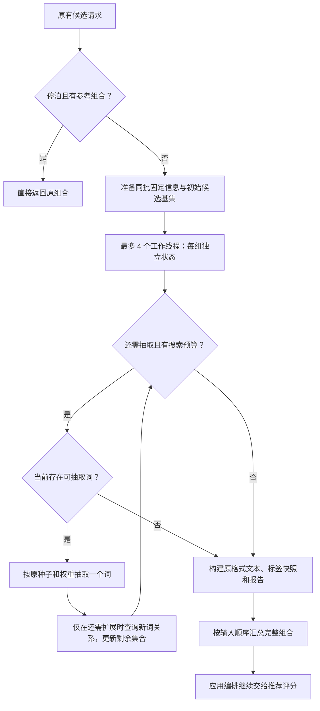

# 候选生成增量优化方案

状态：已确认并实现。检查基线为 a5a3d46，实施前基线为 8eb37c5；本次沿用已确认的模块边界和调用链。

## 结论与依据

优先减少重复关系查询和结果处理，继续复用现有候选服务、SQLite 和最多 4 线程。第一版优化不增加进程、长期缓存、数据库结构、产品设置或新的业务模块。

已核实：

| 当前实现 | 实际影响 |
| --- | --- |
| provider 按完整组合分配至最多 4 线程，并按输入顺序汇总 | 组合已独立并行；增加到 8/12 线程实测更慢 |
| service._extend 每加一个词，再调用 expansion_candidates，传入全部固定锚点与已选词 | 上一步已经算过的关系和交集被重复计算 |
| expansion_candidates 按词频排序锚点，先查邻居，再用剩余 ID 分批查询 | 已有缩小范围的优化，并非每次扫描整张关系表 |
| 每轮取回关系行、构建字典求交集，随后查询候选名称和频次 | 产生重复的 SQLite 结果读取、Python 对象与标签元数据查询 |
| 每组重复读取数据来源、匹配固定正负词和验证参考组合 | 同批共享输入没有集中准备 |

10 组串行 profile 总耗时约 5.60 秒，expansion_candidates 累计 5.50 秒（约 98%）；166 次扩展、2227 次 SQL execute、约 29 万次关系结果迭代。热点生成器包含 SQLite 游标继续取行的时间，不能将其全部解释为纯 Python 或 GIL 耗时。EXPLAIN 确认当前受限词对查询使用索引。现有证据支持先减少数据处理量，不支持把缺索引或写锁认定为主要瓶颈。

证据：[函数分析](../../../dev/verification/candidate-profile-20261017/report.json)、[4/8/12 线程对照](../../../dev/verification/candidate-threads-8-12-20261017/report.json)。

## 1. 架构与职责

这张图只表达模块依赖。候选仍返回完整组合，推荐仍只评分，任务仍只执行编排选定的组合。App、Host、Web、推荐与任务接口不改。

候选服务内部增加两个小的数据处理步骤，不拆成新服务或业务模块：

- 批次准备：同一池共享只读预设、来源、标签元数据、固定词、合法参考组合及初始候选基集。
- 单组求解：每组复制自己的剩余候选状态，独立抽样和增量过滤，不修改共享基集。

每组使用独立 RNG 和种子 / 目标数量，准备结果不共享这些可变状态。所有共享准备数据仅在本批次有效，用完释放。单组查询结果不跨请求缓存，不引入缓存失效管理。数据库继续为唯一持久来源；预设修改在下一批生效。

## 2. 调用与数据流

具体执行：

1. 保留停泊的早返回，避免为复用整组提示词读取或求解词库。
2. 每批校验预设、读取来源、解析固定正负词、允许词池和参考组合一次。标签 ID / 原名 / 词频在确实需要抽取时读取一次，以只读索引供结果构建使用；仅输出固定词时复用小批量词项匹配。
3. 第一次确实需要抽取时，计算固定统计锚点的公共候选基集；同批只计算一次。只输出固定词、零变化预算等无需抽取的路径不额外建立大集合。
4. 每组从基集复制独立状态。无统计锚点时，首词仍从允许词池按词频加权；有锚点时，仍按 PMI 几何平均权重抽取。
5. 每加入新词，只查询新词与当前剩余候选的关系，剔除缺少关系、不满足阈值或已选中的项，并补充新词的 PMI 贡献。后续不重查已经通过的旧锚点。
6. 若顺流需要删词，先完成原有移除和预算决策，再从固定基集加保留词重建一次，之后增量扩展。删除后不能继续沿用旧的交集，否则会漏掉重新变为合法的候选。
7. 输出仍使用原词项顺序、完整正负文本、来源、candidate_id、报告和序列信息；推荐与任务无感知。

## 3. 状态与权重语义

每组仅保存：已选统计锚点、剩余候选 ID，以及剩余候选对这些锚点的 PMI 贡献。标签名称、词频等来自共享元数据，不在每次扩展时重新查询。

合法集合满足：E_next = (E_current 与新词合格邻居的交集) 去掉已选词。只加词时集合只能缩小；删词时按上一节重建。

抽取权重保持当前公式：有 k 个统计锚点时，w(t) = 2 ** (sum(PMI(t, anchor)) / k - 当前最大平均 PMI)。无统计锚点时按 ID 升序使用原整数词频，不改成另一套归一化权重。

为保持固定种子输出，不能仅把新 PMI 加到旧总和后就直接抽样：

- 锚点继续按 post_count 稳定排序，词频相同按原有出现顺序。
- PMI 贡献按这个顺序从左到右重求和，保持当前浮点加法顺序。每步可重算少量内存数值，重点是避免重复 SQL。
- 候选按 ID 升序排列后交给 random.choices；保留相同的 RNG 调用与种子 / 帧序号规则。
- blocked_keywords 继续在原有权重归一化后过滤。提前删屏蔽项虽不改变理论概率比例，却可能改变浮点归一化，不能未经验证调整。
- 固定锚点彼此当前不验证 PMI，准备阶段不新增这项限制。
- 固定自由词保留输出、不作为统计锚点；负向固定词不参与正向共现筛选。允许词池仍只限制新抽取词。
- 搜索步数继续按一次扩展尝试扣减；目标不可达仍返回部分结果，保留当前 stop_reason 和变化预算定义。

这样可以复用同一套数学规则。现有 sequence 缓存继续只保留最近实际帧；不在序列缓存中持久保留大量候选状态。

## 4. 接口定义

对外保持：

| 接口 | 处理 |
| --- | --- |
| CandidateProvider.generate(context, constraints) | 签名、数量范围与完整组合输出不改 |
| CandidateService.generate(payload, allowed_positive_tag_ids=..., previous_candidate=...) | 原单组入口保留，内部复用相同准备与求解逻辑 |
| HTTP 预览、批量生成、漫游、评分和反馈接口 | 不改字段与调用链 |

候选内部辅助函数（不新增模块对外能力）：

| 辅助函数 | 输入 | 输出与约束 |
| --- | --- | --- |
| _prepare_generation(payload, allowed_positive_tag_ids, previous_candidate) | 本批预设、允许池、参考组合 | PreparedGeneration：批次只读准备结果，初始基集按需生成一次 |
| _generate_prepared(prepared, frame_options) | 准备结果和当前种子 / 帧选项 | 原格式单组结果；所有可变候选状态归本组所有 |

候选与存储间新增的两个最小读接口已获确认并实现：

| 存储接口 | 输入 | 输出 |
| --- | --- | --- |
| generation_tags() | 无 | 按 ID 升序的 (id, name, post_count) 行，构建本批只读元数据索引 |
| qualified_relations(anchor_id, pmi_threshold, minimum, candidate_ids=None) | 锚点、两项门槛、可选剩余 ID 集合 | (candidate_id, pmi) 行；缺失或不合格不返回，自身不作为候选 |

qualified_relations 沿用现有正反向索引和有界 IN 分批。首个统计锚点读取合格邻居，后续限制到剩余 ID；显式空 candidate_ids 返回空，不能解释为全词库。规则、交集、抽样和权重留在候选模块，存储只返回数据。

pair_relations 继续服务预览与参考校验，不改其 PMI/count 语义。现有 expansion_candidates 在调用迁完后移除，不保留两套运行时生成引擎或旧版兼容分支；测试以事先记录的基线输出对照。

## 5. 分步落地与验证

第一步：集中准备共享元数据、固定词和固定候选基集；保持当前抽样规则和 4 线程，单独测收益。

第二步：改成单组增量交集，删除旧的全量重复扩展路径，继续验证旧语义。

第三步：同一词库、预设和种子交错测试 10/40 组，以及 1/2/4 线程。记录总耗时、SQL 次数、关系行读取量、CPU 和峰值内存；根据新算法实测选择线程数。优先确认工作量减少，不能只看一次最快结果。

少量有意义的冒烟合并为三类：

1. 固定种子旧新文本 / 快照 / ID 相同，覆盖固定自由词、正负向、屏蔽词、允许池和无锚点首抽。
2. 顺流删除后候选恢复、变化预算、sequence 重放、停泊早返回、搜索上限及部分结果。
3. 多线程基集不被修改、不同预设 / 请求不串数据、异常仍返回整批失败。

不跑全量测试、不提交真实 GPU 任务、不修改业务数据库。用真实词库只读性能测试，少量中性夹具检查语义。改造前记录基线；没有稳定收益或固定种子结果不一致时先修正，不发布性能猜测。实测结果见下节；耗时随词库、预设、组合和机器负载变化。

本版暂不引入多进程、Redis、全关系图常驻内存或额外索引。连接重用不是首要改动：当前 profile 中连接创建加关闭约 0.13 秒，远小于重复关系处理；仅在前两步后仍成为显著开销时再评估。

设计复核：独立只读审查已核对浮点累加、过滤顺序、删词恢复、无锚点权重、固定锚点语义、批次生命周期和惰性准备。实现与冒烟已按这些约束核对。

## 6. 实施结果（2026-10-17）

候选内部 `expansion.py` 保存批次准备数据与单组增量交集；provider 每批准备一次，service 继续负责原有种子、长度、预算及快照。存储只返回元数据与合格关系。旧 `expansion_candidates` 已移除，不保留双引擎。元数据与固定基集按需读取，批次结束释放；每组复制交集，顺流删词后从基集和保留词重建。

真实词库只读对照，冻结相同默认预设（10–30 词、PMI 0、最低共现 5、5 个固定正向词）与种子，旧新实际 provider 均为最多 4 线程，交错各测两轮：

| 完整组合数 | 优化前平均 | 优化后平均 | 耗时减少 |
| --- | --- | --- | --- |
| 10 | 4.014 秒 | 0.597 秒 | 85.1% |
| 40 | 11.969 秒 | 1.925 秒 | 83.9% |

两轮完整候选文本、词项快照、来源与 ID 指纹一致。这里只测候选生成，不含推荐评分与 ComfyUI 出图，也未提交 GPU 任务。

独立进程的 10 组查询与内存诊断：SQL 2408 → 542 次，关系行 552052 → 43780，标签行 170803 → 21548；Python 分配峰值 25.55 → 18.17 MiB，进程峰值工作集 109.38 → 84.91 MiB。内存诊断使用 tracemalloc，不拿该诊断耗时作性能对比；峰值包含测试进程及统计开销。

优化后再交错测两轮 40 组：1／2／4 线程平均 2.681／2.564／2.627 秒。差异较小，保留现有 4 线程上限；这一组的机器负载与上表不同，不跨组比较提速。8／12 线程没有新的收益依据，未扩大线程池。

少量冒烟与中性旧新对照覆盖：双向索引及分批查询、共享基集隔离、删词恢复、浮点累加顺序、固定自由词与负向词、屏蔽词、允许池、固定种子、sequence 重放、顺流预算、部分结果与异常传播。没有运行全量测试，没有修改业务数据或数据库结构。

原始记录：[性能与查询报告](../../../dev/verification/candidate-incremental-20261017/report.json)。不同负载、预设和组合会影响耗时；以上是本机本次测试结果。
