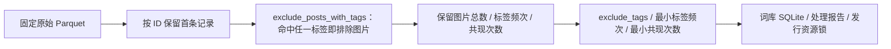
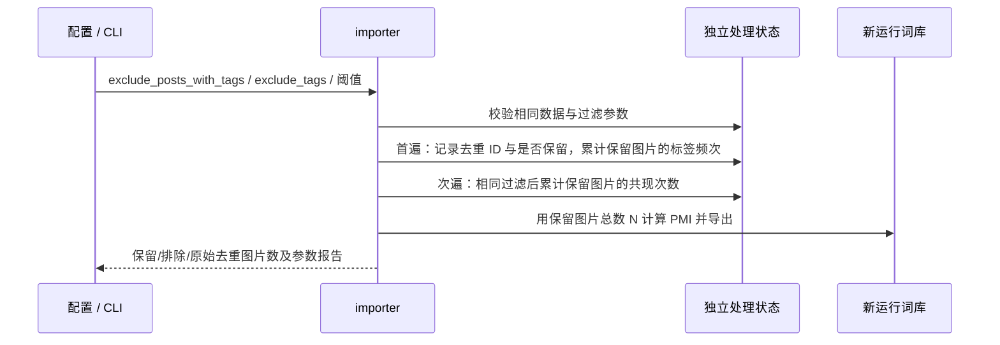

# 按标签排除原始图片记录

## 概述

离线词库处理新增 `exclude_posts_with_tags`，整条排除命中任一标签的图片，默认排除 questionable 与 explicit，compact 的 `exclude_tags` 改为空。

## 架构

## 职责边界

- 沿用现有 corpus 离线处理边界；用户本次已明确参数语义、默认值与 compact 变更，本文记录对应实现。
- JSON/Python 参数为 `exclude_posts_with_tags`，CLI 为 `--exclude-posts-with-tags`，支持标签列表；传空列表或 CLI 空参数可处理全部评级。
- 图片排除匹配所有可用的 `tag_string` / `tag_string_*` 原始标签列与评级映射，`q/e` 映射为 `questionable/explicit`；频次、共现与导出仍只使用普通标签和评级，不新增候选标签类别。
- 首条去重规则保持：被排除的首条记录也标记为已见，后续同 ID 记录不能重新纳入。
- `exclude_tags` 继续只删除标签，不删除图片；两项过滤独立，图片排除先于所有统计。
- 图片过滤影响两遍统计与 PMI 人口总数；过滤条件进入中间状态校验与构建指纹。已有状态缺失新字段时拒绝复用，不迁移或修改旧统计。

## 调用和数据流

## 重点关注

- 覆盖用户示例：`a,b,c` 与 `a,c,d` 被 `b,d` 过滤，`a,e,f` 保留。
- 验证默认评级排除、空列表关闭、独立标签删除、跨分片重复、断点续传与条件不匹配拒绝复用。
- 原始数据、旧缓存与用户运行数据保留；发行词库按新指纹独立重建，上传新资源后更新锁文件，CI 继续复用固定产物。
- 同步双语离线数据处理说明与当前精简词库范围，历史交付记录保留。
