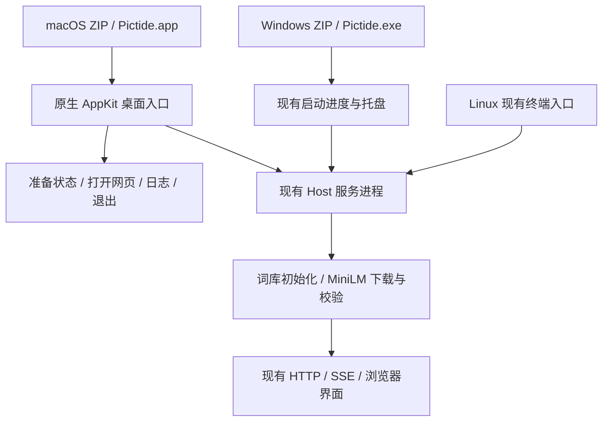
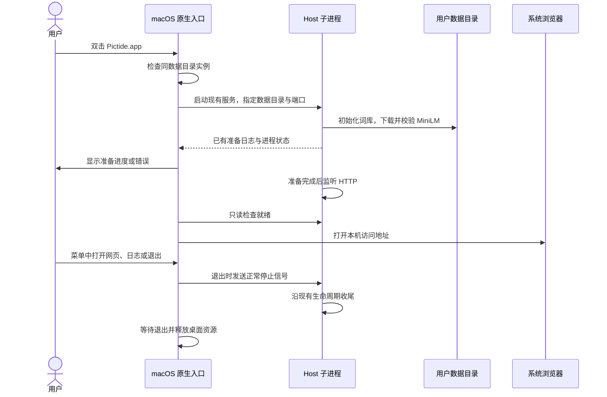

# Windows 与 macOS 桌面分发

## 概述

Windows 提供根目录 EXE，macOS 提供标准 `.app` 与原生菜单栏入口，沿用浏览器界面、首次依赖准备和现有服务。

状态：实现完成，Windows 实际包与桌面生命周期验证通过；macOS 原生编译及桌面验证待在 Mac 上完成。本次尚未发布。

## 架构

## 职责边界

| 组成 | 本次变更 |
| --- | --- |
| Windows 包 | `Pictide/Pictide.exe` 为默认桌面入口，依赖集中在程序子目录；`data/` 只保存用户运行数据。沿用已有临时准备终端、就绪后收起、原生托盘和重复启动复用。显式 `--cli` 保留终端模式。 |
| macOS 包 | Apple Silicon、Intel 各提供一个含 `Pictide.app` 的 ZIP；`.app` 内封装可执行程序、运行库、前端、词库种子及许可证。支持拖入“应用程序”后启动。 |
| macOS 桌面入口 | 在主线程运行系统 AppKit 事件循环；以同一应用内的可执行程序启动 Host 子进程，通过 `--cli --no-browser` 运行现有服务。入口负责准备状态、浏览器打开、菜单操作和子进程收尾。构建时将 `scripts/macos_launcher.swift` 编译为使用系统 AppKit 的轻量原生入口 `Contents/MacOS/Pictide`，由其启动同目录 Python 引擎 `PictideService`；复用网站图标与现有双语文案，包内不增加第三方 GUI 运行时。 |
| Host 与桌面会话 | 复用现有准备流程和就绪检查；Windows 保持原托盘路径。macOS 的桌面入口在准备成功、HTTP 就绪后打开网页，关闭网页后服务继续运行；菜单退出向自己的服务进程发出正常停止信号。 |
| 运行目录 | Windows 默认 `Pictide/data/`；macOS `.app` 默认 `~/Library/Application Support/Pictide/`。`--data-dir` 与现有环境变量继续优先；源码与 Linux 使用既有默认目录。替换程序保留运行数据。 |
| Linux | 保持现有 ZIP 与终端启动方式、Ctrl+C 退出；本次不调整格式或增加桌面集成。 |
| 构建与冒烟 | 共用当前自动化构建入口，临时产物位于 `dev/`，`releases/` 只保存最终包。macOS 采用系统归档与解压并检查 bundle、framework、链接及启动；四平台继续仅在推送版本标签时触发 Actions。 |

macOS 入口提供四类内容：

- **准备状态**：首次启动展示轻量原生准备窗口，显示已有下载进度；下载、校验完成后关闭准备窗口并进入网页。失败时展示简短错误和日志入口。
- **运行状态与地址**：菜单栏图标显示正在准备或已就绪，菜单可查看本机地址，启用局域网时显示访问地址。
- **打开 Pictide / 查看日志**：调用系统浏览器和文件管理器。
- **退出 Pictide**：正常停止自己的服务进程并移除菜单栏入口。

桌面入口与服务之间沿用本地进程及准备日志，不增加业务 HTTP API。入口等待子进程退出；入口退出或异常收尾时释放自己的子进程。重复启动按同一数据目录检查并复用现有实例，使用 POSIX 文件锁维护 macOS 会话所有权；其他数据目录的实例独立运行。

## 调用和数据流

## 重点关注

- 沿用目录式 PyInstaller 运行库，Windows 的单一启动入口和 macOS 的 `.app` 均不采用每次自解压的单文件模式。
- macOS 采用标准 bundle 结构及构建时 ad-hoc 签名，暂不接入 Developer ID 和 Apple 公证。首次安全提示仍按系统流程由用户允许；程序不修改系统安全设置或自动移除下载隔离属性。
- v0.4.0 的 Python 加载错误仍缺少用户端系统版本、架构和签名诊断；已确认实际文件存在。本次分别验证 framework 可加载、归档往返和整包启动，不将更换包装本身宣称为已查明故障原因。
- 原 `codex/macos-portable-archive` 分支只按需复用原生归档检查，不整体合并其版本变更；保留已有版本与标签。
- 新目录只影响新构建；已有 Windows 便携数据可手动复制 `data/`，旧 macOS 包的个人数据按指南手动复制到新位置。实现不自动移动或删除旧包及用户数据。
- MiniLM 继续在首次启动准备完成后才允许进入网页；生图模型与 ComfyUI 由用户准备。系统语言为简体中文时使用中文，其余回退英文。
- 验证只用隔离数据与端口，不提交真实 GPU 任务。Windows 做实际 EXE、托盘、重复启动和退出冒烟；macOS ARM64/Intel 分别做原生构建、系统解压、库加载与 HTTP 冒烟，Finder 首次打开和菜单视觉需 Mac 桌面验证。CI 无头验证不等同于首次下载后的 Gatekeeper 验证。
- 本次不打版本标签或创建 Release；完成并验证后另行发版。报告、临时文件继续保存在 `dev/`。

参考：[PyInstaller 平台打包](https://pyinstaller.org/en/stable/usage.html)、[Apple NSStatusBar](https://developer.apple.com/documentation/appkit/nsstatusbar)、[macOS 应用安全提示](https://support.apple.com/en-us/102445)。

## 实现与验证

- `scripts/portable_entry.py` 将 Windows 根目录 EXE 默认接入现有桌面启动器；`--cli` 和 `--no-browser` 保留终端/无界面路径。`backend/paths.py` 按发行平台选择默认数据目录，显式参数和环境变量继续优先。
- `scripts/macos_launcher.swift` 在主线程运行 AppKit；CLI 通过 `execv` 委托给 `PictideService`。桌面入口展示已有准备日志及下载百分比，校验 HTTP 所属数据目录后打开网页；就绪后停止准备计时器。服务的 stdin 管道随父入口关闭而结束，`backend/desktop_launcher.py` 的监视线程据此停止自己的服务，避免留下孤立实例。
- macOS 构建生成标准 bundle、图标、菜单栏/高清声明及 ad-hoc 签名，使用 `ditto` 归档。原生冒烟会用系统工具解压，检查 framework、内部链接、签名、两个可执行入口的 `--help`，再验证隔离 HTTP；这些检查已接入后续标签构建，当前未执行远端 Actions。
- 10 项针对性 Python 冒烟通过：覆盖三平台模拟打包、资源和个人数据保留、失败原子保留旧包、数据目录选择、Windows 既有进程协议及真实 stdin 管道关闭退出。模拟 macOS 构建通过不代表 AppKit 原生编译通过。
- 实际 Windows 构建完成，前端类型检查和构建通过；ZIP 未引入额外 GUI 运行时或模型权重。隔离启动冒烟使用已有、经哈希校验的 MiniLM（本次为 warm startup），验证 HTTP、前端资源、词库初始化及 SQLite 完整性，未提交生图任务。
- 实际 EXE 未传 `--desktop` 或 `--data-dir`，验证默认旁置 `data/`、准备进程退出、服务控制台窗口句柄为 0、192 DPI 的 PMv2 托盘、重复启动复用、托盘正常退出与占用端口失败。所有验证进程已经停止；主应用与 ComfyUI 保持运行。
- 本机为 Windows，macOS 仅完成代码静态审查与打包调用模拟；ARM64/Intel 原生编译、Finder 首次打开、准备窗口、菜单和退出仍待 Mac 验证。不将旧版本 Python 加载错误标记为已解决。

验证材料保存在 `dev/verification/desktop-distribution-20261020/`，本地最终 Windows 包位于 `releases/pictide-0.4.0-win32-amd64.zip`。
