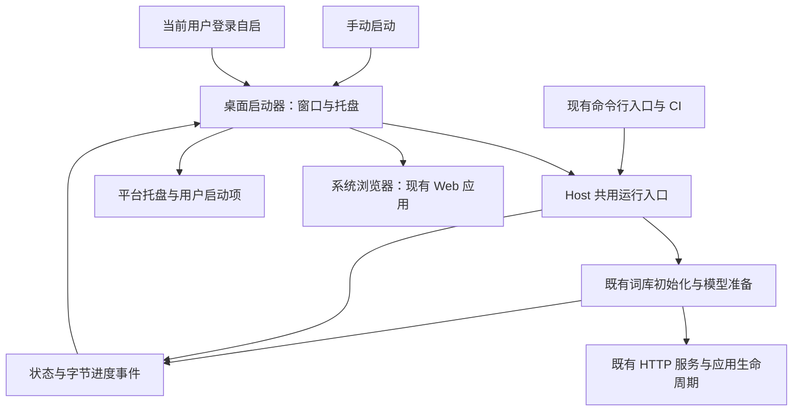
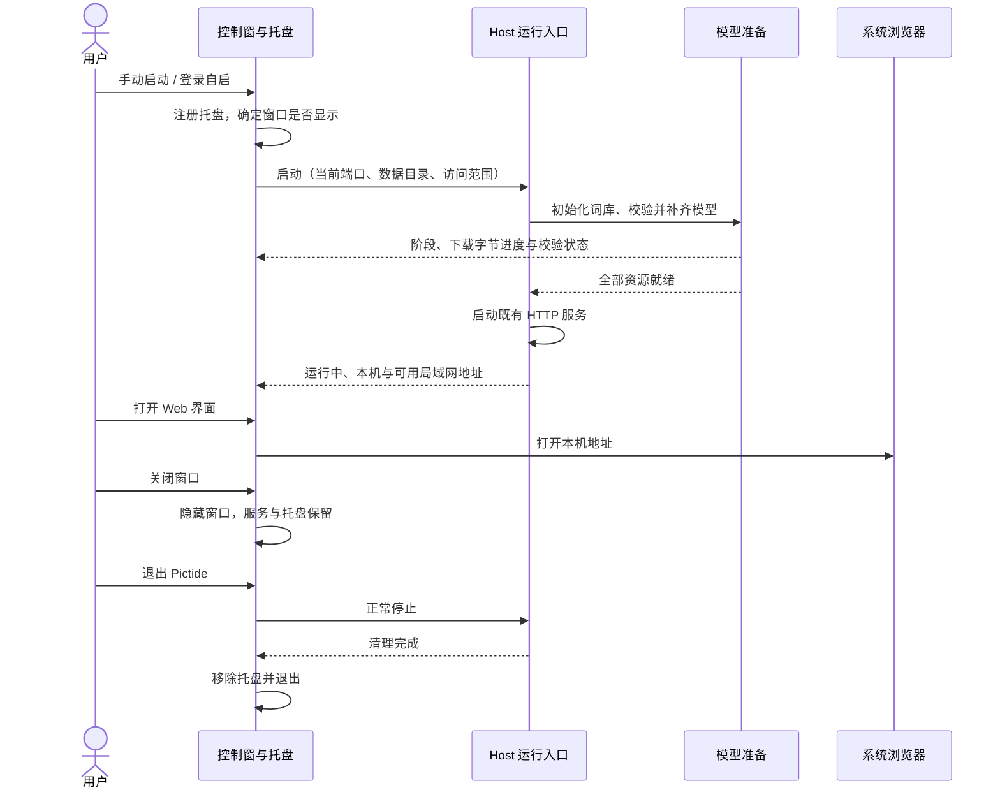

# 轻量桌面启动器

## 概述

用一个小型控制窗与系统托盘管理 Pictide 的启动、初始化和访问，让桌面用户直接使用现有 Web 应用。

状态：按本次六项需求修订，待确认架构与交互后实现；当前尚无图形启动器。

## 架构



## 职责边界

| 组成 | 变更与接口 |
| --- | --- |
| 桌面窗口 | 使用 Tkinter/ttk、系统字体与 Pictide 图标，接收运行状态与初始化进度；提供打开网页、启停服务、复制地址和展开日志。GUI 主线程只处理界面。 |
| Host 共用运行入口 | 接收端口、数据目录、访问范围及停止信号，报告状态、可访问地址和失败；GUI 在独立线程运行服务事件循环，CLI 共用启动及正常清理流程。网页与 HTTP/SSE 接口沿用现状。 |
| 初始化进度 | `prepare_startup` 与 `prepare_model` 增加可选结构化事件回调，包含阶段、文件名、已完成字节和总字节。CLI 沿用文字输出，GUI 使用同一过程绘制进度条，不解析终端字符串。 |
| 托盘与自启 | 使用小型平台适配层；首期 Windows 用标准库 `ctypes` 调用系统托盘 API，`winreg` 管理当前用户登录启动项。托盘动作交回 GUI 线程，只有启动器拥有的服务接受停止请求。 |
| 配置与日志 | 端口、数据目录与局域网参数沿用当前入口；启动器偏好保存在所选 `data/launcher.json`，运行日志仍在 `data/logs/`。自启启动命令记录所选数据目录及访问参数。 |
| 发行与验证 | 图形入口隐藏终端，原 CLI 入口保留供服务器和 Actions 使用。窗口与 CLI 共用同一份 Python、后端及资源，不打包第二套运行时；GUI 依赖只由桌面入口加载。 |

业务模块与数据库不因控制窗变化；提示词、漫游、生成和收藏继续在现有网页中使用。

## 调用和数据流



## 界面与默认行为

```text
Pictide                                  ×
● 正在准备首次运行

正在下载推荐模型             36 / 91 MB
[████████░░░░░░░░░░░░]             40%

本机访问     服务就绪后显示
局域网访问   未开启

[打开 Web 界面]                 [停止]

□ 允许局域网访问    □ 开机自动启动
▸ 日志                              [打开日志目录]
```

- **状态与地址**：准备中、启动中、运行中、停止中、已停止、失败。运行后显示本机地址；启用局域网访问后显示实际可用的局域网地址并可复制。保留当前仅本机访问的默认值，地址使用真实端口。
- **打开网页**：服务就绪后按钮可用，使用系统默认浏览器。手动启动先显示控制窗，用户按需打开网页；登录自启保持托盘运行，不自动弹出网页。
- **初始化**：首次显示整体进度条；下载部分按模型清单总字节计算，已校验文件及有效续传进度计入完成量。文件下载完后明确显示“校验中”，全部校验完成、HTTP 服务就绪后才允许进入网页。后续启动复用有效模型。
- **开机自动启动**：采用当前用户登录后启动，默认关闭；勾选后注册当前路径、数据目录和参数，取消后移除。便携目录移动后重新启用可更新路径。
- **自动托盘**：启动即加入托盘。关闭窗口隐藏到托盘，菜单只放“打开网页 / 显示控制窗 / 退出 Pictide”。退出才停止服务；托盘不可用时保持控制窗可见。初始化或启动失败时显示窗口与可理解的错误。
- **日志**：默认折叠，展示近期日志并可打开日志目录；失败时展开错误。详细日志沿用本地文件，展示中不输出 API 密钥。

局域网访问在服务停止时调整，再启动应用；不新增热切换。相同用户、同一数据目录的重复图形启动唤醒已有控制窗，避免登录自启与手动启动产生两份服务。

## 轻量与平台范围

- 优先复用现有 Python 运行时、系统浏览器和已有图标；窗口只承担启动控制，不复制 Web 功能。
- 2026-10-19 本机依赖粗测：Tcl/Tk、Tkinter 与对应 DLL 共 **10,965,487 字节**，按现有 ZIP 的 DEFLATE 6 压缩为 **3,960,499 字节（约 3.78 MiB）**。这是依赖文件估算，不是最终便携包增量；原本机 Windows ZIP 为 69,147,920 字节。
- Windows ZIP 新增体积先以 **5 MiB 左右**为目标，实际记录图形版与同源码 CLI 版的压缩大小及解压大小，再决定是否需要裁剪依赖；模型仍在启动时下载。
- 沿用原方案先验证 Windows 的完整六项功能及包体积。macOS/Linux 复用控制窗和运行入口，托盘、登录自启及桌面入口分别适配验证；Linux 托盘能力受桌面环境影响，逐平台列出支持范围。已有四平台 CLI 构建与验证保持可用。

## 验证重点

- 少数冒烟覆盖首次初始化进度、已有模型快速启动、启动失败、关闭到托盘、退出后停止、再次启动和自启项启用/取消；使用独立数据目录与端口，不重启主实例。
- 自启验证使用当前用户的测试启动项并在结束后清理；最终是否开启由用户在界面选择，本次设计阶段不改本机启动项。
- Actions 继续执行四平台的 CLI 打包及冷启动验证；Windows 增加图形入口、托盘资源和包体积检查。桌面实际交互另做少量人工冒烟，不把 headless CI 成功当作完整桌面验证。
- 首次准备期间退出在下载边界响应停止并保留有效 `.part` 文件；已提交的生图任务沿用现有停止与恢复语义。

## 技术依据

- [Python Tkinter 与线程模型](https://docs.python.org/3.12/library/tkinter.html#threading-model)：使用主线程驱动窗口，耗时准备及服务运行与界面分开。
- [Windows 通知区域](https://learn.microsoft.com/en-us/windows/win32/shell/notification-area)：托盘采用系统 API。
- [Windows 登录启动项](https://learn.microsoft.com/en-us/windows/win32/setupapi/run-and-runonce-registry-keys)：当前用户登录时启动。
- [跨平台托盘的环境差异](https://pystray.readthedocs.io/en/latest/usage.html#selecting-a-backend)：作为 macOS/Linux 后续选型参考，不在首期额外引入跨平台托盘依赖。
