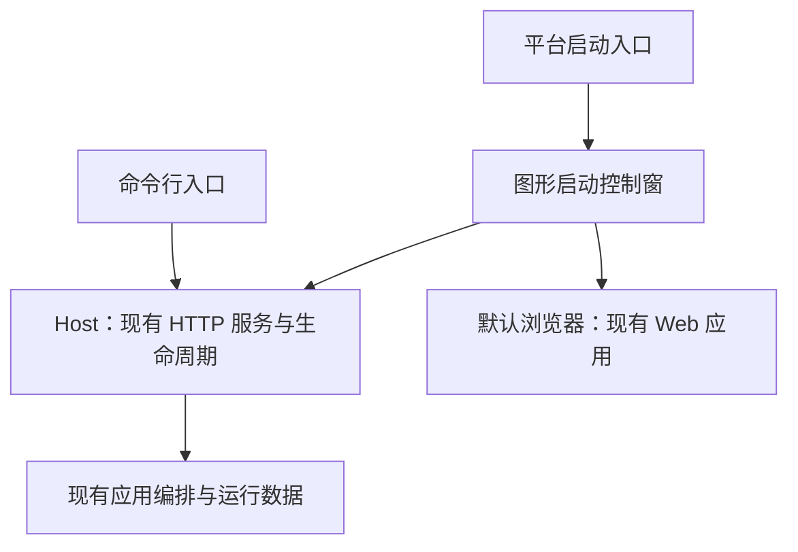
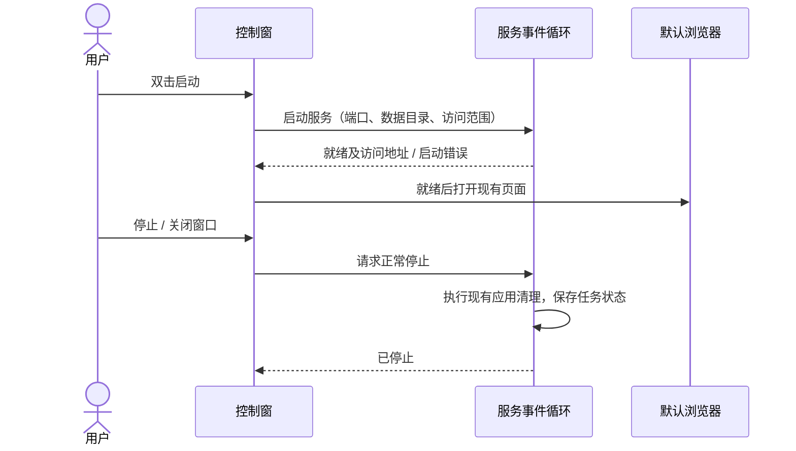

# 图形启动控制窗

## 概述

为图形桌面提供轻量启动控制窗，展示 Pictide 运行状态、访问地址和停止操作，沿用现有网页体验。

状态：待用户确认，尚未实现。

## 界面

```text
Pictide
● 运行中

本机访问    http://127.0.0.1:8189       [复制]
局域网访问  http://192.168.x.x:8189     [复制]

[打开 Pictide]                       [停止]

▸ 运行日志
```

- 启动后自动运行服务，就绪后打开默认浏览器；控制窗保持可见，显示「准备中 / 启动中 / 运行中 / 停止中 / 已停止 / 启动失败」。停止后可再次启动。
- 局域网地址仅在启用局域网访问时显示；沿用已有端口、数据目录与局域网参数。
- 日志默认折叠，失败时展开错误摘要，并可打开日志目录；日志继续写入所选数据目录。
- 关闭控制窗等同停止本地服务，按现有生命周期收尾，保存任务记录；停止完成后退出。关闭浏览器仍可通过控制窗重新打开页面。
- 本期复用系统字体与原生主题，按钮和状态使用中英文文案；不加入托盘、开机启动或内嵌浏览器。

## 架构



## 职责边界

| 组成 | 接口及职责 |
| --- | --- |
| 启动入口与发行构建 | 图形桌面的默认入口打开控制窗；保留显式命令行模式，服务部署继续使用原有终端入口。Windows 图形入口隐藏控制台，启动准备失败在窗口中可见。源码与便携入口都需要接入。 |
| 图形控制窗 | 优先使用标准库 Tkinter/ttk，承担状态展示、打开浏览器、复制地址、显示日志与请求停止；不读取业务数据库或编排生成任务。当前本机 Python 可导入 Tkinter，实际窗口及打包资源仍需验证。 |
| Host | 将现有服务启动和正常停止抽成可复用运行入口，接收停止信号并报告就绪或失败；图形界面主线程与服务事件循环分开，复用应用的启动和清理过程。 |
| 网页与应用编排 | 继续使用现有 HTTP/SSE 契约、数据目录和任务恢复机制。图形控制窗不另开应用数据实例。 |

## 调用和数据流



## 重点关注

- 首期先完成并验证 Windows，再分别验证 macOS/Linux 的桌面入口及 Tcl/Tk 依赖；无图形环境继续使用命令行，不把未验证的平台写成已支持。
- 便携包包含图形运行时，终端日志、资源初始化和端口冲突的错误均有可见反馈。
- 不接管已运行的其他实例；同端口启动失败时显示原因和访问入口，停止按钮仅控制本窗口启动的服务。
- 少数冒烟覆盖启动成功、端口占用、停止与再次启动、关闭窗口和独立数据目录；验证期间保留主实例及用户任务。
- 服务停止只结束本地应用；已提交给云端服务的请求仍遵循现有取消及恢复语义。
