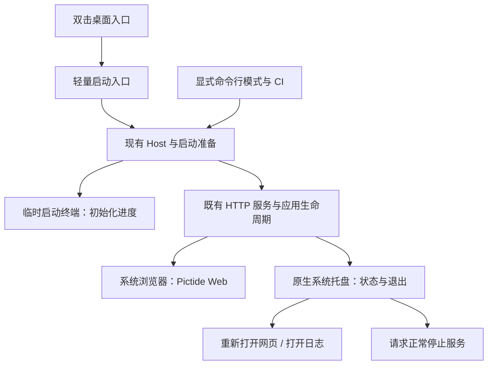
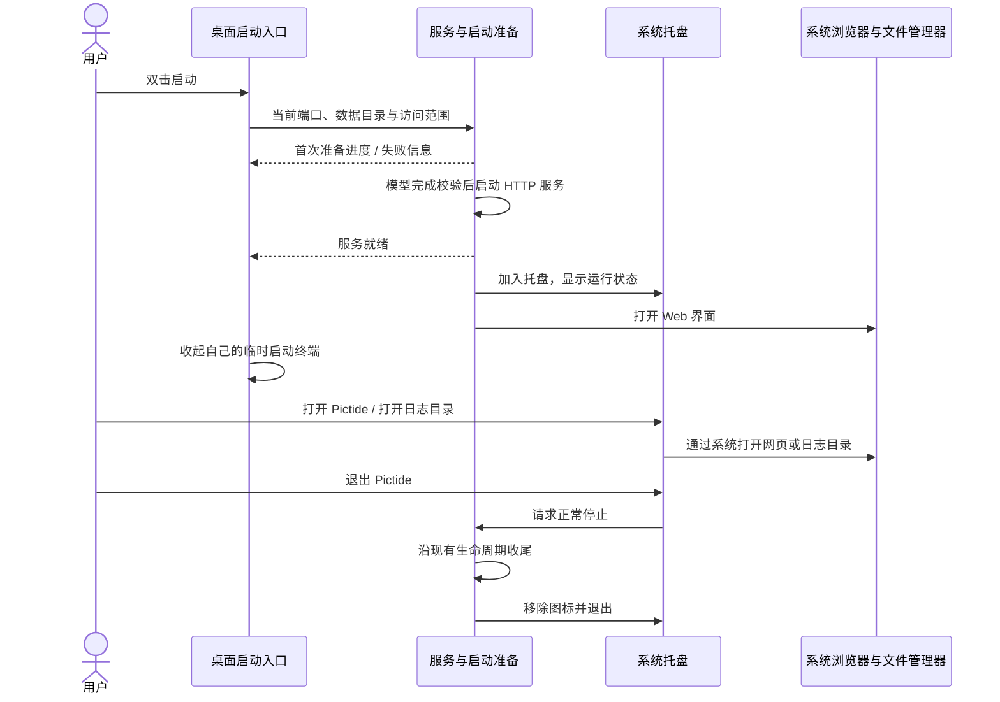

# 桌面启动与托盘退出

## 概述

沿用系统浏览器和现有服务，解决双击启动、首次准备进度和便捷退出三个问题。

状态：用户已确认收敛到这三个问题，取消独立控制窗；本页为修订方案，尚未实现。

## 架构

## 职责边界

| 组成 | 变更 |
| --- | --- |
| 桌面入口 | 保留双击启动方式；首次依赖准备、词库初始化与模型下载使用启动终端显示进度。就绪后自动打开浏览器，收起由启动器创建的临时终端；失败时保留错误输出。 |
| Host | 复用现有模型准备、HTTP 就绪后打开浏览器及生命周期；桌面模式增加就绪通知与正常停止信号，命令行模式继续支持 Ctrl+C。 |
| 托盘 | Windows 优先用标准库 `ctypes` 调用系统 API；提示显示服务状态，菜单提供“打开 Pictide / 打开日志目录 / 退出 Pictide”。托盘动作交给现有服务事件循环处理。 |
| 模型与日志 | 沿用现有下载进度、校验、续传和 `data/logs/`，不增加图形进度回调、独立日志面板或启动器配置文件。 |
| 发行与 CI | 继续共用现有 Python 及后端运行时，不增加 GUI 运行时；显式 CLI 与无桌面环境保留终端，不初始化托盘。现有四平台构建与冒烟调用保持可用。 |

程序入口和托盘统一复用网站的 Pictide 图标：沿用 `web/public/icons/pictide.svg` 的设计，以已有 `pictide-512.png` 为平台图标导出源。构建时生成 Windows `.ico` 等平台格式，复用已有 Pillow；不增加图标专用运行时依赖，也不维护另一套图案。

启动提示、初始化进度、服务状态、托盘菜单和错误摘要支持简体中文与英文，启动时按系统首选显示语言选择：`zh-CN`、`zh-SG`、`zh-Hans` 等简体中文语言使用中文，英语及其他未支持语言使用英文；识别失败也回退英文。使用轻量双语文案表，不增加第三方依赖或语言选择界面。底层库原始日志保留原文；网页继续使用现有语言设置。

## 调用和数据流

## 交互范围

- **双击就能开始**：服务就绪后自动打开现有网页；关闭网页后，可通过托盘再次打开。
- **首次等待看得见**：复用启动窗口里的模型下载百分比、校验及失败信息。模型全部准备完成后才允许进入应用，下载失败保留有效部分供下次续传。
- **需要时容易退出**：服务运行期间保留托盘，明确提供退出操作；退出执行正常清理，避免只关闭网页后找不到后台服务。

已取消独立控制窗、Tkinter/ttk、独立图形进度窗、地址管理面板与开机自启；后续按实际使用需要单独评估。首次进度采用已有终端输出，本期不以另一套界面替换它。

## 重点关注

- 先完成 Windows 原生托盘与桌面入口验证；macOS/Linux 后续分别评估原生集成，既有 CLI 保持可用。不为统一桌面外观引入额外运行时。
- 只收起启动器自己创建的终端；用户主动打开的命令行终端保留。托盘不可用时保留终端退出入口。
- 同一数据目录重复桌面启动时，重新打开已有实例网页，避免新增第二份后台服务；其他实例和数据目录继续独立。
- 端口、数据目录与局域网参数沿用原入口，运行地址在启动输出和日志中可查，不增加第二处设置。
- 包体积与常驻资源消耗以相同源码、相同模型准备方式的 CLI 包为基线实测；此前 Tcl/Tk 的约 3.8 MiB 压缩估算不再纳入方案。
- 少数冒烟覆盖首次下载、已有模型启动、失败可见、关闭网页后重开、托盘退出和 CLI；验证使用独立数据目录及端口，保留主实例和用户任务。原生桌面交互与 headless CI 结果分别记录。
- 文案验证覆盖简体中文、英文、未支持语言与语言检测失败的英文回退。

## 技术依据

[Windows 通知区域](https://learn.microsoft.com/en-us/windows/win32/shell/notification-area)提供原生托盘能力；Python 侧只做薄适配，业务界面仍由现有浏览器承担。
