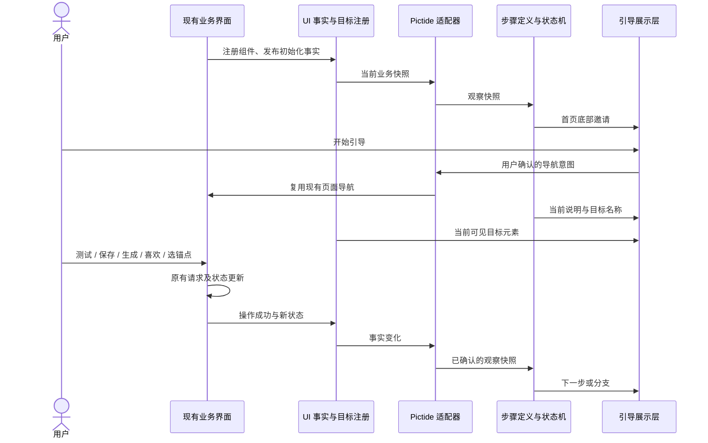

# 首次使用引导

## 概述

用跟随组件的聚焦与底部引导条，带用户完成接入、首图、反馈、锚点探索和喜欢回顾。

状态：交互需求已确认；本页提交新增前端模块、接口和数据流设计，等待确认后实现。ComfyUI 与生图模型自动安装已搁置。

## 架构

## 职责边界

| 组成 | 接口与职责 |
| --- | --- |
| 通用引导状态机 | 接收步骤定义与观察快照，处理开始、继续、跳过和完成。步骤以稳定名称标识，通过纯条件函数判断推进；不认识 API、任务、喜欢和锚点，不导入业务控制器。 |
| Pictide 步骤定义 | 维护文案、目标名称、观察条件和分支，保存本页的体验顺序；文案接入现有中英词典。 |
| 状态适配器 | 把现有业务状态和成功通知映射为只读引导快照；集中处理与 Pictide 的连接。导航意图复用既有导航入口，不另写业务 API 请求。 |
| 共享 UI 事实通知 | 业务只发布事实，例如当前页面、连接测试结果、配置保存结果、图片可显示、反馈保存结果、毛玻璃与锚点状态。事件不含引导步骤编号；业务成功与否由原调用链决定。 |
| 共享组件目标注册 | `registerTarget(name, element)` 注册实际 DOM 元素，组件卸载时注销；React 通过 ref 接入。允许同一逻辑目标有普通/沉浸等多个实例，聚焦当前可见实例。业务行为不依赖引导是否存在。 |
| 引导展示层 | 订阅当前步骤和目标注册，绘制底部条与聚焦框；负责布局、滚动可见性、键盘和可访问性。消费元素引用，不查询业务表单值或解析界面文字。 |
| 浏览器记录 | 按当前浏览器站点保存邀请、进度、跳过和完成状态，不增加后端 API、数据库表或依赖。仅保存步骤及必要图片标识，排除密钥、提示词、表单草稿和组件坐标。 |

建议源码按职责拆分为 `web/src/onboarding/`（状态机、步骤、适配器）、`web/src/components/onboarding/`（展示），共享目标与 UI 事实接口独立于引导目录。现有控制器和组件只接入中性的注册与事实接口，不调用 `nextStep()` 或判断“用户正在第几步”。

### 观察契约

适配器提供当前页面、已有 API 与最近测试/保存结果、漫游等待状态、当前图片 ID/是否实际载入、当前图片评价、两处毛玻璃状态、锚点面板展开/已选项以及喜欢页加载状态。

- 测试成功关联当前配置草稿版本；修改地址、密钥、类型或模型等配置后，旧测试结果不再满足本轮完成条件。版本是本地序号，不把密钥传给引导。
- 测试和保存分别确认；“测试成功”不代表实际出图成功。保存后回到漫游的动作由用户点击引导条按钮触发。
- 图片就绪指当前图片实际载入成功，反馈指对应图片的保存已成功，锚点指保存已成功；鼠标、触屏、键盘操作采用同一份事实。
- 条件关联当前图片和本轮操作，避免旧任务事件、预取完成或上一张图的反馈推进错误步骤。若图片很快生成，允许直接进入可显示状态，不停留在已消失的生成提示上。

### 组件目标

稳定名称至少包含 `api.form`、`api.test`、`api.save`、`roam.start`、`roam.pending`、`roam.image`、`roam.privacy`、`roam.like`、`roam.next`、`anchors.trigger`、`anchors.terms`、`anchors.clear`、`nav.liked`、`liked.privacy`、`liked.collection`。

目标名称不依赖中英文文案、页面嵌套或屏幕分辨率。引导定义不保存 `top/left` 像素值；展示层从注册组件实时测量边界，以 ResizeObserver、滚动和视口变化驱动更新，布局变化时合并到动画帧处理，不增加定时轮询。目标挂载、展开或变为可见后恢复聚焦；缺失时保留可理解的底部提示，不把框指向页面原点。

## 调用和数据流

### 体验流程与文案

序号对应用户提出的流程。界面每次只说眼前的一件事，优先一句短话，操作名称沿用按钮文字。结果与过渡说明合并到相邻操作，不额外要求用户点击“继续”；等待用户的真实操作，不用定时切换催促。

| 序号 | 引导文案方向 | 目标与推进条件 |
| --- | --- | --- |
| 1 | “欢迎来到 Pictide，一起试试漫游？” | 首次使用显示漫游首页，窗口底部弹出邀请：“带我看看 / 自己探索”。选择后记录，不重复弹出。 |
| 2 | “先连一个生图服务。”→“填好后，测试一下连接。”→“连接成功，保存就好。” | 按实际状态分别显示，聚焦配置表单、测试、保存；测试当前草稿成功、保存成功后，底条提供“回到漫游”。保留现有服务类型、草稿和错误展示。 |
| 3 | “点「开始漫游」，看看第一张。” | 聚焦漫游开始按钮；用户触发后，等实际等待状态或图片就绪。 |
| 4 | “图片正在准备，稍等一下。” | 聚焦真实生成中提示；实际失败留在原错误处理流程，可修复或重试。就绪后继续，快速完成时直接进入下一步。 |
| 5 | “图片好了，点这里关掉毛玻璃。” | 聚焦漫游毛玻璃按钮；等用户关闭毛玻璃。 |
| 6 | “第一张图片来了。” | 与第 7 项合并展示，不单独要求点“继续”。 |
| 7 | “喜欢就点个心，也可以看下一张。” | 同时强调喜欢与下一张；下一张继续探索，当前提示保持，直到有实际喜欢或用户选择“先了解锚点”。不替用户点赞。 |
| 8 | “找到喜欢的了！” | 确认喜欢保存成功后，与第 9 项入口说明合并；无喜欢分支不显示庆祝。 |
| 9 | “打开锚点，留住感兴趣的元素。”→“选一个想保留的元素。” | 先聚焦锚点入口，再聚焦可选词；等待至少一个可编辑锚点保存成功，预设固定词不算新选择。支持跳过本段。 |
| 10 | “再看一张，沿着这个方向继续。” | 聚焦下一张；等用户请求后，带当前锚点的新图片实际显示，不拿旧缓存或当前图片充数。 |
| 11 | “想换个方向时，点这里清空锚点。” | 显示清空锚点入口，必要时先请用户打开锚点面板。 |
| 12 | 同上一条，持续提示。 | 继续切图不推进；清空提示持续，直到用户成功清空、跳过本段或退出引导。收起面板时改为引导重新打开面板，指向当前存在的目标。 |
| 13 | “清空好了，看看新的画面吧。” | 只有成功清空后出现；聚焦下一张并等新图片显示。清空本身不自动发起额外生图。 |
| 14 | “刚才喜欢的图片，也都留着呢。” | 与第 15 项合并，无收藏时省略这句。 |
| 15 | “点「喜欢」，回去看看。” | 新图片显示后聚焦喜欢导航；用户切换到喜欢页后继续。 |
| 16 | “这里也有毛玻璃，点一下就能看。” | 聚焦喜欢页自己的毛玻璃按钮；如果已经关闭则直接继续。 |
| 17 | “喜欢的画面，随时都能回来重看。” | 喜欢页加载完成后，与第 18 项合并展示；无收藏时改为“点过喜欢的图片，会收在这里”，不声称已有图片。 |
| 18 | “接下来，按你的心意漫游吧。” | 底条提供“继续漫游”，由用户点击完成引导并回到漫游。 |

### 跳过与恢复

- 用户可随时结束引导，保持当前页面、草稿和图片；在通用设置提供“新手引导”入口重开。结束引导不取消任务或修改偏好。
- 首次邀请基于当前浏览器站点的引导记录；已有服务或图片时沿用现场状态，文案改为“当前图片”，满足的配置步骤可跳过。首次默认进入漫游，已有用户的深链接与后续访问不被首页重定向覆盖。
- 刷新后提供“继续上次引导”，重新观察现场条件后恢复有效步骤；不重放生成、保存、喜欢或清空操作，不缓存表单草稿。
- 用户没有喜欢也能继续了解锚点；无锚点、停泊锁定或没有可选词时，给出解释及跳过入口。引导不擅自切换漫游方式、预设或固定词。

## 重点关注

- 引导条固定在窗口下方，桌面与移动端复用；手机避开底部导航、安全区与软键盘。必要时滚动当前组件的容器，使目标与底条同时可用；不为引导改变页面正常布局。
- 聚焦框依附实际组件，遮罩只做视觉强调，不吞掉表单、下拉菜单、切图或反馈事件。引导保持可跳过，Tab/键盘操作沿用原界面，不创建阻止填写表单的焦点陷阱；适当使用状态播报，尊重减少动态效果。
- 引导只解释并观察操作；所有可能生成图片、产生费用或修改数据的动作由用户点击原有业务控件触发。不会为演示发起连接、下载、GPU 或云端生图请求。
- 首页邀请与通用设置重开入口复用现有主题和组件，文案使用简体中文与英文；用户实际标签保持原文。
- 采用少数状态机冒烟验证测试失败/保存失败不推进、快速出图、先下一张后喜欢、清空持续提示与完成/跳过。界面检查覆盖桌面、窄屏/PWA、滚动/锚点面板调整、目标卸载恢复及键盘操作。普通源码验证完成类型检查与构建，不触发 GitHub Actions。
- 验证优先隔离数据和模拟生图服务；模拟结果只证明引导与业务衔接，真实 GPU/云端出图另行明确场景。实现后再记录已验证范围。
