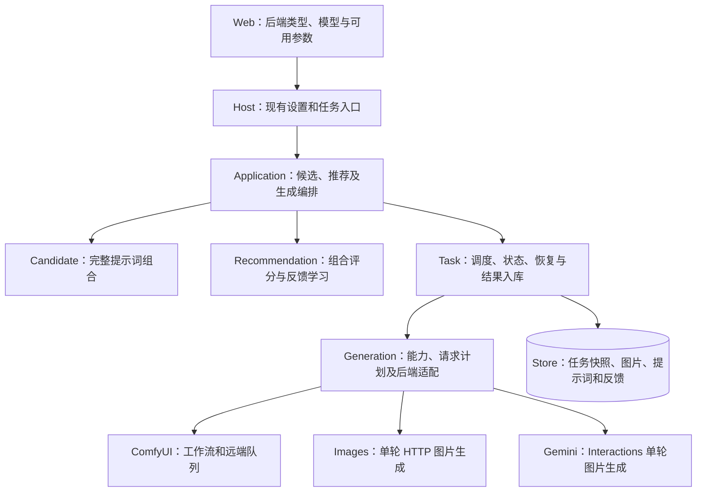
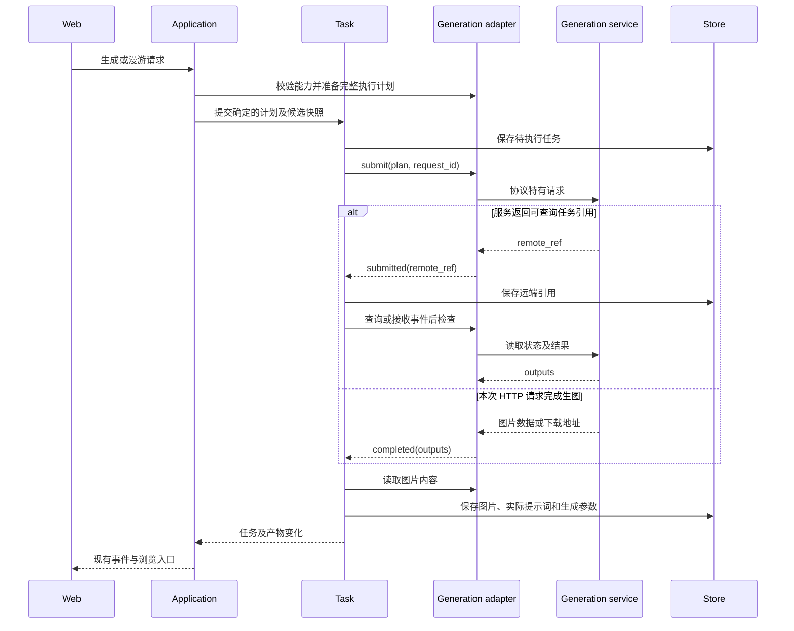

# 多生图 API 接入

## 概述

已确认：首批增加 OpenAI Images 接口族和 Gemini 原生生图，让用户连接云端模型，在本地继续浏览、反馈与管理图片。

用户于 2026-10-19 确认实施首批范围；当前变更增加 `openai`、`gemini`，保留 `comfyui`。以下顺序按 Pictide 的接入收益建议排列，不表示市场份额排名。

| 批次 | 接口 | 目标及范围 |
| --- | --- | --- |
| 已有 | ComfyUI Server API | 工作流、队列、历史和事件；继续服务自托管用户。 |
| 首批 | OpenAI Images 接口族 | `images/generations` 单轮文生图；支持自定义 API Base URL、API Key 和模型。本批用协议模拟服务验证；OpenAI 官方真实出图及火山方舟 Seedream、硅基流动等第三方接口分别待验证。 |
| 首批 | Gemini 原生生图 | 依据当前官方指南接入 Interactions 的单轮图片输出；`generateContent` 已进入 Legacy 文档，本批不同时增加这套兼容路径。Imagen 的专用 API 单独评估。 |
| 后续 | AUTOMATIC1111 | `sdapi/v1/txt2img`，增加已有本地 WebUI 用户的接入方式；其他衍生项目按实际兼容验证。 |
| 后续 | fal.ai | 队列提交、状态查询和输出下载；先为少数明确模型维护字段映射。 |
| 按需求 | Replicate、BFL、Stability AI | 各自维护适配器，不把平台队列格式、模型参数或输出结构视作统一协议。 |

## 架构

## 职责边界

- **Web / Host**：沿用后端列表和生成入口，按后端与所选模型显示可用配置。云端用户填写地址、密钥和模型，不经过 checkpoint 或工作流设置。API Key 只由 Pictide 后端调用外部服务，读取配置时继续隐藏密钥。
- **Application**：继续选择完整候选、评分和提交任务；接口适配留在 Generation。候选、推荐与任务保持现有调用边界。
- **Generation**：沿用注册表，在 `GenerationBackend` 中明确能力描述、请求准备、提交、查询和结果读取。ComfyUI 保留现有工作流及事件路径；云端适配器不生成伪 ComfyUI 节点图。
- **Task**：统一管理本地任务；提交结果区分“远端已接收，返回可查询引用”与“本次请求已完成，返回图片”。前者进入查询/事件路径，后者直接保存产物。当前 `submit -> prompt_id -> inspect` 的单一路径需据此调整，HTTP 长请求使用异步 I/O。
- **Store**：保存后端类型、模型、实际发送参数及产物；保留原始候选快照以解释推荐反馈。对未应用的图像种子或负向提示词明确标记，不把用户输入当作服务端已执行参数。

本批接口语义：

| 接口 | 约定 |
| --- | --- |
| 后端配置 | 公共字段为 `kind/name/base_url/api_key/model`，协议特有参数归所属适配器校验；现有 ComfyUI 配置沿用。 |
| 能力描述 | 按适配器及模型声明负向提示词、图像种子、尺寸、模型发现、事件、取消和恢复能力；缺少模型列表接口时支持手填模型。 |
| 请求准备 | 接收完整提示词与生成选项，返回确定的执行计划及实际应用字段；不支持的非空参数显式提示，不静默丢弃。 |
| 提交结果 | `submitted(remote_ref)` 或 `completed(outputs)`；结果不明确时沿用未知状态，不伪造可恢复的远端任务 ID。 |
| 查询 / 取消 / 恢复 | 仅在后端支持相应能力时调用；中断本地等待不等于远端已取消或停止计费。 |
| 结果读取 | 处理 Base64 或图片 URL，下载并保存到当前数据目录后再供浏览器读取。 |

## 调用和数据流

## 重点关注

- 首批覆盖单轮文生图、生成结果、喜欢和现有漫游；图像编辑、多轮对话、LoRA 和模型市场作为后续需求。暂不引入自动 LLM 提示词改写。
- 相同 `images/generations` 路径不代表字段完全兼容。本批只提供已列出的可选参数，后续按实际验证增加服务预设；兼容聊天接口也不表示支持图片接口。
- 现有共现词与锚点先保持原意发送，区分“API 能返回图片”与“该模型适合现有词库和偏好学习”。用小型中性场景验证提示词理解和锚点保持，再决定模型推荐；不因云端模型接入宣称标签提示词效果等同本地模型。
- 云端新配置默认关闭自动预取；用户选择预取后沿用事件驱动机制。说明请求会发送给所选服务，图片和反馈保存于本地，生成计费和数据处理由服务约定决定。
- 无远端查询引用或幂等保证的请求，超时或进程中断后保持结果未知，避免自动重发造成重复生成和费用。首批不做进程内假任务队列来伪装远端恢复。
- 历史 ComfyUI 图片、任务、喜欢及偏好继续按已有生成快照解释；本批同步当前架构、用户指南与后端 API 文档。
- 验证先使用协议模拟服务，覆盖成功、URL/Base64、失败和不支持参数；真实服务调用按明确的小量场景验证，记录费用与实际兼容模型。当前调研未调用收费生图接口。

## 首批实现范围

- 配置新增 `kind=openai/gemini`，共用 `name/base_url/api_key/model`；OpenAI 可选 `size/quality`，Gemini 可选 `aspect_ratio/image_size`。Base URL 包含版本路径，模型手动填写，模型列表接口返回当前配置值。
- 连接检查只读查询所选模型，不提交收费生图；检查成功与真实出图成功分别记录。新增实现使用现有 HTTP 依赖，不增加厂商 SDK。
- OpenAI 使用 `/images/generations`；Gemini 使用 `/interactions`、`x-goog-api-key`、图片 `response_format` 与 `store:false`。暂不接入 `generateContent`、Imagen、图像编辑或多轮对话。
- 公共能力字段为 `negative_prompt/seed/models/events/cancel/recovery/cloud`。首批云端负向提示词和确定图像种子不支持，非空内容明确拒绝；候选与漫游须使用负向为空的预设。候选种子继续只控制本地抽词。
- 同步云端响应进入现有本地任务和产物存储，支持 Base64 和 URL 下载。任务、图片通过 `backend_kind` 解释后端语义，保留实际模型与请求快照。超时或中断后的不确定请求不自动重发，本地取消不承诺服务商停止或免计费。
- 新选择的云端漫游后端默认预取 `0`，用户明确启用后沿用事件驱动预取。正向提示词和参数发送到云端；图片、提示词记录、反馈及偏好继续保存在本地。
- 当前用户指南、架构和后端接口文档同步中英双语；标签提示词效果、真实服务权限和第三方兼容程度均以实际验证为准。

### 验证状态

本批通过 9 项模拟协议检查、5 项云端任务集成检查、现有 ComfyUI 全流程及双任务窗口冒烟、3 项默认工作流检查，以及前端类型检查、构建和 5 项配置/密钥帮助方法检查。真实页面使用独立本机模拟服务，验证 OpenAI 漫游出图、Gemini 配置及手动出图、喜欢、种子说明、协议切换草稿与手机宽度；在途恢复检查保持两个请求槽位，工作进程中断后保留未知状态且不重发。验证材料保存在本地 dev/verification/cloud-backends-20261019/。真实收费服务出图、模型效果和第三方端点兼容尚未验证；既有便携发行包未重新构建。

### 官方资料

- [ComfyUI Server API](https://docs.comfy.org/development/comfyui-server/comms_routes)
- [OpenAI Images：Create image](https://developers.openai.com/api/reference/resources/images/methods/generate)
- [Gemini 当前生图指南](https://ai.google.dev/gemini-api/docs/image-generation) · [Generate Content Legacy 指南](https://ai.google.dev/gemini-api/docs/generate-content/image-generation)
- [火山方舟图片生成 API](https://console.volcengine.com/ark/region:cn-beijing/docs/image-generation-api) · [硅基流动接口变更记录](https://docs.siliconflow.cn/docs/release-notes/overview)
- [AUTOMATIC1111 API](https://github.com/AUTOMATIC1111/stable-diffusion-webui/wiki/API)
- [fal.ai Queue](https://fal.ai/docs/documentation/model-apis/inference/queue) · [Replicate Predictions](https://replicate.com/docs/topics/predictions/create-a-prediction) · [BFL 生图](https://docs.bfl.ai/quick_start/generating_images) · [Stability API](https://platform.stability.ai/docs/api-reference)
