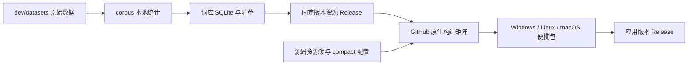
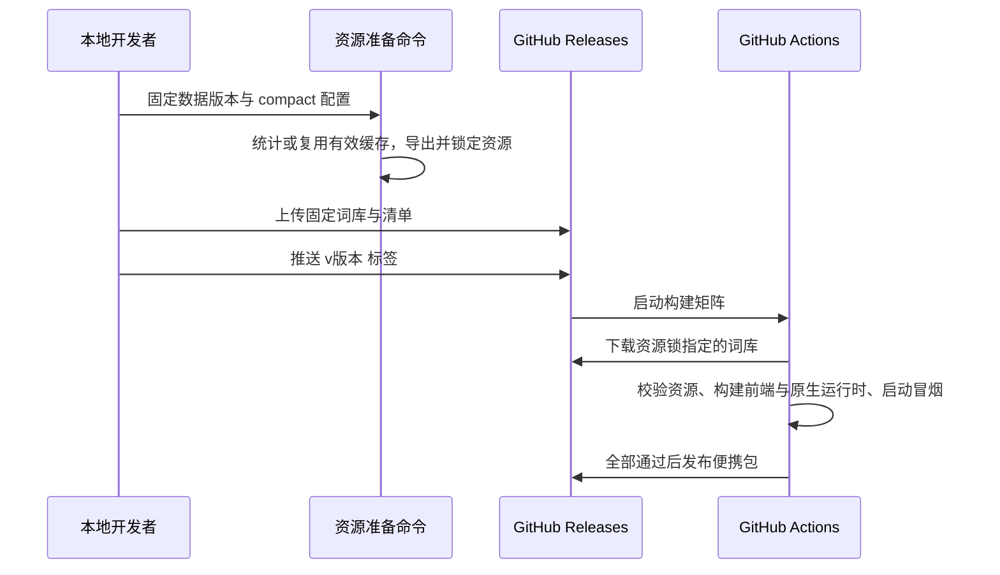

# 预构建词库与 GitHub Releases

## 概述

本地准备固定词库资源，GitHub Actions 校验并复用同一份资源，按版本标签构建各平台便携包并发布 Release。

## 架构

## 职责边界

- `corpus.portable`：沿用现有统计与缓存，提供单独准备词库和验证预构建词库的入口；消费端校验数据、规范化参数、处理代码指纹与文件哈希，生产依赖版本仅作为生产记录。
- 本地资源命令：导出 `vocabulary.sqlite3`、`report.json`，生成源码跟踪的资源锁；以内容标识命名资源 Release，上传资源后再推送应用版本标签。
- `scripts/build_portable.py --prebuilt-library`：显式接收预构建目录，验证失败即终止；GitHub Actions 始终使用此入口，省去原始数据处理依赖。MiniLM 继续按固定版本下载和校验。
- GitHub Actions：校验标签与源码版本，下载资源、执行原生构建和隔离启动冒烟；全部成功后发布 ZIP、SHA-256 与构建报告。资源标签与应用 `v*` 标签分别管理。

## 调用和数据流

## 重点关注

- 用户已确认上述复用方案并授权实现 GitHub Actions；本记录在实现前落盘。
- 构建资源独立于开发应用的 `data/`；原始数据与模型保留在长期目录。
- 资源锁保存完整文件校验信息，CI 不依赖跨标签 Actions cache 保证资源可用。
- Windows x64、Linux x64、macOS ARM64/Intel 使用原生 runner；实际平台结果以对应 Actions 运行记录为准。
- 不覆盖已有 Release 资源或已发布版本；上传失败保留本地产物以便恢复。

## 2026-10-19 多平台验证

[Actions 运行 39251933209](https://github.com/Lykr/pictide/actions/runs/39251933209) 的第二次执行完成；源码提交为 `7658e41`。

| 平台 | 原生 runner | 构建与启动冒烟 |
| --- | --- | --- |
| Windows x64 | windows-2022 | 通过 |
| Linux x64 | ubuntu-22.04 | 通过 |
| macOS ARM64 | macos-15 | 通过 |
| macOS Intel | macos-15-intel | 通过 |

四个平台均校验锁定的 filtered 词库，完成前端类型检查与构建、原生 ZIP 打包，再从新数据目录首次下载并校验 MiniLM，检查 HTTP 就绪、词库初始化、SQLite 完整性及前端静态资源。包内未携带模型权重，未提交生图任务；本次未验证云端真实出图、GPU 生图或桌面安装交互。

本次由 `workflow_dispatch` 触发，四份便携包和报告已上传到 Actions artifacts，保留 1 天；`publish` 按预期跳过，尚未通过应用版本标签发布新 Release。

首次执行在词库下载处报 `release not found`：源码资源锁引用的构建资源及 tag 已缺失。恢复本地保留的原 tag 与两个原始文件后，远端大小、SHA-256 和锁文件一致，重跑通过。工作流相对初始实现没有改动；启动下载、整条图片过滤及双版导出与现有构建接口兼容，无需代码修复。

资源 Release 与面向用户的双版词库下载分别管理。只要需重建的源码仍由 `corpus/prebuilt.json` 引用某资源，就保留对应 tag、Release 和文件，供构建下载。
