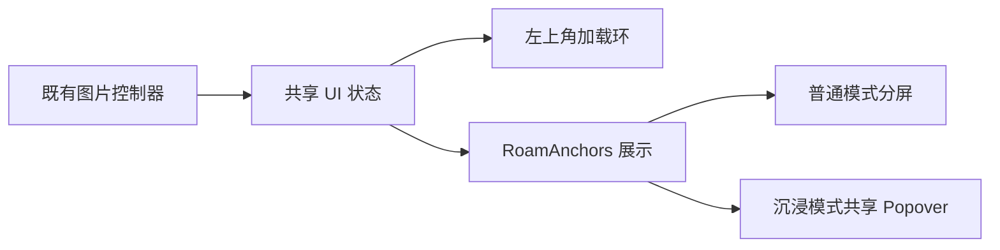
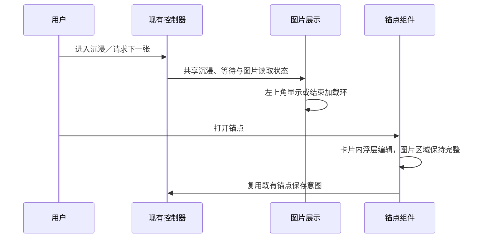

# 沉浸模式加载与浮层

## 概述

沉浸图片左上角显示加载环，底部工具栏按内容收紧，锚点使用卡片内浮层。

## 架构

## 职责边界

- 控制器发布当前图片读取状态和漫游沉浸状态，沿用既有 UI 事实通道；任务、候选、锚点保存与预取逻辑保持原职责。
- 加载环复用 Lucide 和主题；漫游覆盖等待下一张与图片读取，生成／喜欢大图覆盖图片读取。失败结束加载提示，减少动态效果时保留静态状态标识。
- RoamAnchors 共用展开状态、输入草稿、词项和保存逻辑，仅根据展示模式切换 Collapsible 与 Popover；浮层 Portal 挂在当前图片卡片内，兼容原生全屏。
- 既有沉浸控制器识别锚点浮层，打开时保持控件可见，Esc 先收起浮层，再退出沉浸。

## 调用和数据流

## 重点关注

- 普通模式保留左右分屏、手机紧凑区域与拖动比例。
- 沉浸底栏按按钮内容计算宽度；浮层限制在安全区内并支持滚动，切图和编辑不丢草稿。
- 少量隔离界面验证覆盖桌面、窄屏、全屏 Portal、键盘收起顺序、加载结束与失败；不提交真实 GPU 任务。
