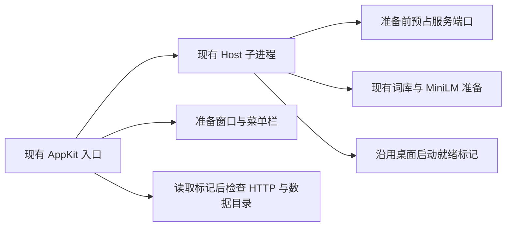
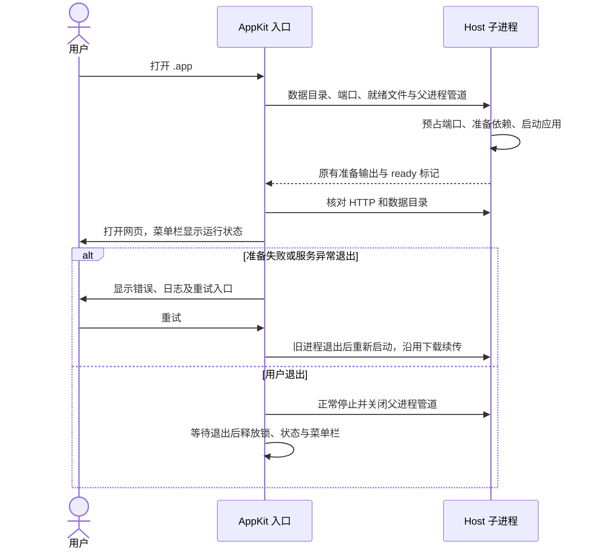

# macOS 启动与菜单栏完善

## 概述

在现有轻量 `.app` 上补齐可靠就绪、准备失败重试和准确的菜单栏状态，对齐 Windows 的启动与退出体验。

## 架构

## 职责边界

- 沿用已确认的 AppKit 入口 → Host 子进程 → HTTP / 浏览器边界；不增加业务 API、GUI 运行时或安装模块。
- Host 的 macOS 桌面子进程在准备依赖前预占端口，沿用 Windows 已有的 `PICTIDE_DESKTOP_STATUS` 文件通知机制；CLI 与其他平台保持原路径。
- AppKit 入口负责友好的准备信息、失败后重试、状态与菜单动作；重试仅在旧子进程退出后启动自己的新进程。
- 网站图标继续作为图案来源，菜单栏通过原生图像能力生成透明单色模板，系统处理明暗外观和高清缩放。

## 调用和数据流

## 重点关注

- 当前范围为启动、准备进度和菜单栏；ComfyUI 与生图模型安装不在本次范围。
- 防止旧的同目录 CLI 服务被错误识别成 `.app` 自己启动的服务；端口占用时在下载前失败。
- 服务退出即清除 ready 状态，保留最新错误尾部；失败重试复用同一日志文件，保留前次内容。
- 菜单提供打开网页或准备状态、重试、数据目录、日志和退出；地址只在服务就绪时显示。
- 正确处理 `--lan` 覆盖 `--host ::1` 后的本机地址；退出与异步就绪响应不能重新打开网页。
- 不接入 Developer ID 或公证，不修改系统设置；保留用户数据与所有外部生图服务。
- 本机为 Windows，执行少数 Python 生命周期与三平台模拟打包冒烟；将原生启动器自检加入现有 macOS 包冒烟。没有 Mac 原生编译或桌面结果时明确记录未验证，不触发额外 Actions 或版本发布。

参考：[NSImage 模板图像](https://developer.apple.com/documentation/appkit/nsimage/istemplate)。
