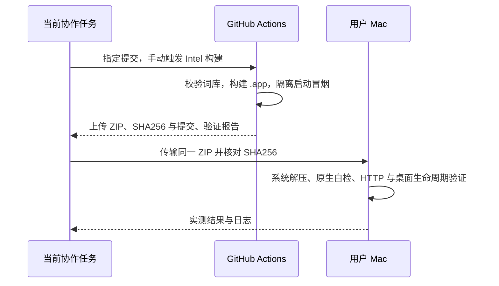

# macOS Actions 构建与实机验证

## 概述

由 GitHub Actions 构建 macOS `.app`，再将同一产物传到用户提供的 Mac 做隔离运行验证。

## 架构

## 职责边界

- 新增仅 `workflow_dispatch` 的 macOS 验证工作流，可选择 Intel 或 Apple Silicon；本次 Mac 为 Intel。
- 复用现有固定词库、Python/Node/pnpm 与构建/冒烟脚本；没有发布步骤，不修改现有标签发版工作流或版本号。
- Mac 仅用于解压和运行 Actions 产物，使用独立数据、端口和验证目录；不在 Mac 上构建。
- 验证材料放在 `dev/verification/`，最终 ZIP 放在 `releases/`。保留用户已有应用、数据、外部生图服务及系统设置。

## 调用和数据流

## 重点关注

- 日常推送仍不触发自动构建；正式发版仍由 `v*` 标签触发。手动验证只产生 Actions artifact。
- 原生 CI、Mac 运行与 Finder 下载隔离/安全提示分别记录，不将无隔离属性的 SSH 文件传输视为 Gatekeeper 首次下载验证。
- 此前在 Mac 完成的初步 Swift 编译与隔离环境检查只作为准备记录，最终包以本工作流产物为准。

## 构建问题修正

- 首次原生 Actions 构建在整包签名检查失败：`PictideService` 的原签名仍封存修改前的 bundle `Info.plist`。
- 构建在修改入口与 plist 后依次重新签名 Python 服务、新原生入口和外层 `.app`，然后执行深度严格校验；不通过校验不产出最终 ZIP。原先 PyInstaller 已签名的运行库保持原有处理。
- 三平台模拟打包冒烟同步验证签名顺序；实际结果以重新运行的原生 Actions 为准。

## 首轮原生 CI 结果（2026-10-20）

- [Intel 构建与冒烟](https://github.com/Lykr/pictide/actions/runs/39399278570)通过，源码提交为 `a578287c7460b0035151bb1999df071bf7f721e4`。
- 原生 Swift/AppKit 编译、完整 bundle 签名、系统归档/解压、framework 加载和启动器自检通过。
- 包冒烟在独立目录完成首次 MiniLM 下载、词库初始化、SQLite 完整性、HTTP/前端资源、桌面 worker 就绪与父管道关闭后退出；未配置生图后端或提交 GPU 任务。
- 产物由仅手动触发的验证工作流保存，未创建版本标签或 Release。

## 首轮实机检查与退出修正

- 同一 ZIP 在用户 Intel Mac（macOS 15.7.9）通过校验和、系统解压、完整签名、Python/framework 加载、原生入口自检与隔离 HTTP 检查；原生 AppKit 入口也成功就绪、打开网页，重复启动复用已有服务。
- 正常退出时发现服务的父管道监视线程持有 `sys.stdin.buffer` 的锁，Python 解释器关闭 stdin 时触发 `_enter_buffered_busy`，原生入口也未在验证时限内退出。
- 监视线程改为从现有 stdin 文件描述符调用 `os.read`，保持同一 EOF → SIGTERM 机制，避免持有 Python 缓冲 IO 锁；新增父管道仍打开时服务正常退出的真实进程冒烟。
- 修复包继续由 Actions 构建后传回 Mac 验证。测试未更改系统设置；浏览器 Automation 未获授权，不申请授权或修改权限。

## 原生入口退出修正

- 第二轮包（`5568f95`）通过原生 CI 与实机启动；Python 服务退出时不再出现缓冲锁错误，但原生入口仍停在等待退出阶段。
- AppKit 的 [terminateLater](https://developer.apple.com/documentation/appkit/nsapplication/terminatereply/terminatelater) 会运行模态 run loop。SIGTERM 的主 dispatch 回调调用 `terminate` 后，服务退出处理再次排入同一主 dispatch 队列，无法及时执行退出回复。
- 服务退出回调改为投递到主 run loop 的默认与模态模式，并唤醒 run loop，继续沿用 `terminateLater` / `reply` 的正常收尾。启动器自检补充模态模式下处理进程退出的检查。

## 最终验证（2026-10-20）

- [最终 Intel Actions 构建](https://github.com/Lykr/pictide/actions/runs/39402269159)全部通过，源码为 `b058b9fef1d5d89287710e42f6c6868af48cb0dc`，包含 10 项原生启动器自检、首次 MiniLM 下载和包启动冒烟。
- 同一 ZIP 经 SHA-256 核对后，在用户 Intel Mac / macOS 15.7.9 上通过系统解压、签名、framework 加载、原生自检、独立数据初始化与 HTTP/前端资源检查。实机使用经校验的已有 MiniLM，不重复下载。
- 真实 AppKit 入口成功启动、打开网页；同数据目录重复启动退出码为 0，服务进程保持同一个。对原生入口发送 SIGTERM，经过其正常退出处理后入口退出码为 0，服务退出、端口关闭，实例文件与就绪标记均清除。
- 独立端口被占用时，在依赖准备前退出服务，原生入口保留失败状态；没有模型文件或运行数据库产生，退出失败窗口后没有自有进程残留。最终测试没有使用强制结束进程。
- 未验证：Apple Silicon 包、Finder 首次下载隔离/Gatekeeper 流程、菜单明暗外观、按钮点击与失败后手动重试；未配置生图后端或提交 GPU 任务。旧 v0.4.0 包的加载错误原因仍未查明，不将新包成功等同于旧包故障已定位。
- 浏览器 Automation 未获授权，保留系统权限；测试网页需用户手动关闭。其他应用、个人运行数据和系统设置保持原状。

最终包 `releases/pictide-0.4.0-darwin-x86_64.zip`：72,464,727 字节，SHA-256 为 `6e2ce5fb4f4e912e03630903cc9e4cffd49aef1ab8ffdda697c207fb30a1e11d`。报告与证据保存在 `dev/verification/macos-native-20261020/actions-39402269159/`；Mac 中的同一包位于本次隔离验证目录，未安装到「应用程序」。本次未打标签或发布 Release。
