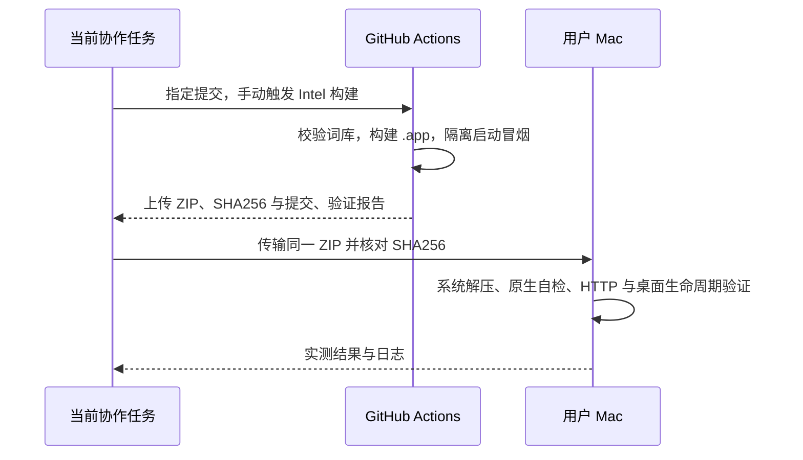

# macOS Actions 构建与实机验证

## 概述

由 GitHub Actions 构建 macOS `.app`，再将同一产物传到用户提供的 Mac 做隔离运行验证。

## 架构

## 职责边界

- 新增仅 `workflow_dispatch` 的 macOS 验证工作流，可选择 Intel 或 Apple Silicon；本次 Mac 为 Intel。
- 复用现有固定词库、Python/Node/pnpm 与构建/冒烟脚本；没有发布步骤，不修改现有标签发版工作流或版本号。
- Mac 仅用于解压和运行 Actions 产物，使用独立数据、端口和验证目录；不在 Mac 上构建。
- 验证材料放在 `dev/verification/`，最终 ZIP 放在 `releases/`。保留用户已有应用、数据、外部生图服务及系统设置。

## 调用和数据流

## 重点关注

- 日常推送仍不触发自动构建；正式发版仍由 `v*` 标签触发。手动验证只产生 Actions artifact。
- 原生 CI、Mac 运行与 Finder 下载隔离/安全提示分别记录，不将无隔离属性的 SSH 文件传输视为 Gatekeeper 首次下载验证。
- 此前在 Mac 完成的初步 Swift 编译与隔离环境检查只作为准备记录，最终包以本工作流产物为准。

## 构建问题修正

- 首次原生 Actions 构建在整包签名检查失败：`PictideService` 的原签名仍封存修改前的 bundle `Info.plist`。
- 构建在修改入口与 plist 后依次重新签名 Python 服务、新原生入口和外层 `.app`，然后执行深度严格校验；不通过校验不产出最终 ZIP。原先 PyInstaller 已签名的运行库保持原有处理。
- 三平台模拟打包冒烟同步验证签名顺序；实际结果以重新运行的原生 Actions 为准。
