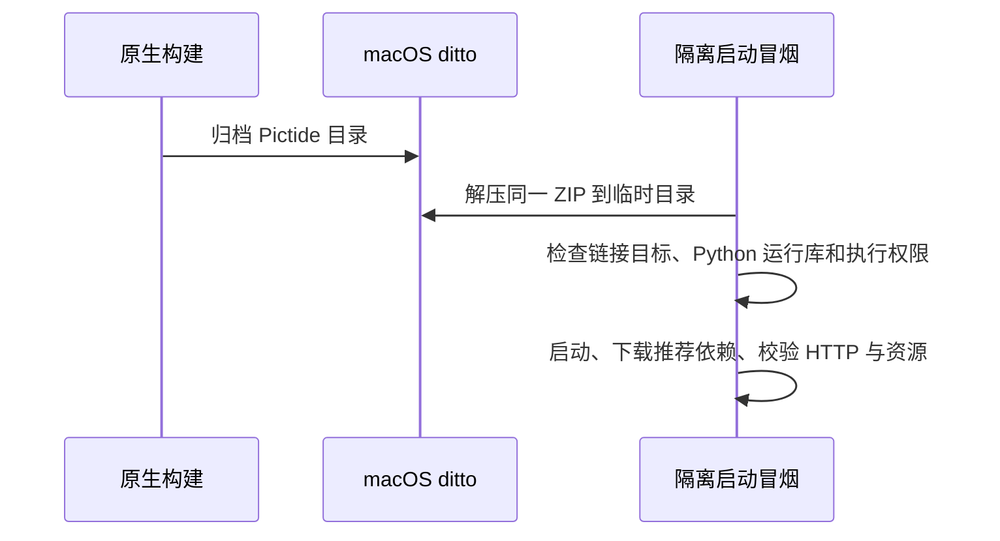

# macOS 便携包原生归档验证

## 概述

macOS 便携包改用系统 `ditto` 归档和解压冒烟，验证 Python.framework 的链接与实际启动，补齐首次安全提示说明。

## 架构

## 职责边界

- `scripts/build_portable.py`：macOS 使用 `/usr/bin/ditto -c -k --keepParent` 保存原生目录，Windows/Linux 沿用现有归档。
- `scripts/smoke_portable.py`：macOS 调用系统解压工具，不通过自写代码重建符号链接；随后验证归档中的链接、Python 运行库和现有 HTTP 启动路径。
- 用户指南：说明首次启动的 Gatekeeper 提示和包内缺文件时的重新解压路径；安全决策由用户按系统提示操作。
- 保持应用模块、启动参数、数据目录和仅版本标签触发 Actions 的约定。

## 调用和数据流

## 重点关注

- 用户在 v0.4.0 中通过 Finder 解压后，启动器报 `_internal/Python` 不存在；发布 ZIP 内存在该符号链接及其实际 Python.framework 文件，用户端具体缺失层级待核实。
- 原 CI 冒烟由自写解压逻辑恢复链接，不能证明系统解压行为正确。本次先补齐这一验证缺口，原生结果通过后再交付修订版本。
- `start.command` 和内部程序分别接受 Gatekeeper 检查；当前无 Developer ID 签名及 Apple 公证，本次不自动清除隔离属性、不修改系统安全设置。
- `ditto` 命令行验证与用户从浏览器下载后通过 Finder 首次启动分别记录，不混称完成桌面安装验证。
- 保留 v0.4.0 标签与资产，修订包使用新版本。

参考：[Apple ZIP 分发](https://developer.apple.com/documentation/xcode/packaging-mac-software-for-distribution)、[PyInstaller 符号链接要求](https://pyinstaller.org/en/stable/common-issues-and-pitfalls.html#requirements-imposed-by-symbolic-links-in-frozen-application)。
