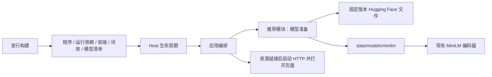
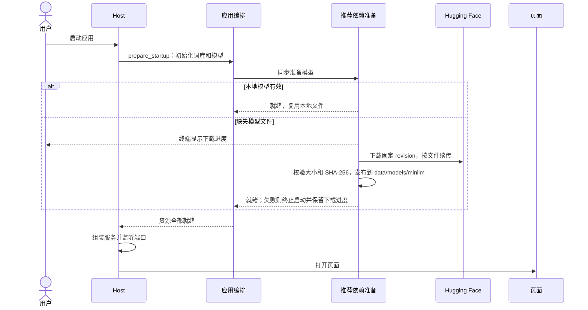

# MiniLM 首次启动下载

## 概述

便携包只携带 MiniLM 的固定下载清单，启动时下载并校验模型，准备完成后再启动服务和打开页面，后续启动复用本地文件。

## 架构

## 职责边界

- 发行构建：导出词库和固定模型清单；移除构建阶段模型下载、模型文件复制和 `--models-dir` 参数，保留 FastEmbed、ONNX Runtime、tokenizer 等运行依赖及许可证声明。
- 推荐模块：在 `backend/recommand/model.json` 唯一维护模型来源、revision、文件大小与 SHA-256；`prepare_model(directory)` 同步准备模型，使用 `.part` 续传并在校验后原子发布文件。编码器继续只读取本地文件并执行 CPU 推理。
- 应用编排：沿用 `prepare_startup(paths, seed_dir)`，先补齐便携词库，再调用模型准备入口；全部成功后返回 Host。下载失败向启动入口报告错误。
- Host：准备成功后才组装服务、监听端口并打开浏览器；下载期间终端显示进度，下载失败返回非零退出码，下次启动续传。
- 数据目录：模型落在所选 `data/models/minilm/`，构建与测试均使用独立数据；完整有效的本地模型复用。需要替换无效已有文件时先备份，个人记录保留。

## 调用和数据流

## 重点关注

- 用户已明确确认先完成模型下载再进入应用；本修订据此实施。
- 模型准备完成前不监听 HTTP、不打开页面；下载失败保留用户数据和部分下载，报告错误，下次启动重试。
- 源码和便携启动共用准备流程，离线环境可按文档预放模型；已有完整模型继续复用，不在运行中切换用户模型。
- 模型来源与校验信息由推荐模块唯一维护；离线 corpus 工具继续只处理词库，线上启动不导入 corpus。
- Actions 保持复用已发布词库；更新真实便携包冒烟，覆盖首次下载、再次启动复用与下载失败保留数据；不提交 GPU 生图任务。
- 同步双语 README、安装指南、架构/数据文档和构建说明；记录模型移出后实测的 ZIP 体积。

## 交付与验证

- 2026-10-19：发行构建已移除模型下载与权重复制，模型清单迁至推荐模块；启动入口在模型准备失败时返回非零状态，HTTP 和浏览器均未启动。
- Windows x64 ZIP 从 154,577,659 B（147.4 MiB）降至 71,512,905 B（68.2 MiB），减少约 53.7%。本地产物：`releases/minilm-startup-download-20261019/`。
- 5 项词库、4 项便携启动与 3 项模型准备冒烟通过；真实 ZIP 解压启动、模型文件校验、词库和静态资源可用性检查通过。
- 真实打包程序完成 tokenizer 续传及配套配置下载，确认下载期间 HTTP 端口保持关闭；该验证复用了已校验的本地公开 ONNX，未重复下载完整权重。完整模型再次准备时未请求网络。
- 验证实例已关闭；无 GPU 生图任务。记录位于 `dev/verification/minilm-startup-20261019/`，Linux/macOS 原生验证待实际运行。
