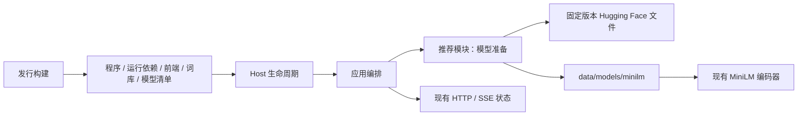
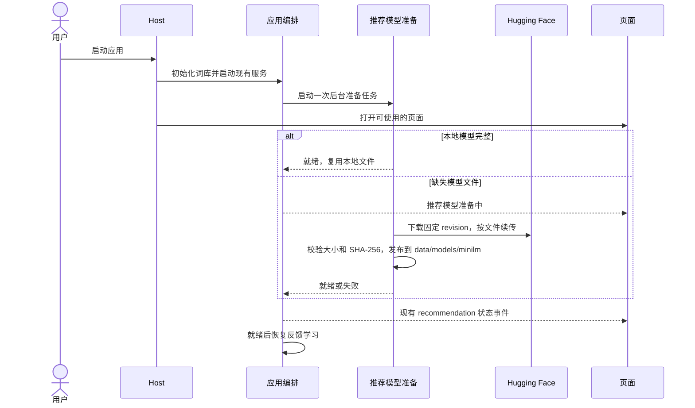

# MiniLM 首次启动下载

## 概述

便携包只携带 MiniLM 的固定下载清单，应用首次启动时后台下载模型，后续启动复用所选数据目录中的本地文件。

## 架构

## 职责边界

- 发行构建：导出词库和固定模型清单；移除构建阶段模型下载、模型文件复制和 `--models-dir` 参数，保留 FastEmbed、ONNX Runtime、tokenizer 等运行依赖及许可证声明。
- 推荐模块：维护唯一的模型来源、revision、文件大小与 SHA-256；提供异步模型准备入口，按需下载缺失文件，使用 `.part` 续传并在校验后原子发布文件。编码器继续只读取本地文件并执行 CPU 推理。
- 应用编排：在现有启动/停止生命周期内管理一次模型准备任务；模型准备成功后唤醒反馈学习，通过现有 `recommendation` 事件刷新页面。退出时停止下载并保留可续传文件。
- 浏览器：沿用推荐可用状态与错误字段，展示准备中或下载失败；模型准备期间可浏览和配置应用，生成沿用现有推荐不可用时的降级行为，反馈继续保存。
- 数据目录：模型落在所选 `data/models/minilm/`，构建与测试均使用独立数据；完整的用户已有模型继续使用，个人记录保留。

## 调用和数据流

## 重点关注

- 页面启动与模型下载并行；模型下载失败时保留可使用的页面与反馈，显示错误，下次启动自动重试。
- 源码和便携启动共用准备流程，离线环境可按文档预放模型；已有完整模型继续复用，不在运行中切换用户模型。
- 模型来源与校验信息由推荐模块唯一维护；离线 corpus 工具继续只处理词库，线上启动不导入 corpus。
- Actions 保持复用已发布词库；更新真实便携包冒烟，覆盖首次下载、再次启动复用与下载失败保留数据；不提交 GPU 生图任务。
- 同步双语 README、安装指南、架构/数据文档和构建说明；记录模型移出后实测的 ZIP 体积。
