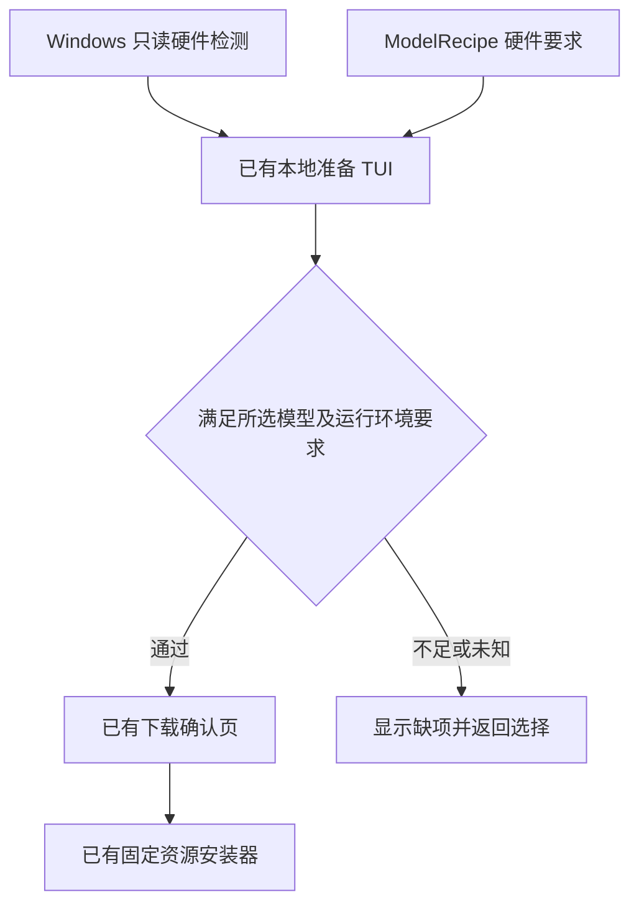
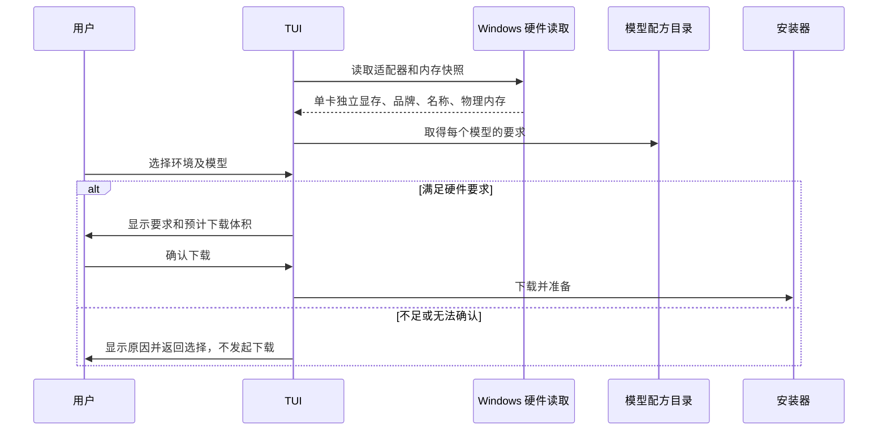

# 默认模型的下载前硬件检查

## 概述

每个默认模型配方声明硬件要求，在下载任何该模型环境资源前检查，通过后才允许继续。

状态：硬件准入已实现，针对性检查、原生 EXE 终端交互及便携包隔离启动通过。沿用既有 TUI、模型配方与安装器边界。

## 架构

## 职责边界

- `windows_hardware.py` 属于 Windows 准备界面的内部实现：读取 DXGI 适配器名称、品牌、独立显存，优先读取装机内存，失败时回退可用物理内存总量；不把共享内存当作显存，不合并不同显卡容量，不安装工具或修改系统。
- `ModelRecipe` 必须携带硬件要求，`recipe_catalog()` 继续用既有字典传递元数据；缺失要求的配方不进入可下载目录。要求覆盖独立显存、系统内存和可选运行环境。
- TUI 在选择模型后、显示下载确认前检查，安装器调用 `hardware_issues()` 再读取并复检，检查通过才调用下载函数。所选环境与实际显卡匹配后，按单张显卡的显存判断；目前未绑定 ComfyUI 执行卡，多张同品牌显卡采用最小独立显存，任一容量未知即阻止，避免通过较大显存卡检查却在默认小显存卡运行。不足、无对应显卡或检测失败均阻止模型下载，不提供忽略检查继续下载的入口。
- 保留仅安装 ComfyUI、已有生图 API、稍后配置的现有路径；CPU 环境不满足要求独立显卡的默认模型。已有外部 API 不受本地模型下载检查影响。
- 候选、推荐、任务、生图协议与应用 HTTP 接口保持既有职责；不新增前端硬件接口。

## 调用和数据流

## 重点关注

- Anima 官方未声明明确最低显存；当前配方的 Pictide 下载策略为 **8 GiB 独立显存、16 GiB 装机内存**，支持所选 NVIDIA、NVIDIA CUDA 12.6、AMD、Intel 环境与实际品牌匹配。它针对固定 832×1248、10 步、CFG 1 工作流，不标为官方最低要求。当前 12 GB/32 GB 机器真实链路已有记录；8 GB 实体显卡及 AMD/Intel 的实际生图仍待验证。
- DXGI 的独立显存可能略低于显卡标称容量，本机 RTX 4070 Ti 返回约 11.71 GiB。容量比较按最近整数 GiB 档位取整，最多容许 512 MiB 的硬件/驱动预留；7.49 GiB 判为 7 GB，7.8 GiB 判为 8 GB。共享内存始终不计入。
- 通过静态硬件检查不能保证驱动、其他程序占用和所有运行时状态；接入前仍保留既有只读工作流预检。
- 针对性验证覆盖容量边界、检测未知、手动环境不匹配、多卡不相加、不同模型要求、被阻止时安装回调零调用。物理低显存硬件与预算模拟分开记录。
- 14 项针对性检查通过，覆盖 DXGI 64 位容量、独立/共享内存区分、装机内存回退、未知/不足硬件、手动环境匹配、各模型独立门槛及安装器二次检查；阻止时下载函数零调用。本机只读检测为 RTX 4070 Ti、12 GB 档位独立显存、32 GB 装机内存。本轮空闲显存约 1.5 GB，保留其他程序状态，未进行受限预算或额外 GPU 出图测试。
- 真实打包 EXE 的交互终端显示 12 GB 显存 / 32 GB 内存及模型的 8 GB / 16 GB 要求，可以进入确认页；切到 CPU 环境后，选择 Anima 被阻止并返回模型页。取消退出后确认没有下载目录、受管 ComfyUI 或模型文件。
- 类型检查、构建和新包隔离启动冒烟通过。Windows ZIP 为 **69,183,060 字节**，SHA256 为 `030e03cae33851cd8021c1fd9655a9bd2eec869601375313b76019a4d2165f6f`；本次未发布新 tag 或 Release。

参考：[Anima 官方模型说明](https://huggingface.co/circlestone-labs/Anima)、[DXGI 独立显存定义](https://learn.microsoft.com/en-us/windows/win32/api/dxgi/ns-dxgi-dxgi_adapter_desc)、[ComfyUI 硬件要求](https://docs.comfy.org/installation/system_requirements)。
