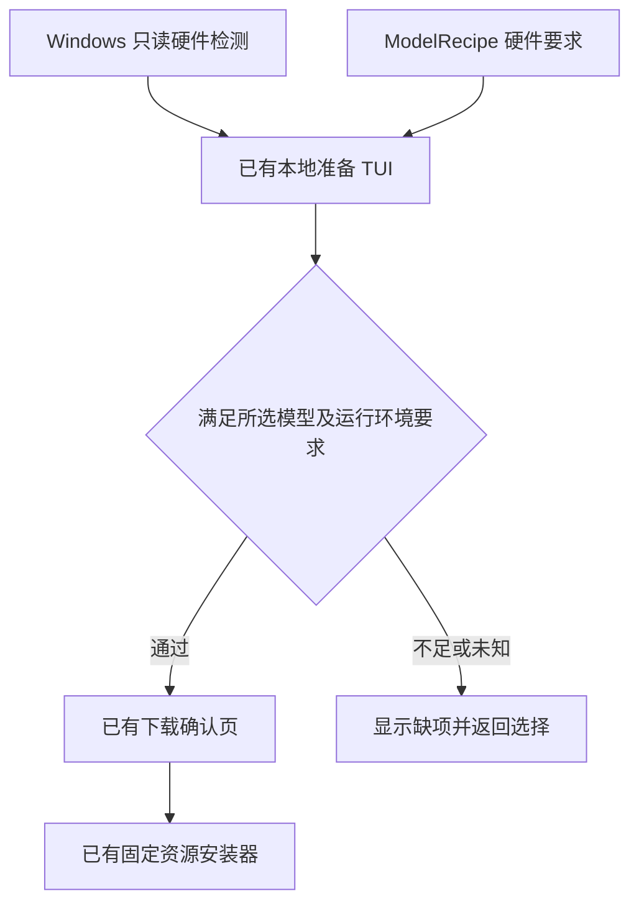
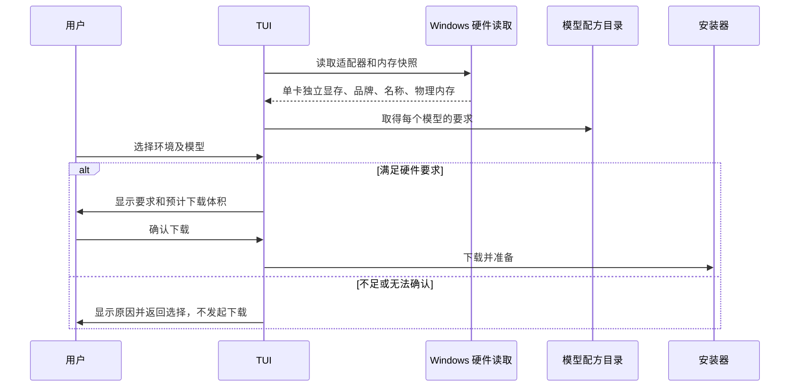

# 默认模型的下载前硬件检查

## 概述

每个默认模型配方声明硬件要求，在下载任何该模型环境资源前检查，通过后才允许继续。

状态：按用户确认的硬件准入要求实现中，沿用既有 TUI、模型配方与安装器边界。

## 架构

## 职责边界

- 硬件检测属于 Windows 准备界面的内部实现：读取 DXGI 适配器名称、品牌、独立显存和系统物理内存；不把共享内存当作显存，不合并不同显卡容量，不安装工具或修改系统。
- `ModelRecipe` 必须携带硬件要求，`recipe_catalog()` 继续用既有字典传递元数据；缺失要求的配方不进入可下载目录。要求覆盖独立显存、系统内存和可选运行环境。
- TUI 在选择模型后、显示下载确认前检查。所选环境与实际显卡匹配后，按单张匹配显卡的显存判断；不足、无对应显卡或检测失败均阻止模型下载，不提供忽略检查继续下载的入口。
- 保留仅安装 ComfyUI、已有生图 API、稍后配置的现有路径；CPU 环境不满足要求独立显卡的默认模型。已有外部 API 不受本地模型下载检查影响。
- 候选、推荐、任务、生图协议与应用 HTTP 接口保持既有职责；不新增前端硬件接口。

## 调用和数据流

## 重点关注

- Anima 官方未声明明确最低显存；门槛是 Pictide 针对固定默认工作流的下载策略，不标为官方最低要求。先验证 832×1248、10 步、CFG 1 工作流的受限显存预算，再记录最终门槛及验证边界。
- 通过静态硬件检查不能保证驱动、其他程序占用和所有运行时状态；接入前仍保留既有只读工作流预检。
- 针对性验证覆盖容量边界、检测未知、手动环境不匹配、多卡不相加、不同模型要求、被阻止时安装回调零调用。物理低显存硬件与预算模拟分开记录。

参考：[Anima 官方模型说明](https://huggingface.co/circlestone-labs/Anima)、[DXGI 独立显存定义](https://learn.microsoft.com/en-us/windows/win32/api/dxgi/ns-dxgi-dxgi_adapter_desc)、[ComfyUI 硬件要求](https://docs.comfy.org/installation/system_requirements)。
