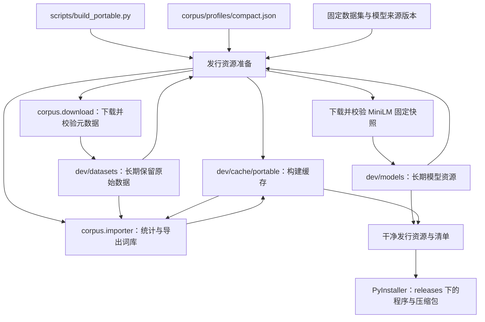
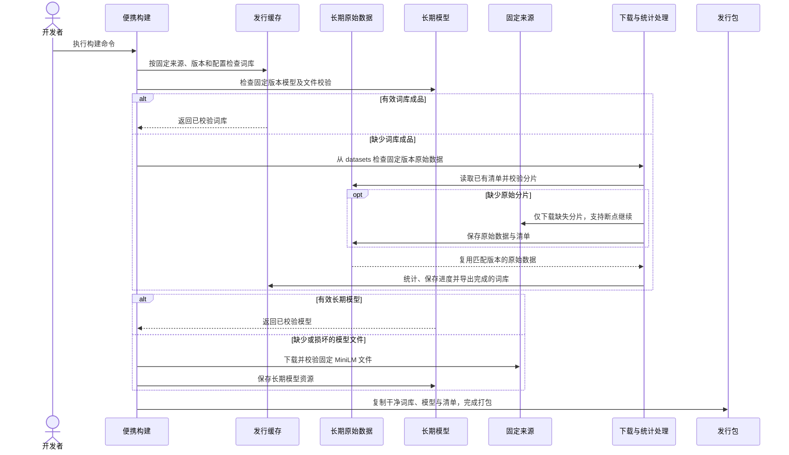

# 独立发行资源与构建缓存

## 概述

便携构建独立准备词库与 MiniLM，有效词库缓存与长期模型直接复用，缺失时自动下载并构建，全新检出可完成发行构建。

状态：用户已确认并实施；便携构建使用独立发行资源，替代原先读取个人运行数据目录的方式。验证范围按实际交付记录，完整真实数据统计与各平台原生打包分别报告。

## 架构



## 职责边界

| 组成 | 接口及职责 |
| --- | --- |
| 便携构建脚本 | 原始数据默认使用已有 `dev/datasets/danbooru-2026/`，构建缓存使用 `dev/cache/portable/`，长期模型使用 `dev/models/`；提供 `--dataset-dir PATH`、`--cache-dir PATH`、`--models-dir PATH`、`--profile PATH` 与现有 `--output-dir PATH`。移除 `--source-data-dir`，不读取个人词库选择、图片、偏好、密钥或模型目录。前端构建仍沿用现有准备步骤。 |
| 发行资源准备 | `prepare_resources(dataset_dir, cache_dir, profile, *, models_dir=ROOT / 'dev/models')` 返回已校验词库、模型路径及来源信息。命中词库缓存和长期模型直接导出，缺失或无效时准备对应资源。固定来源纳入 `corpus/resources.json`，记录数据集 10 个分片和模型 5 个文件的版本、字节数与 SHA-256；资源准备实现位于 `corpus/portable.py`。生成随包 `resources/` 和来源、参数及校验清单。 |
| `corpus.download` / `corpus.importer` | 继续负责元数据下载、断点与统计处理；原始分片及下载清单长期保留在 datasets，完整且版本匹配时从本地读取，仅补齐缺失分片。统计中间结果与成品放构建缓存。离线源码及其依赖留在 `corpus/`，首次构建依赖纳入开发构建环境，运行发行包无需安装数据处理依赖。 |
| 模型准备 | 按固定 MiniLM 快照下载现有编码器需要的五个文件；校验文件后长期保存在 `dev/models/minilm/<model-revision>/`。只准备推荐模型，生图模型仍由用户选用的服务提供。 |
| 运行时资源初始化 | 继续使用包内种子，补齐用户所选数据目录中缺失的文件；不在应用启动时下载或统计原始数据。 |

目录布局：

```text
dev/datasets/danbooru-2026/          长期保留，复用当前已有目录
  raw/                              原始 Parquet
  download.sqlite3                  下载清单、版本、校验与断点记录

dev/cache/portable/                 可重建的构建缓存
  libraries/<fingerprint>/
    state.sqlite3                   统计中间结果与进度
    vocabulary.sqlite3              已完成的干净词库
    report.json                     来源、处理参数、数量及校验

dev/models/                        长期保留的模型资源
  minilm/<model-revision>/           五个模型及 tokenizer 文件，校验信息在 corpus/resources.json
```

- 词库指纹包含源数据身份及固定版本、规范化后的处理配置、`corpus.importer` 代码和处理依赖版本；配置或统计逻辑变化使用新缓存目录。JSON 缩进、字段顺序和排除标签顺序变化不改变语义。命中时校验成品文件 SHA-256，文件损坏则重新准备。
- 原始数据按清单记录的固定版本复用，保持现有分片路径；不为了接入新构建流程搬迁、复制或重新下载完整数据。版本不匹配时明确报错并允许通过 `--dataset-dir` 指定对应版本，不覆盖已有原始数据。
- 词库参数调整或清理构建缓存后，重新统计直接复用 datasets。完整且版本匹配的本地原始数据可离线重建词库；有效成品与长期模型齐备时也不请求网络。
- 成品命中要求完成标记、匹配指纹及有效文件校验。未完成输出不作为可发布资源，保留可恢复的下载与统计进度。
- `dev/` 已被 Git 忽略；PyInstaller 的临时构建仍放 `dev/build/`，最终包继续放 `releases/`。原始数据、模型和缓存目录可分别指向其他磁盘或 CI 持久目录，清理缓存保留 datasets 和 models。

先按 [Windows](../setup/windows.md#构建便携包)、[Linux](../setup/linux.md#构建便携包) 或 [macOS](../setup/macos.md#构建便携包) 准备前端和独立 Python 3.11+（推荐 3.12）的 `dev/runtime/builder/` 环境，安装 `backend/requirements-release.txt`（包括离线处理依赖）。以下 `python` 指该构建环境解释器，构建过程不使用开发运行目录 `data/`。

默认构建命令：

```shell
python scripts/build_portable.py
```

换用已有数据、共享缓存或其他规格：

```shell
python scripts/build_portable.py --dataset-dir DATASET_PATH --cache-dir CACHE_PATH --models-dir MODELS_PATH --profile corpus/profiles/compact.json
```

## 调用和数据流



## 重点关注

- 默认精简规格沿用当前 `compact.json`：普通词最低出现 100 次，排除 `questionable` / `explicit` 标签，共现最低 1,000 次；评级对应的原始记录仍参与统计。
- 全新环境缺少原始数据时需要下载并完成统计；清空构建缓存时 datasets 和 models 保留，直接本地重新统计，无需下载已有原始数据和模型。输出阶段进度并支持中断后继续。
- 不自动清理其他规格或旧版本缓存；开发者可单独管理 `dev/cache/portable/`，发行数据不与运行中的 `data/` 混用。
- 验证用小型中性数据与模拟下载覆盖首次下载、暖缓存零网络、清理缓存后复用原始数据、配置变化及损坏/中断缓存；保留原有便携初始化冒烟。全量真实数据处理与原生打包分别报告执行结果。

## 交付与验证（2026-10-19）

- `corpus/portable.py` 准备独立资源，`corpus/resources.json` 固定源数据与模型清单；`scripts/build_portable.py` 使用新目录参数，随包清单和构建报告记录来源、指纹及处理参数。
- 7 项定向冒烟通过：3 项资源缓存及恢复、3 项原有资源初始化与启动、1 项完整打包衔接。衔接验证使用真实导出、清单及 ZIP，但模拟 PyInstaller 输出；尚未重新构建原生发行包。
- 真实固定版 MiniLM 已下载到独立 `dev/models/`，完成 SHA-256 校验和两个中性词的 CPU 离线编码；中性词库配合真实模型的后续准备在禁用网络时命中缓存。
- 本地原始数据清单的 10 个分片与发行锁定清单一致，原始路径保留。本次未重新下载或全量统计约 6.25 GB 的原始数据；完整词库构建及新版原生包需按新流程单独执行。
