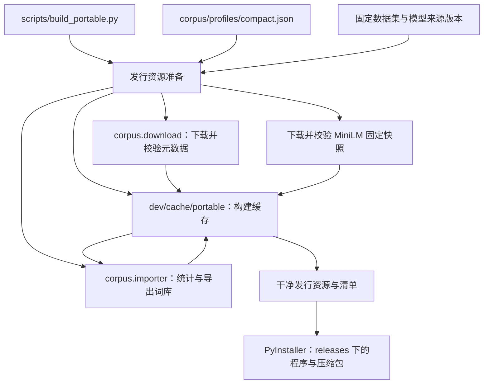
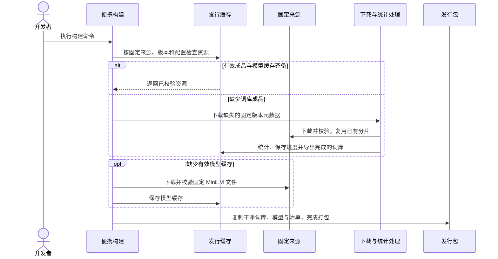

# 独立发行资源与构建缓存

## 概述

便携构建独立准备词库与 MiniLM，有效缓存直接复用，缺失时自动下载并构建，全新检出可完成发行构建。

状态：待用户确认，尚未实现；替代现有打包时读取个人运行数据目录的方式。

## 架构



## 职责边界

| 组成 | 接口及职责 |
| --- | --- |
| 便携构建脚本 | 默认使用仓库 `dev/cache/portable/`；提供 `--cache-dir PATH`、`--profile PATH` 与现有 `--output-dir PATH`。移除 `--source-data-dir`，不读取个人词库选择、图片、偏好、密钥或模型目录。前端构建仍沿用现有准备步骤。 |
| 发行资源准备 | 检查成品词库和模型缓存；命中直接导出，缺失或无效时准备对应资源。固定来源、版本与模型文件清单纳入源码。生成随包 `resources/` 和来源、参数及校验清单。 |
| `corpus.download` / `corpus.importer` | 继续负责元数据下载、断点与统计处理；离线源码及其依赖留在 `corpus/`。构建流程复用现有能力，首次构建依赖纳入开发构建环境，运行发行包无需安装数据处理依赖。 |
| 模型准备 | 按固定 MiniLM 快照下载现有编码器需要的五个文件；校验文件后缓存。只准备推荐模型，生图模型仍由用户选用的服务提供。 |
| 运行时资源初始化 | 继续使用包内种子，补齐用户所选数据目录中缺失的文件；不在应用启动时下载或统计原始数据。 |

建议缓存布局：

```text
dev/cache/portable/
  sources/danbooru/<source-revision>/
    raw/                            原始 Parquet
    download.sqlite3                下载校验与断点记录
  libraries/<fingerprint>/
    state.sqlite3                   统计中间结果与进度
    vocabulary.sqlite3              已完成的干净词库
    report.json                     来源、处理参数、数量及校验
  models/minilm/<model-revision>/    五个模型及 tokenizer 文件与校验记录
```

- 词库指纹包含源数据身份及固定版本、规范化后的配置、处理程序版本；配置或算法变化使用新缓存目录。
- 原始数据和模型按固定版本复用，词库参数调整无需重新下载；有效成品与模型缓存齐备时不请求网络。
- 成品命中要求完成标记、匹配指纹及有效文件校验。未完成输出不作为可发布资源，保留可恢复的下载与统计进度。
- `dev/` 已被 Git 忽略；PyInstaller 的临时构建仍放 `dev/build/`，最终包继续放 `releases/`。缓存根目录可通过参数指向其他磁盘或 CI 持久缓存。

默认构建命令：

```shell
python scripts/build_portable.py
```

换用共享缓存或其他规格：

```shell
python scripts/build_portable.py --cache-dir PATH --profile corpus/profiles/compact.json
```

## 调用和数据流



## 重点关注

- 默认精简规格沿用当前 `compact.json`：普通词最低出现 100 次，排除 `questionable` / `explicit` 标签，共现最低 1,000 次；评级对应的原始记录仍参与统计。
- 首次冷构建需要下载数据并完成统计，耗时与磁盘占用明显高于缓存构建；输出阶段进度并支持中断后继续。
- 不自动清理其他规格或旧版本缓存；开发者可单独管理 `dev/cache/portable/`，发行数据不与运行中的 `data/` 混用。
- 验证用小型中性数据与模拟下载覆盖冷缓存、暖缓存零网络、配置变化及损坏/中断缓存；保留原有便携初始化冒烟。全量真实数据处理与原生打包分别报告执行结果。
