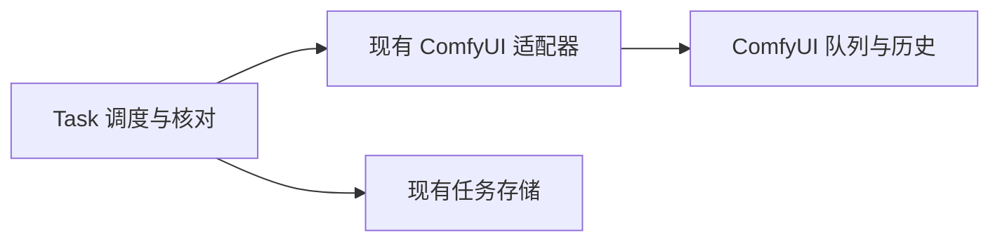
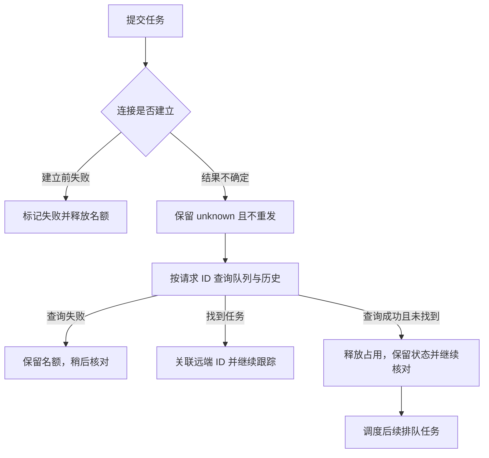

# 漫游队列的断连恢复

## 概述

修复 ComfyUI 断连后旧的不确定任务长期占满生成名额，使新漫游任务一直排队的问题。

## 架构

## 职责边界

- 保持现有模块和接口；ComfyUI 适配器区分连接建立失败与请求发出后结果不确定。
- Task 核对远端记录后管理名额；Store 沿用 `finish_dispatch`，保留任务、图片与反馈记录。
- 本次为现有边界内的内部修复，不增加 API、数据库字段或前端交互。

## 调用和数据流

## 重点关注

- `ClientConnectorError` 表示 HTTP 请求尚未发出；超时、连接中断、服务端错误和无效成功响应仍按不确定结果处理。
- 成功查询未找到只表示当前队列和可查询历史没有记录，不将旧任务改为已完成或重新排队；后续发现迟到记录仍可关联并保存结果。
- 已知仍在远端排队或执行的任务保留名额；远端不可达时继续保留占用，避免仅凭本地等待时间推断结果。
- 启动恢复复用同一核对逻辑，解决已有数据中的占用，不编写专项数据迁移。
- 使用隔离 SQLite 与模拟后端覆盖断连、查询失败、两个旧占用、重启恢复和迟到结果；部署前备份运行数据库，检查任务后重启，验证当前用户队列恢复。

## 验证

- 2026-10-20：通过 11 个定向冒烟，使用本机模拟 HTTP、临时 SQLite 与中性图片样例；未为回归测试创建真实 GPU 任务。
- 覆盖连接被拒绝、超时与 HTTP 错误的确定性分类；两个旧不确定任务在启动后释放名额；重复重启不重提；查询失败保留占用、确认缺失后补位、迟到结果恢复；已知运行与取消任务保持占用及原有结果保存行为。
- 运行目录部署后由同一启动核对流程恢复用户已有排队任务，保留历史任务状态与数据，无需手工改表。
- 本地源码已部署并通过托盘退出动作平滑重启，运行数据库已做 SQLite 一致性备份并通过完整性检查。旧的两个不确定占用自动释放，状态记录保留；原先排队的两个用户任务均已实际生成完成。外部 ComfyUI 进程保持运行，本次未新增验证用 GPU 任务。
- 前端源码与构建产物保持现有版本；本次仅部署后端修复，未构建便携包或发布新版本。
