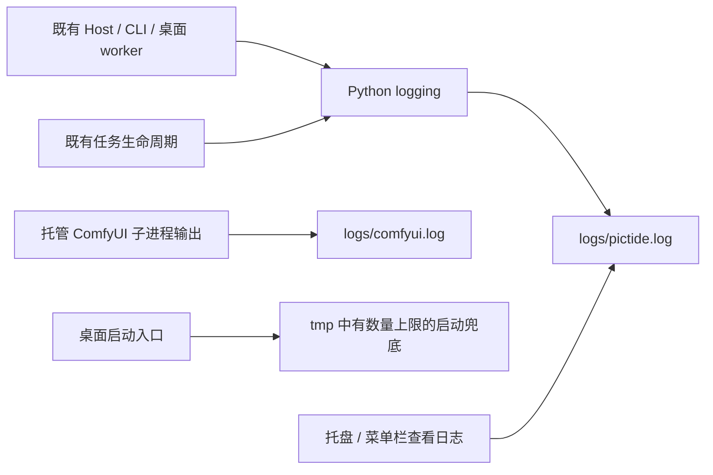
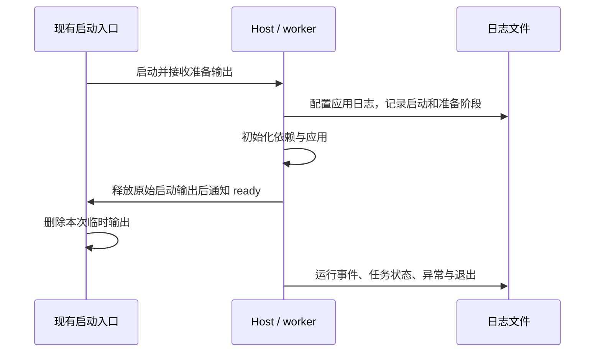

# 运行日志整理

## 概述

统一启动、运行与异常日志，托管 ComfyUI 单独轮换，日志入口直接打开当前应用日志。

## 架构

## 职责边界

- 保持 Host、应用、任务与生图服务的现有业务边界；日志工具只负责格式、轮换、异常记录和启动输出收尾。
- `backend/runtime_logging.py` 提供 `make_log_handler(path)`，统一 UTF-8、每份 1 MiB、保留 3 份备份；应用默认 INFO，通过 `PICTIDE_LOG_LEVEL=DEBUG` 启用调试。保留外部日志配置，不开启 HTTP 访问日志。
- 主进程与线程未处理异常、asyncio 与 HTTP 服务异常进入应用日志，异常保留调用栈。日志格式包含时间、级别、PID、模块；任务事件包含任务 ID、后端 ID/类型、耗时和失败信息，避免写入提示词、密钥及请求正文。
- ComfyUI 的 stdout/stderr 通过所属进程的读取线程写入独立轮换日志，结束时排空并释放文件；外部 ComfyUI 不创建该日志。
- 桌面 worker 在就绪前沿用原启动输出和状态通知；就绪通知前调用 `finish_desktop_output()` 将原始 stdout/stderr 转向空输出，释放临时输出文件。运行异常由 Python 日志处理。父启动进程在创建 worker 前释放自身的应用日志句柄，避免父子轮换冲突。
- macOS 启动输出改到 `tmp/macos-startup-<UUID>.log`；成功后关闭父进程持有的输出文件并删除，失败仅保留最近 3 份。运行后异常摘要读取 `logs/pictide.log` 的尾部。Windows 使用同样的临时兜底策略。
- Windows 由启动器读取 worker 输出管道并写入 `tmp/desktop-output-*.log`，限制单份 1 MiB；避免虚拟环境转发进程继承并长期占用日志文件。成功删除本次文件，失败最多保留 3 份；旧命名的历史材料保持原样。

## 调用和数据流

## 重点关注

- 历史日志不自动删除、迁移或覆盖；新规则只管理新生成的日志和本次临时启动文件。
- 验证放在独立 worktree、数据目录与端口，覆盖真实进程输出轮换、异常落盘、下载失败和生命周期，不运行全量测试或真实 GPU 任务。
- macOS 构建使用 GitHub Actions；当前 Mac 只运行构建好的产物。平台验证结果分别记录。

## 实现与验证（2026-10-20）

- 已实现共享日志工具、任务生命周期记录、ComfyUI 输出轮换和桌面启动输出交接；当前配置见[运行日志](../data-layout.zh-CN.md#运行日志)。Windows 重复启动在取得锁失败后释放本次日志处理器，由实际服务独占轮换文件。
- Windows 定向日志冒烟 18 项通过、1 项 Unix 场景跳过；另有 2 项路径/轮换重配置测试通过。覆盖 5 MiB 连续子进程输出、UTF-8、调用栈、凭据及提示词脱敏、任务状态与去重、模拟 MiniLM 下载失败。未提交真实 GPU 任务。
- Windows 源码真实托盘验证通过：隔离数据与随机端口，MiniLM 使用校验过的本地文件；验证进度进程退出、服务存活、重复启动复用、启动临时文件删除、托盘正常退出和 HTTP 关闭。证据保存在 `dev/verification/runtime-logging-20261020/`。
- 本机主实例已在数据库与日志备份后正常重启，继续以 `0.0.0.0:8189` 提供访问；任务状态计数保持一致，外部 ComfyUI 保持运行。历史日志保持原样。
- [macOS Intel 手动验证构建](https://github.com/Lykr/pictide/actions/runs/39408062105)通过：源码 `8e16706`，定向生命周期与日志测试、原生 AppKit 构建、签名/归档检查及隔离启动冒烟通过。该提交之后仅增加 Windows 重复启动日志归属修复。构建只保存 Actions artifact，未创建应用 Release。
- 同一 Actions ZIP 已传到指定 Intel Mac（macOS 15.7.9），核对 SHA-256 `bdb29925b7f707a45f3f224371c29f541723227f47bc3eb376f27b48ec728f63` 后通过归档、签名、14 项原生启动器自检与真实 `.app` 生命周期验证；确认统一日志、成功临时输出删除、失败输出保留及异常调用栈。实机使用校验过的 MiniLM 本地文件，未验证该机首次下载。未自动点击菜单或重试按钮。
- Mac 测试进程已全部关闭；Edge 既有自动化权限不允许关闭测试标签页，未请求权限或修改系统设置。保留的测试页为 `http://127.0.0.1:52355`，对应测试服务已退出。报告已复制到上述验证目录。
