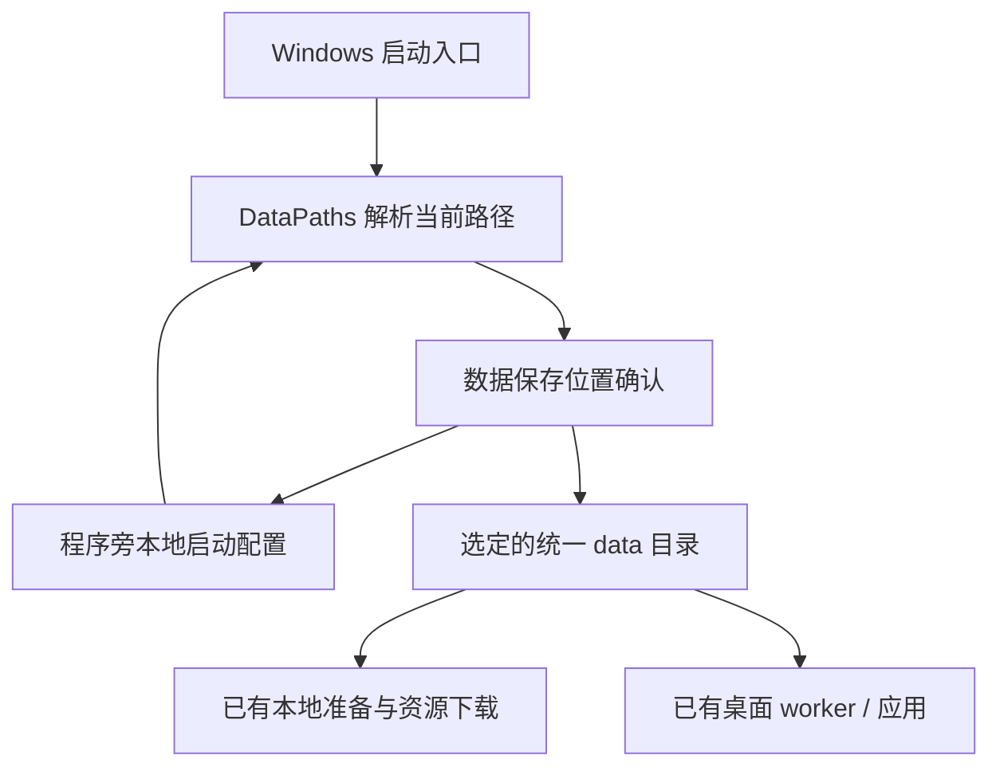
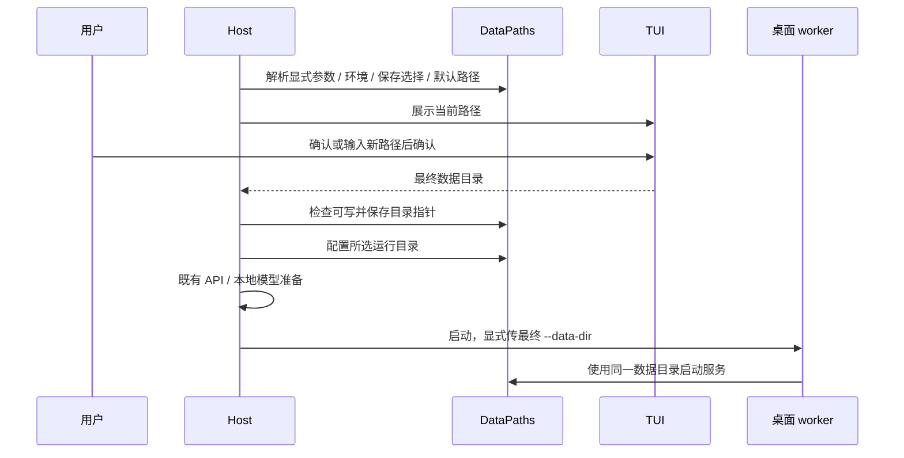

# 首次启动确认数据保存位置

## 概述

初始化前让用户确认当前数据目录或指定新目录，记住选择，下载确认页只保留下载信息。

状态：按用户确认的目录选择方式实现中。

## 架构

## 职责边界

- `DataPaths` 继续统一所有运行数据：显式 `--data-dir`、进程环境变量、程序旁保存的选择、既有默认路径，按此顺序解析。Windows 程序旁 `pictide.local.json` 仅保存数据目录指针，属于启动配置；模型、数据库、图片、偏好、日志与缓存仍在选定目录。该本地配置不入 Git 或发行 ZIP。
- TUI 的 `choose_data_directory(current_directory, *, language=None, error=None)` 只返回用户确认的绝对路径，不创建目录、不保存配置。首次启动默认当前路径；指定新目录后仍需确认。更换位置不迁移或删除原数据。
- 启动准备在配置运行目录、创建日志或下载资源之前调用目录选择；确认后检查目录可用并原子保存选择，再进入既有初始化流程。已确认且路径未被覆盖时，后续启动不重复提问；`--setup` 可重选。
- CLI、无浏览器和隐藏 worker 保持非交互，显式 `--setup` 才主动进入选择。活动实例复用现有目录与单实例锁；重新准备前仍需退出托盘实例。
- 桌面启动器始终把父进程最终确认的目录作为最后一个 `--data-dir` 参数传给 worker，覆盖原始启动参数中的旧值，避免父子进程使用不同数据。
- 下载确认页移除 ComfyUI、模型和数据目录信息；目录选择页已说明保存内容与路径。

## 调用和数据流

## 重点关注

- 默认确认保持现有路径；程序内部路径按相对程序目录保存，便携包移动时仍可用，外部目录保存绝对路径。
- 用户可选择已有或新建的数据目录，原目录数据保持原位；本次不做数据迁移和历史数据清理。
- 少量定向验证覆盖选择确认、取消、无效输入、记忆与优先级、父子目录一致及下载确认无重复路径。原生 EXE 使用隔离路径验证，不启动用户的 GPU 任务。
- 不修改注册表、系统环境变量或终端设置，不重启现有运行实例。
