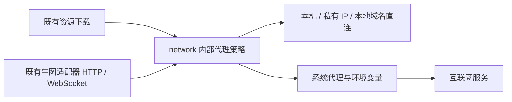
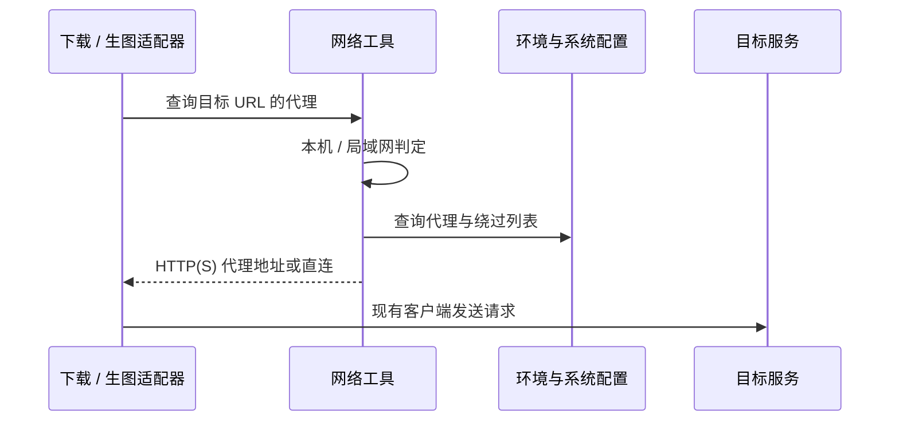

# 对外请求跟随系统代理

## 概述

统一模型下载、生图 API、事件流与图片下载的代理规则，互联网跟随系统 HTTP(S) 代理，本机和局域网直连。

## 架构

## 职责边界

- 沿用已确认的业务边界。`backend/network.py` 仅提供内部 `proxy_for_url(url)` 与同步 `open_url(request, timeout=...)` 工具；不承载任务状态或生图协议。
- 代理来源沿用 Python 标准库：环境变量优先，其次平台系统 HTTP(S) 代理；遵循标准库的代理绕过规则（含 `NO_PROXY`）。没有可用代理时直连。
- 回环、私有和链路本地 IP、`localhost`、无点的本地主机名及 `.local` / `.lan` 域名始终直连；自定义内网域名可通过绕过列表指定。URL 分类不触发额外 DNS 查询。
- 同步下载在每个跳转目标重新选择代理；异步适配器通过既有 aiohttp 请求的 `proxy` 参数应用同一规则，沿用现有关闭自动跳转的规则。ComfyUI WebSocket 同步适配。
- 本机启动探测保持直接连接；候选、推荐、任务接口和模块边界保持原样。凭据处理、TLS 验证、任务不重复提交和图片下载隔离继续沿用现有机制。

## 调用和数据流

## 重点关注

- 按用户已确认的规则实现，不修改系统代理设置，不新增 GUI 或依赖；PAC 脚本与 SOCKS 解析不在本次范围。
- 使用本机模拟代理、服务和 WebSocket 验证路由及凭据隔离，不调用真实云端生图或 GPU；Mac 验证不改变系统代理配置。
