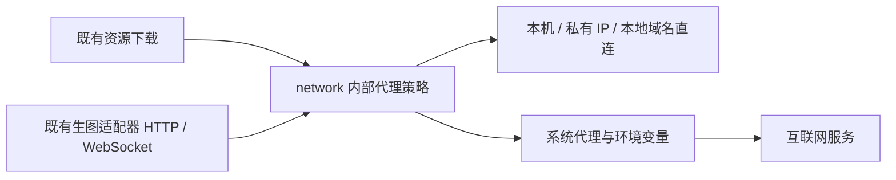
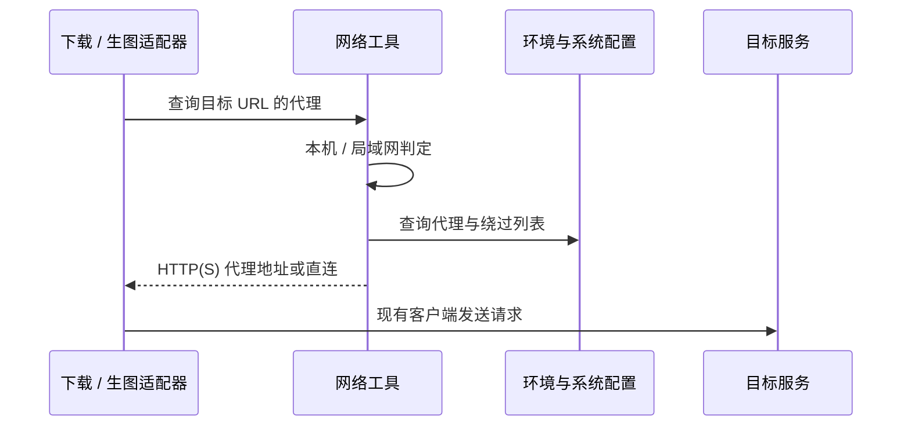

# 对外请求跟随系统代理

## 概述

统一模型下载、生图 API、事件流与图片下载的代理规则，互联网跟随系统 HTTP(S) 代理，本机和局域网直连。

## 架构

## 职责边界

- 沿用已确认的业务边界。`backend/network.py` 仅提供内部 `proxy_for_url(url)` 与同步 `open_url(request, timeout=...)` 工具；不承载任务状态或生图协议。
- 代理来源沿用 Python 标准库：环境变量优先，其次平台系统 HTTP(S) 代理；遵循标准库的代理绕过规则（含 `NO_PROXY`）。没有可用代理时直连。
- 回环、私有和链路本地 IP、`localhost`、无点的本地主机名及 `.local` / `.lan` 域名始终直连；自定义内网域名可通过绕过列表指定。URL 分类不触发额外 DNS 查询。
- 同步下载在每个跳转目标重新选择代理；异步适配器通过既有 aiohttp 请求的 `proxy` 参数应用同一规则，沿用现有关闭自动跳转的规则。ComfyUI WebSocket 同步适配。
- 本机启动探测保持直接连接；候选、推荐、任务接口和模块边界保持原样。凭据处理、TLS 验证、任务不重复提交和图片下载隔离继续沿用现有机制。

## 调用和数据流

## 重点关注

- 按用户已确认的规则实现，不修改系统代理设置，不新增 GUI 或依赖；PAC 脚本与 SOCKS 解析不在本次范围。
- 使用本机模拟代理、服务和 WebSocket 验证路由及凭据隔离，不调用真实云端生图或 GPU；Mac 验证不改变系统代理配置。

## macOS 系统证书修复（2026-10-20）

用户确认优先修复 Mac 首次 MiniLM 下载的 CA 问题，沿用既有网络工具边界。

- 实机确认：冻结 Python 的 OpenSSL 默认 CA 路径指向构建机器的 `/Library/Frameworks/Python.framework/Versions/3.12/etc/openssl/cert.pem`，目标 Mac 上该文件不存在。已有模型的热启动成功，缺少 MiniLM `config.json` 的真实 HTTPS 下载失败；仅在测试进程指定包内 certifi 后下载成功，确认故障在证书信任源。
- `network.tls_context()` 在 macOS 使用固定版本 `truststore==0.10.5`，由系统 Security.framework 验证证书链与主机名；依赖只在 macOS 安装。同步下载、Host 生图会话（含 ComfyUI WebSocket）和隔离的云端图片下载共用此上下文。Windows/Linux 沿用 Python 默认上下文。
- 不使用全局 SSL 注入，不额外载入 certifi 根证书，不修改系统证书或代理设置。旧的补充 certifi 方案保持未集成。
- 验证重点：可信 MiniLM HTTPS 下载、陌生自签名证书拒绝、代理路由与凭据隔离。最终安装包由 GitHub Actions 构建，再在用户 Mac 的独立目录运行；该 Mac 不承担构建工作。
- 实机验证结果在完成后补充；尚未创建版本标签或发布 Release。
