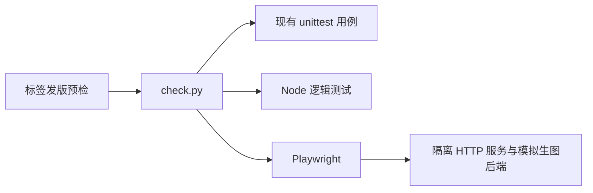
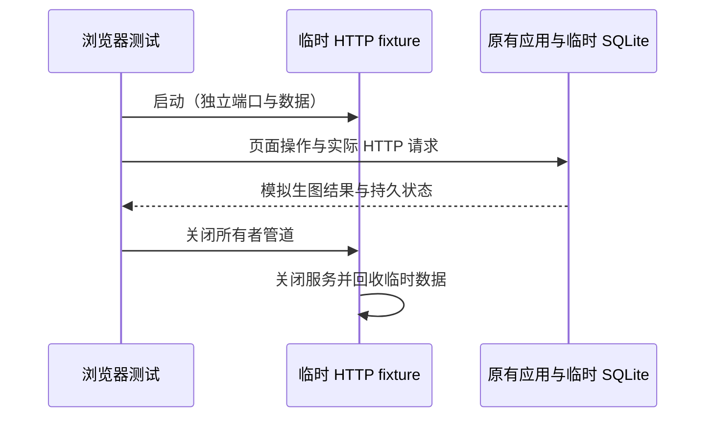

# 测试入口与发版冒烟

## 概述

统一少量关键测试的执行入口，将核心业务与真实浏览器检查接入后续标签发版。

## 架构

## 职责边界

- `scripts/check.py` 选择 core、ui、corpus、browser 小组，失败返回非零；不扫描全量测试。
- Python 与 Node 测试继续使用原有框架；新增通知状态回归，修正共现集成对隐式默认候选数量的依赖。
- Playwright 只操作真实页面，HTTP fixture 复用现有应用与测试后端，用临时目录和动态端口隔离数据。
- 发行工作流只在版本标签推送时运行，在四平台构建前执行 core、ui、browser；corpus 按数据处理变更单独执行。

## 调用和数据流

## 重点关注

- 固化通知布局、弹窗重试和移动端引导的锚点编辑流程。
- 不下载模型，不提交真实 GPU 或付费 API 请求，模拟检查与真实模型验证分别报告。
- 不改动 v0.5.0 标签和既有发行包；界面源码、业务边界与运行目录保持现有职责。
