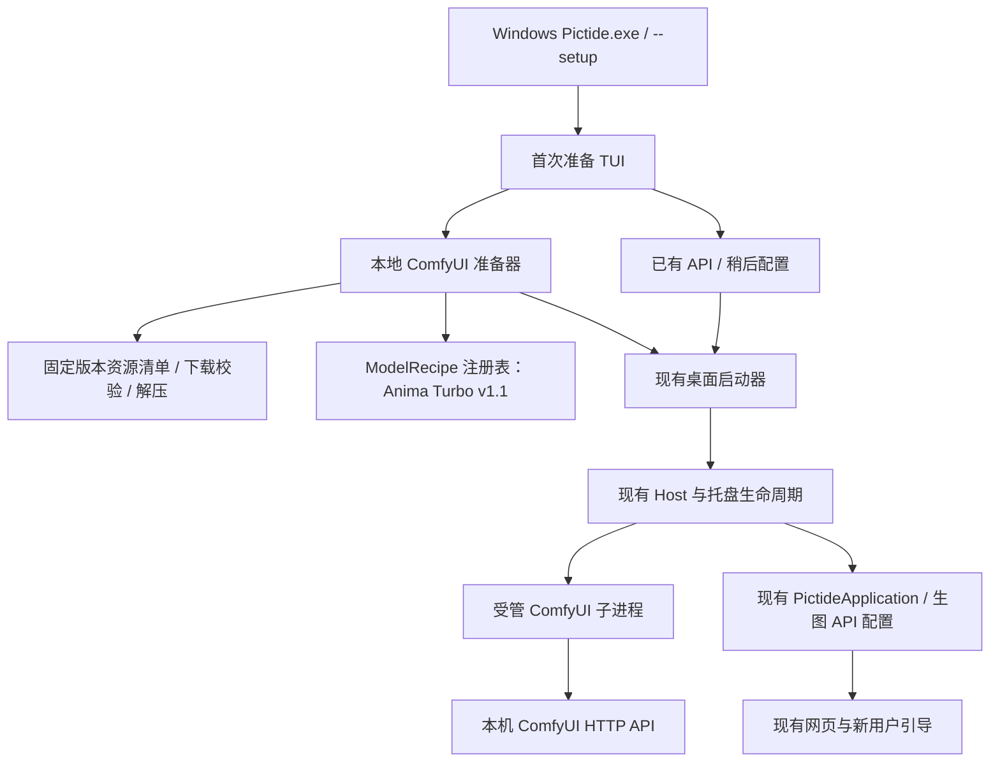
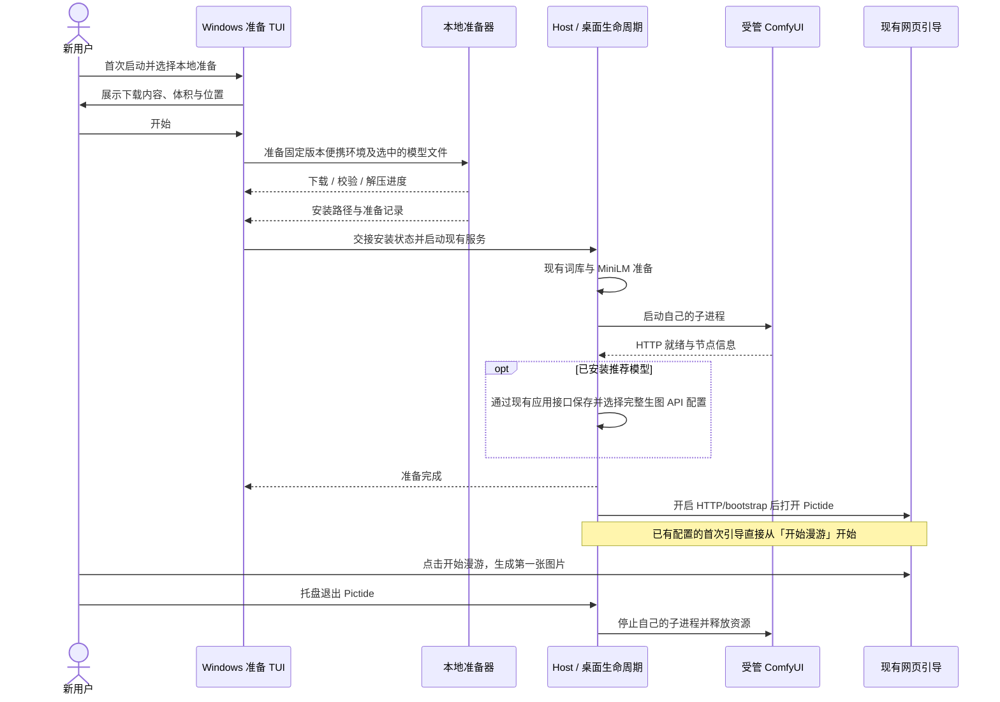

# Windows 首次本地生图准备 TUI

## 概述

Windows 首次启动通过轻量 TUI 引导选择已有生图 API、自动安装本地 ComfyUI 与推荐使用的 Anima Turbo v1.1，或稍后配置。

状态：已实现；NVIDIA 官方环境安装、最终便携包、网页首图引导、真实出图及托盘退出回收通过。推荐模型为 Anima Turbo v1.1，每个推荐模型均携带完整默认工作流并自动接入。AMD、Intel、CPU 尚未对应硬件实测，本次未发布新 tag 或 Release。

## 架构



## 职责边界

| 组成 | 接口与职责 |
| --- | --- |
| Windows 入口 / TUI | 会话入口 `prepare_windows_setup(paths, *, force=False)` 决定是否引导；`run_setup(profiles, recipes, install, *, language=None)` 在可交互的 Windows 启动终端中提问、选择、显示下载与解压进度，返回准备结果；完成后交回现有桌面启动器。系统语言为简体中文时使用中文，其余使用英文。 |
| Host | 判断当前是否已有生图 API、是否完成准备；在自己的生命周期内启动及回收受管 ComfyUI。TUI 不直接操作业务数据库。现有 `--cli`、`--no-browser` 与自动化冒烟默认保持非交互；显式 `--setup` 可重新打开引导。 |
| 本地准备器 | `prepare_local_comfy(paths, profile_id, recipe_id_or_None, progress)`。下载固定版本的官方 Windows 便携包及按需使用的独立解压工具，校验 SHA256，在临时目录解压成功后安装并返回安装状态；不依赖用户安装 Python、Git 或 7-Zip。 |
| 资源清单 | 固定 URL、版本、文件大小、SHA256 与目标相对路径。随源码提交，小体积发行包按需下载 ComfyUI。运行时不追踪浮动 `latest`。 |
| 模型扩展 | 每个 `ModelRecipe` 必须包含 `id`、名称、模型文件清单、硬件要求、完整默认 API 工作流及正负提示词、种子、图片输出绑定；`connection(base_url)` 生成现有 ComfyUI API 配置。首个配方为 Anima Turbo v1.1，默认推荐并允许用户只安装 ComfyUI。后续推荐模型沿用同一契约，安装完成即可生成，无需用户补工作流。 |
| 受管进程 | `ManagedComfy.start() -> base_url` 与 `close()`。使用便携 Python 直接运行 ComfyUI，默认只监听本机空闲端口，禁止自动打开 ComfyUI 网页；日志存入所选数据目录。退出 Pictide 时仅回收本次启动的受管子进程。 |
| 生图 API 配置 | 选择推荐模型时，由 Host 在提供 HTTP/bootstrap 前复用 `PictideApplication.save_backend` 保存并选择已安装模型的完整生图配置，让漫游与生成页立即可用。只安装 ComfyUI 时保留现有网页配置流程，TUI 展示本地地址并说明仍需准备模型。已有 API 与用户修改保留，显式重新准备不覆盖其他连接。 |
| 网页引导 | 沿用 `web/src/onboarding/pictide-flow.mjs` 的 `newProgress`：bootstrap 已有生图 API 时从 `roam-start` 开始，直接聚焦「开始漫游」，等待用户点击生成第一张。已有 API、稍后配置或仅安装 ComfyUI 的用户，按实际配置状态进入现有引导；不增加 HTTP 引导标记、数据库字段或安装器到前端的专用通道。 |

源码分工：`backend/windows_setup_ui.py` 负责标准库终端展示；`backend/windows_hardware.py` 读取 DXGI 独立显存和装机内存；`backend/local_generation.py` 维护固定资源、模型配方、硬件准入与安装；`backend/local_generation_session.py` 负责准备状态、同数据目录准备锁、受管进程与自动接入，Host 组合现有应用生命周期。接入前复用现有 `check_backend` 做只读检查。默认工作流以 `docs/assets/workflows/anima-turbo-v1.1.api.json` 为维护源，构建时加入随包工作流资源。

### TUI 交互

应用初始化前先[确认数据保存位置](setup-data-directory.md)。所选目录没有准备记录、也没有已配置 API 时，显示：

```text
欢迎使用 Pictide
你准备如何生成图片？

> 我已有生图 API
  帮我安装本地 ComfyUI
  稍后配置

↑ ↓ 选择 · Enter 继续 · Esc 返回
```

选择本地安装后：

1. 「准备本地生图环境」先展示检测到的显卡型号，默认提供「使用推荐环境」，通过「选择其他环境」再展开完整列表；识别失败时直接进入手动选择。环境列表只显示适用硬件和用途，不混排下载体积。NVIDIA 标准环境使用 CUDA 13.0，兼容环境使用 CUDA 12.6，可在遇到 CUDA 或驱动兼容问题时尝试；CPU 明示为慢速选项，型号支持沿用 ComfyUI 官方要求。
2. 「选择生图模型」显示设备容量及每个模型的要求，仅满足硬件要求的模型可继续；不足、未知或环境不匹配时显示原因并返回选择。跳过项为「暂不下载模型，仅安装 ComfyUI」。最终确认页只展示一个预计下载体积，同时展示模型许可、安装位置与磁盘空间需求，由用户选择开始或返回。安装器在任何下载前再次检查；门槛、容量规则与验证范围统一见[默认模型硬件要求](model-hardware-requirements.md)。
3. 显示“下载 → 校验 → 解压 → 启动”阶段，以及当前文件、已下载大小、速度和进度；支持取消、失败重试与后续启动续传。
4. 安装推荐模型时自动保存并选中默认工作流，显示“本地生图已就绪”并进入网页。用户选择「带我看看」后，直接引导点击「开始漫游」生成第一张图片，无需填写地址、测试、导入或绑定工作流；生成页也已选好该模型。仅安装 ComfyUI 时显示“ComfyUI 已就绪”，给出本机地址并说明仍需添加模型。

选择已有 API 或稍后配置时记录选择并继续进入 Pictide，后续启动直接走现有准备与托盘流程。已有 API 的配置仍由网页承担。应用关闭后可通过 `Pictide.exe --setup` 再次运行准备流程。

TUI 使用标准库与当前进程的终端能力，提供方向键选择和进度条，不增加 GUI 运行时；仅改变自身控制台模式。终端能力不足时回退到编号输入与逐行进度。

### 数据与安装位置

路径均相对于用户所选 `data/`：

- `runtime/comfyui/`：本次安装的 ComfyUI 与自带 Python。
- `runtime/local-generation.json`：准备选择、安装版本、启动参数和已就绪状态。
- `models/generation/`：Anima 及后续注册的生图模型；按 `diffusion_models/`、`text_encoders/`、`vae/` 等类型分目录，通过 ComfyUI 额外模型路径接入。
- `cache/downloads/`：安装归档与可续传的下载分段；最终模型移入模型目录。
- `tmp/`：安装暂存与启动状态。
- `logs/comfyui.log`：受管服务日志。

沿用 MiniLM 现有启动前下载与校验，全部准备完成后才打开 Pictide 网页。便携包继续保持轻量，ComfyUI、解压工具和生图模型均不打包。

### 推荐使用的生图模型

Anima Turbo v1.1 使用官方 `circlestone-labs/Anima` 仓库的固定提交 `f973fc41ec7545364ac9776c2440285f43ff2a30`，三个文件合计 **5,628,171,998 字节，约 5.63 GB**：

| 类型 | 文件 | 大小 |
| --- | --- | --- |
| 主模型 | `anima-turbo-v1.1.safetensors` | 4,182,230,656 字节 |
| 文本编码器 | `qwen_3_06b_base.safetensors` | 1,192,135,096 字节 |
| VAE | `qwen_image_vae.safetensors` | 253,806,246 字节 |

默认工作流使用 **832×1248（2:3 竖图）、10 步、CFG 1、Euler / simple**，只需 ComfyUI 内置节点；正向、负向、种子和图片输出继续使用现有绑定接口。CFG 1 下负向提示词不参与引导，界面与指南说明这一点。工作流参考文件位于 [Anima Turbo API 工作流](../../assets/workflows/anima-turbo-v1.1.api.json)。

模型沿用 CircleStone Labs 非商业许可；生成图片可商用。TUI 下载确认页提供简短说明与模型许可链接，Pictide 原创源码继续使用 Apache-2.0。模型不随应用发行包分发，未来将其接入付费产品前需另行确认商业授权。

默认 832×1248 工作流已在新的 NVIDIA 受管环境通过 Pictide `/api/jobs` 真实生成一张中性风景图；ComfyUI 执行约 **18.01 秒，包含冷模型加载**，已核对尺寸与画面。此前独立本机 ComfyUI 的 1024×1024 单次测试约 8.05 秒，环境、尺寸和计时边界不同，不作为本次安装或默认尺寸的耗时承诺。

## 调用和数据流



## 重点关注

- Anima Turbo v1.1 作为首个推荐使用的生图模型；每个推荐配方必须附完整默认工作流与绑定。只有受管 ComfyUI 就绪、模型可用且工作流已保存并选中时才显示“本地生图已就绪”；网页引导中的生成动作仍由用户触发。
- 先复用同数据目录的已运行实例，避免重复引导或重复安装；仅操作自己的安装目录和子进程。用户已有的 ComfyUI、模型目录与正在执行的任务保持原有所有权。
- 下载执行前展示真实体积，固定资源使用官方 SHA256；现有正确文件复用，失败保留续传数据。解压成功后再记录安装完成，重试不覆盖用户已有模型与业务配置。
- 当前已核实 ComfyUI `v0.42.1` 提供 NVIDIA、CUDA 12.6、AMD、Intel 和 ARM64 资产；本版聚焦 Windows x64，CPU 复用合适的官方便携环境。独立解压工具可按需下载官方 `7zr.exe`（约 0.60 MB），其版本与哈希同样锁定。
- NVIDIA / AMD / Intel 的官方包约 1.45–2.02 GB，实际界面展示所选资源的精确大小。选择当前 NVIDIA 标准包与 Anima 时，总下载约 7.65 GB，另有 MiniLM 原有约 91 MB 首次下载。解压后的磁盘占用另行预检并说明。
- 使用标准库绘制 TUI，应用进程内设置终端模式；不修改系统终端、注册表、PATH、开机启动、防火墙或显卡驱动，不需要管理员权限。
- 现有前端业务与候选、推荐、任务模块不增加安装职责；本地准备通过现有 ComfyUI 适配器接入，不增加生图 API 协议或业务 HTTP 端点。
- 验证使用独立 worktree、数据目录和端口；少量冒烟覆盖分支选择、资源校验/续传、模型注册接口、已有 API 保留及子进程收尾。真实 NVIDIA 验证结果见下方，AMD、Intel 和 CPU 仅覆盖配置与模拟路径，未做对应硬件实测。
- 本次不发布版本标签，不触发 GitHub Actions；通过本地构建与新用户入口冒烟后交付 Windows 最终 ZIP，并同步相应中英使用与架构文档。

## 实现与验证

- Windows TUI、固定资源安装、模型配方与受管 ComfyUI 生命周期已实现；11 项本地准备定向检查、7 项便携启动、3 项桌面启动器、11 项引导规则检查通过，前端类型检查、构建与最终 ZIP 的 CLI 启动冒烟通过。
- 网页复用已有 `backendCount > 0 → roam-start` 规则；接入发生在 HTTP/bootstrap 前。未完成模型准备、只安装环境及无配置的跳过路径继续使用生图 API 配置引导。
- 首次空图库在 bootstrap 后等待用户点击「开始漫游」；`app.js` 的预取入口仅在已有 `activeId` 或显式 `nextImageWait` 时激活，避免引导前自动生成首图。首图之后沿用既有预取数量，用户的 `prefetch_count` 保持原值。
- 官方 NVIDIA ComfyUI `v0.42.1` 归档完成真实下载及全量 SHA256 校验；隔离 TUI 编号输入路径完成安装约 **88.8 秒**。三个模型文件复用已有下载后重新全量哈希校验；该耗时不包含重新下载模型。
- 首次完整链路验收的 ZIP 内冻结 `Pictide.exe` 默认桌面启动约 **57.38 秒**，完成受管 ComfyUI 启动、只读预检、默认 API/工作流保存并选中。真实浏览器验证 `invite → roam-start → roam-pending`，没有进入设置页，首次点击前没有生成请求。该界面验证拦截生图请求，真实 GPU 出图另通过 Pictide `/api/jobs` 完成。
- 新受管环境生成一张 **832×1248、10 步、CFG 1、Euler / simple** 的中性风景图，ComfyUI 执行 **18.01 秒（含冷模型加载）**；PIL 尺寸检查与目视检查通过。
- 托盘退出验证确认 Pictide worker 退出、桌面实例记录清理、自有 ComfyUI 端口关闭；原有 8188/8189 应用保持运行。
- 首次完整链路验收的 Windows ZIP 为 **69,175,935 字节**，比改造前增加 **35,423 字节**，SHA256 为 `c83c91f2761751cf026be1dfe3eb07fec4f65c54b719f880b19dc0f29bc9bd06`；未捆绑 ComfyUI 或生图模型。AMD、Intel 和 CPU 尚未对应硬件实测。本次未创建新 tag、Release 或触发 GitHub Actions。
- 后续整理环境和模型选择：中英文的推荐 NVIDIA/AMD、手动 CUDA 12.6、识别失败后选择 CPU 路径完成无下载交互冒烟，4 项 TUI 检查通过。更新的 Windows ZIP 重新完成类型检查、构建与隔离 CLI 启动冒烟，体积 **69,177,684 字节**，SHA256 为 `d2d487e33f676e6b74631391c3d059eb7542701e8b63b33d5290e2faa0e23052`；本次仅调整选择交互和说明，未重复执行 GPU 出图。
- 进一步显示完整显卡型号、简化下载确认页为一个预计体积；本机只读识别到 `NVIDIA GeForce RTX 4070 Ti`，4 项 TUI 检查与中英四条无下载交互路径通过。重新构建及隔离启动冒烟通过，当前 Windows ZIP 为 **69,176,971 字节**，SHA256 为 `ee6731282f52c998cdcbdd2bc87334645fef6ec86544f4663a71e3ba511e6498`。本次未增加显存检测或模型硬件门槛。
- 随后增加每个默认模型的强制硬件要求，TUI 和安装器均在下载前检查。显存/内存不足、未知或所选环境不匹配时阻止下载；实现、阈值与当前包验证统一见[默认模型硬件检查](model-hardware-requirements.md)。

参考：[ComfyUI Windows 便携版](https://docs.comfy.org/installation/comfyui_portable_windows)、[官方 v0.42.1 资源](https://github.com/Comfy-Org/ComfyUI/releases/tag/v0.42.1)、[7-Zip 官方独立工具](https://github.com/ip7z/7zip/releases/tag/26.04)、[Anima 官方模型说明](https://huggingface.co/circlestone-labs/Anima)、[Anima 模型许可](https://huggingface.co/circlestone-labs/Anima/blob/main/LICENSE.md)。
