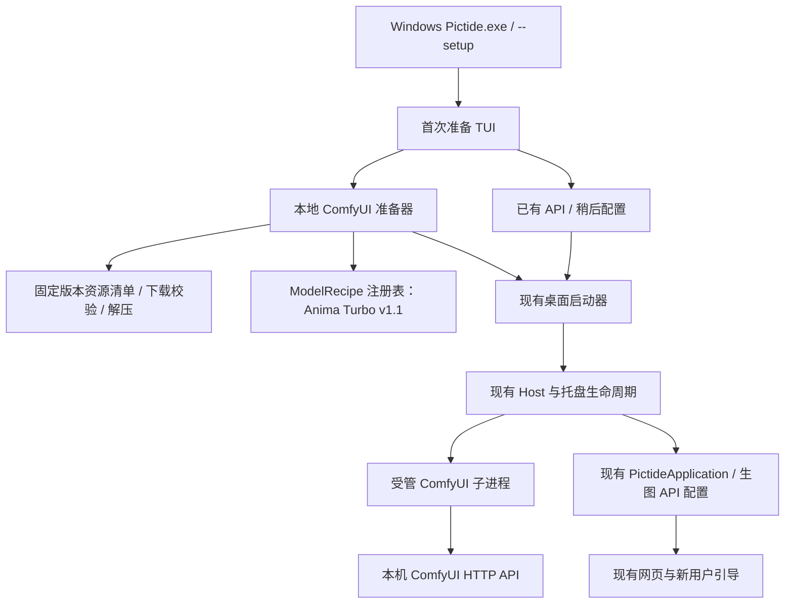
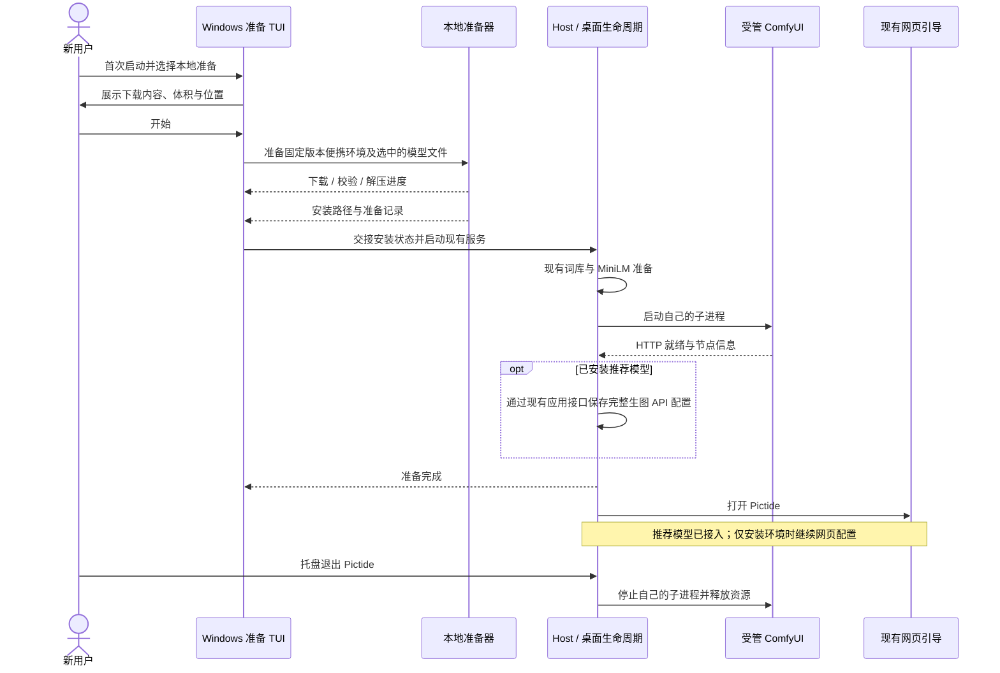

# Windows 首次本地生图准备 TUI

## 概述

Windows 首次启动通过轻量 TUI 引导选择已有生图 API、自动安装本地 ComfyUI 与推荐使用的 Anima Turbo v1.1，或稍后配置。

状态：整体设计待确认；用户已确定推荐使用 Anima Turbo v1.1，沿用可扩展的模型资源与工作流注册接口。

## 架构



## 职责边界

| 组成 | 接口与职责 |
| --- | --- |
| Windows 入口 / TUI | `run_setup(paths, model_recipes, *, force=False) -> SetupSelection`。在可交互的 Windows 启动终端中提问、选择、显示下载与解压进度；完成后交回现有桌面启动器。系统语言为简体中文时使用中文，其余使用英文。 |
| Host | 判断当前是否已有生图 API、是否完成准备；在自己的生命周期内启动及回收受管 ComfyUI。TUI 不直接操作业务数据库。现有 `--cli`、`--no-browser` 与自动化冒烟默认保持非交互；显式 `--setup` 可重新打开引导。 |
| 本地准备器 | `prepare_local_comfy(paths, profile, progress) -> LocalInstallation`。下载固定版本的官方 Windows 便携包及按需使用的独立解压工具，校验 SHA256，在临时目录解压成功后安装；不依赖用户安装 Python、Git 或 7-Zip。 |
| 资源清单 | 固定 URL、版本、文件大小、SHA256 与目标相对路径。随源码提交，小体积发行包按需下载 ComfyUI。运行时不追踪浮动 `latest`。 |
| 模型扩展 | `ModelRecipe` 包含 `id`、名称、模型文件清单及可选 `build_connection(base_url, installed_files)`；输出沿用现有 ComfyUI API 配置与绑定结构。首个配方为 Anima Turbo v1.1，默认推荐并允许用户只安装 ComfyUI。后续增加清单即可复用下载、校验与接入步骤，无需另建插件系统。 |
| 受管进程 | `ManagedComfy.start() -> base_url` 与 `close()`。使用便携 Python 直接运行 ComfyUI，默认只监听本机空闲端口，禁止自动打开 ComfyUI 网页；日志存入所选数据目录。退出 Pictide 时仅回收本次启动的受管子进程。 |
| 生图 API 配置 | 选择推荐模型时，由 Host 复用 `PictideApplication.save_backend` 保存完整工作流及正负提示词、随机种子和图片输出绑定，接入漫游。只安装 ComfyUI 时保留现有网页配置流程，TUI 展示本地地址并说明仍需准备模型。已有 API 不覆盖。 |

### TUI 交互

首次没有准备记录、也没有已配置 API 时，显示：

```text
欢迎使用 Pictide
你准备如何生成图片？

> 我已有生图 API
  帮我安装本地 ComfyUI
  稍后配置

↑ ↓ 选择 · Enter 继续 · Esc 返回
```

选择本地安装后：

1. 检测显卡并展示官方对应便携包，允许调整 NVIDIA / AMD / Intel / CPU 路径；CPU 明示为慢速选项，型号支持沿用 ComfyUI 官方要求。
2. 推荐“ComfyUI + Anima Turbo v1.1”，允许只安装 ComfyUI；展示将下载的全部内容、总下载体积、模型许可、安装位置与磁盘空间需求，由用户选择开始或返回。
3. 显示“下载 → 校验 → 解压 → 启动”阶段，以及当前文件、已下载大小、速度和进度；支持取消、失败重试与后续启动续传。
4. 安装推荐模型时自动配置已验证的工作流，显示“本地生图已就绪”并进入网页；仅安装 ComfyUI 时显示“ComfyUI 已就绪”，给出本机地址并说明仍需添加模型。

选择已有 API 或稍后配置时记录选择并继续进入 Pictide，后续启动直接走现有准备与托盘流程。已有 API 的配置仍由网页承担。应用关闭后可通过 `Pictide.exe --setup` 再次运行准备流程。

TUI 使用标准库与当前进程的终端能力，提供方向键选择和进度条，不增加 GUI 运行时；仅改变自身控制台模式。终端能力不足时回退到编号输入与逐行进度。

### 数据与安装位置

路径均相对于用户所选 `data/`：

- `runtime/comfyui/`：本次安装的 ComfyUI 与自带 Python。
- `runtime/local-generation.json`：准备选择、安装版本、启动参数和已就绪状态。
- `models/generation/`：Anima 及后续注册的生图模型；按 `diffusion_models/`、`text_encoders/`、`vae/` 等类型分目录，通过 ComfyUI 额外模型路径接入。
- `cache/downloads/`：安装归档与可续传的下载分段；最终模型移入模型目录。
- `tmp/`：安装暂存与启动状态。
- `logs/comfyui.log`：受管服务日志。

沿用 MiniLM 现有启动前下载与校验，全部准备完成后才打开 Pictide 网页。便携包继续保持轻量，ComfyUI、解压工具和生图模型均不打包。

### 推荐使用的生图模型

Anima Turbo v1.1 使用官方 `circlestone-labs/Anima` 仓库的固定提交 `f973fc41ec7545364ac9776c2440285f43ff2a30`，三个文件合计 **5,628,171,998 字节，约 5.63 GB**：

| 类型 | 文件 | 大小 |
| --- | --- | --- |
| 主模型 | `anima-turbo-v1.1.safetensors` | 4,182,230,656 字节 |
| 文本编码器 | `qwen_3_06b_base.safetensors` | 1,192,135,096 字节 |
| VAE | `qwen_image_vae.safetensors` | 253,806,246 字节 |

默认工作流使用 **1024×1024、10 步、CFG 1、Euler / simple**，只需 ComfyUI 内置节点；正向、负向、种子和图片输出继续使用现有绑定接口。CFG 1 下负向提示词不参与引导，界面与指南说明这一点。工作流参考文件位于 [Anima Turbo API 工作流](../../assets/workflows/anima-turbo-v1.1.api.json)。

模型沿用 CircleStone Labs 非商业许可；生成图片可商用。TUI 下载确认页提供简短说明与模型许可链接，Pictide 原创源码继续使用 Apache-2.0。模型不随应用发行包分发，未来将其接入付费产品前需另行确认商业授权。

现有本机 ComfyUI 上已验证这三个官方文件的 SHA256 和工作流：RTX 4070 Ti 生成一张 1024×1024 图片，从提交到完成约 8.05 秒。这是单次工作流验证，不代表首次安装耗时或新受管环境的验证结果。

## 调用和数据流



## 重点关注

- Anima Turbo v1.1 作为首个推荐使用的生图模型；模型扩展接口继续保留。只有模型与工作流完成配置时才显示“本地生图已就绪”。
- 先复用同数据目录的已运行实例，避免重复引导或重复安装；仅操作自己的安装目录和子进程。用户已有的 ComfyUI、模型目录与正在执行的任务保持原有所有权。
- 下载执行前展示真实体积，固定资源使用官方 SHA256；现有正确文件复用，失败保留续传数据。解压成功后再记录安装完成，重试不覆盖用户已有模型与业务配置。
- 当前已核实 ComfyUI `v0.42.1` 提供 NVIDIA、CUDA 12.6、AMD、Intel 和 ARM64 资产；本版聚焦 Windows x64，CPU 复用合适的官方便携环境。独立解压工具可按需下载官方 `7zr.exe`（约 0.60 MB），其版本与哈希同样锁定。
- NVIDIA / AMD / Intel 的官方包约 1.45–2.02 GB，实际界面展示所选资源的精确大小。选择当前 NVIDIA 标准包与 Anima 时，总下载约 7.65 GB，另有 MiniLM 原有约 91 MB 首次下载。解压后的磁盘占用另行预检并说明。
- 使用标准库绘制 TUI，应用进程内设置终端模式；不修改系统终端、注册表、PATH、开机启动、防火墙或显卡驱动，不需要管理员权限。
- 现有前端业务与候选、推荐、任务模块不增加安装职责；本地准备通过现有 ComfyUI 适配器接入，不增加生图 API 协议或业务 HTTP 端点。
- 验证使用独立 worktree、数据目录和端口；少量冒烟覆盖分支选择、资源校验/续传、模型注册接口、已有 API 保留及子进程收尾。本机 NVIDIA 做一次真实官方包安装与启动验证，可将已经下载并校验的三个 Anima 文件复制到隔离模型目录；在新受管环境验证一张 1024×1024、10 步的中性场景图片，并检查 Pictide 工作流绑定与图片保存。AMD/Intel 硬件运行情况单列为未验证。
- 本次不发布版本标签，不触发 GitHub Actions；通过本地构建与新用户入口冒烟后交付 Windows 最终 ZIP，并同步相应中英使用与架构文档。

参考：[ComfyUI Windows 便携版](https://docs.comfy.org/installation/comfyui_portable_windows)、[官方 v0.42.1 资源](https://github.com/Comfy-Org/ComfyUI/releases/tag/v0.42.1)、[7-Zip 官方独立工具](https://github.com/ip7z/7zip/releases/tag/26.04)、[Anima 官方模型说明](https://huggingface.co/circlestone-labs/Anima)、[Anima 模型许可](https://huggingface.co/circlestone-labs/Anima/blob/main/LICENSE.md)。
