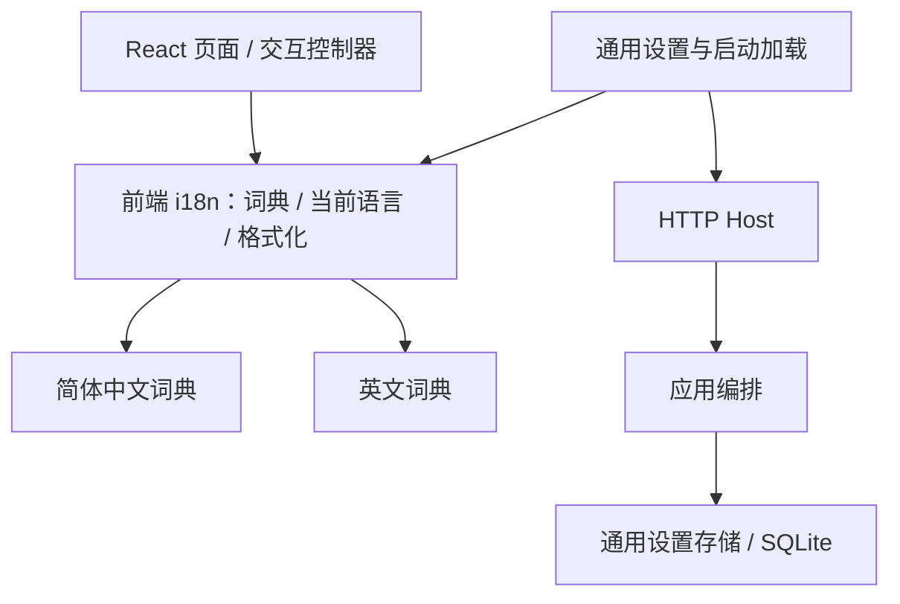
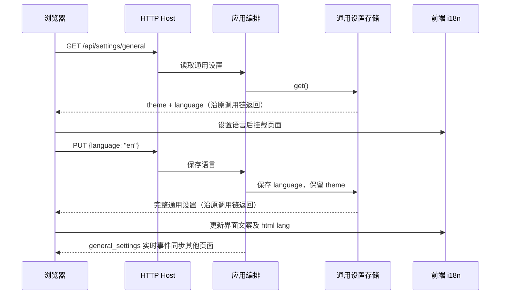

# 简体中文与英文国际化

## 概述

将界面文案集中管理，在「设置 → 通用」提供简体中文／English 切换，并持久保存语言选择。

## 架构

## 职责边界

- 前端 `i18n` 提供 `t(key, params)`、当前语言及订阅能力；React 组件和现有 DOM 控制器共用词典，负责标题、菜单、按钮、说明、占位、无障碍名称、状态反馈，以及日期和数字格式化。
- 通用设置接口仍为 `GET/PUT /api/settings/general`，增加 `language: "zh-CN" | "en"`，完整返回例如 `{"theme":"system","language":"zh-CN"}`。PUT 允许单独提交 theme 或 language，未提交项保持原值。
- Host 转交请求；应用编排协调保存并发布既有 `general_settings` 事件；Store 保存主题与语言，默认语言为 `zh-CN`。候选、推荐、任务的业务接口不变。

## 调用和数据流

## 重点关注

- 覆盖漫游、生成、喜欢、提示词、设置，以及弹窗、分页、悬浮提示和移动端／沉浸模式；统一维护中英文术语，漂流／顺流／停泊对应 Drift／Flow／Anchor。
- 切换不刷新页面、不重建业务状态，保留未保存表单、图片位置及播放状态；启动时加载语言，既有实时事件同步同一应用的其他页面。
- 只翻译产品界面：标签原名、实际正负提示词、用户自定义名称、模型与工作流参数标识保留原文；后端／ComfyUI 原始错误作为诊断详情保留，前端操作提示按所选语言显示。
- 实施前备份应用数据库；验证词典键完整、设置独立保存、前端类型检查和构建，以及中英文主要页面的少量真实界面冒烟。
