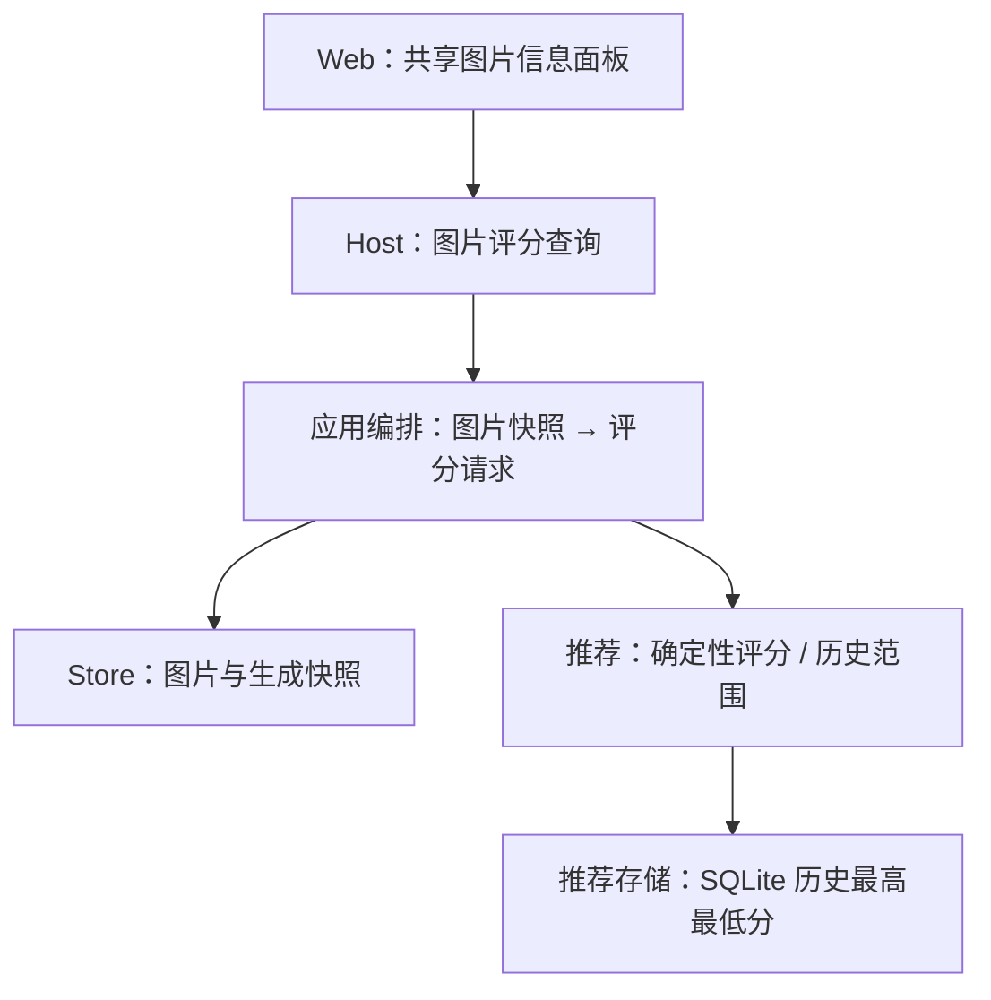
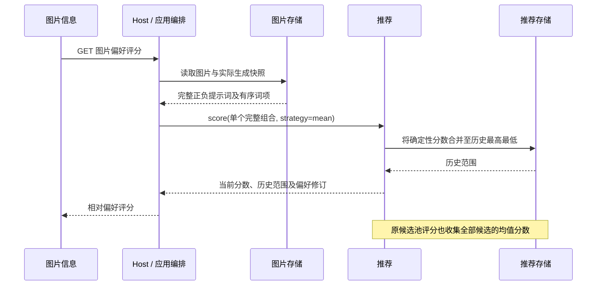

# 图片偏好评分

## 概述

图片信息顶部展示基于当前偏好的偏好评分，以历史最高、最低确定性分数换算为 0–100 的相对刻度。

## 架构

## 职责边界

| 组成 | 变更与接口 |
| --- | --- |
| Web | 漫游、生成、喜欢共用图片信息面板，在种子之前展示“偏好评分”；打开时查询，切图丢弃旧请求结果。 |
| Host / 应用编排 | 新增 GET /api/artifacts/{id}/preference-score；读取现有图片和生成词项快照，调用现有 score(strategy=mean)，计算相对分数。 |
| 推荐 | 原 score 请求与候选选择分数保持；ScoreResult 增加 score_min、score_max。每次评分将所有候选的确定性均值分数纳入历史范围，Thompson 探索分数不纳入；复用已计算的后验均值，不重复分解矩阵。 |
| 推荐存储 | 新增 observe_score_range(user_id, feature_version, policy_version, minimum, maximum)，合并并返回全局历史极值；SQLite 新表 recommendation_score_range。同一用户跨栏目共用，按特征／算法版本隔离，重置偏好时清空。 |
| 图片存储 | 沿用 artifact(id)、roam_snapshot(job_id)，无新增图片数据接口。 |

查询响应包含 status（scored / missing_snapshot / unavailable）、score（原始确定性分数）、love_score（0–100 或 null）、score_min、score_max、state_revision、feature_version、reason。图片不存在返回 404。

换算：love_score = 100 × (score - score_min) / (score_max - score_min)，显示一位小数。最高最低相等时显示“暂无区分”，不强行给 50 分；无快照或服务不可用显示“暂无法评分”。原始分数和历史范围置于悬浮提示，不占主要版面。

## 调用和数据流

## 重点关注

- 是历史范围中的相对刻度，不是喜欢概率；不增加“非常喜欢”等未经校准的等级。
- 按讨论采用近似历史标尺：学习更新后保留极值，不重算全部历史；每次打开图片信息用当前已完成学习的参数重新评分。
- 从上线后的评分请求积累范围，不回填全部历史；重置偏好同步清空范围。
- 评分基于提示词组合，不分析像素；同提示词不同种子分数相同，已学习的自身反馈也会影响当前分数。
- 缺完整快照的手动／历史图片暂无法评分，不拆逗号补造归因。评价、预取和任务调用链不变。
- 实施前备份 SQLite；少量评分／重置冒烟，类型检查、构建及隔离页面验证。

确定性评分权重缓存及喜欢页批量排序见 [评分排序](liked-score-sort.md)。

状态：用户已确认实施；展示名称按最新要求统一为“偏好评分”。