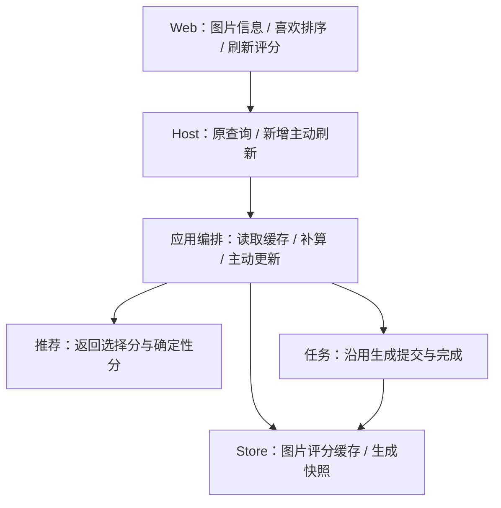
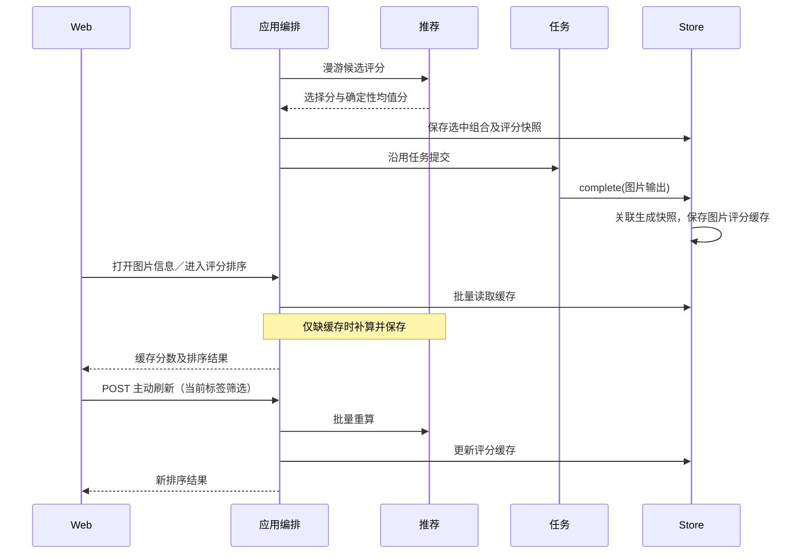

# 图片偏好评分缓存

## 概述

图片复用持久偏好评分，漫游生图时顺便记录，手动刷新评分的按钮移到喜欢页毛玻璃按钮前。

## 架构

## 职责边界

| 组成 | 变更与接口 |
| --- | --- |
| Web | 图片信息继续使用原查询；喜欢页进入／切排序／改筛选复用缓存。新增主动刷新请求；按钮放在页面右上毛玻璃按钮之前，仅偏好评分排序显示，名称为“刷新偏好评分”。 |
| HTTP / 编排 | GET /api/artifacts/{id}/preference-score 和 GET /api/liked/ranked 默认读取缓存，缺缓存时补算并保存。新增 POST /api/liked/ranked/refresh，输入 {tags:[]}，强制重算当前筛选结果并更新缓存，返回原 ranked 结构。 |
| 推荐 | CandidateScore 增加 mean_score，Thompson 请求同时返回已有的确定性均值分数；mean 请求两者相同。复用已有计算，不增加参数求解。 |
| 编排 / 生成快照 | 漫游选择组合时，把 mean_score、特征／算法版本和偏好修订写进任务快照。原选择分数仍保留原含义。 |
| 图片存储 | SQLite 新增 artifact_preference_scores，保存图片 ID、原始确定性分数、特征／算法版本、偏好修订及计算时间。新增批量 image_score_cache(...) 和 save_image_scores(...)；读取时返回对应历史范围。已有 complete(...) 在图片入库时从生成快照保存各输出图片的评分缓存，不新增任务模块接口。 |

信息面板继续返回原 score / love_score / score_min / score_max 等结构；love_score 只按历史范围做轻量换算。批量排序读取原始缓存分数，仍按高分、时间、ID 排序，无法评分放最后。

## 调用和数据流

## 重点关注

- 新漫游图顺便记录已计算的均值分，不把探索随机分当偏好评分；停泊或推荐不可用而未评分的任务，仍走缺缓存时补算。
- 旧图片不启动全库回填，首次需要时补算一次。缺快照不补造标签，评分失败不缓存失败结果，也不覆盖已有成功缓存。
- 后续学习保留图片缓存，用户点击刷新后更新当前筛选结果。明确重置用户偏好时同时清空图片评分缓存和历史范围；特征／算法版本改变时旧缓存不复用。
- 缓存原始分数，0–100 刻度可随历史范围变化而换算；只有轻量算术，不重新编码或求解偏好。
- 同一次主动刷新共用当前偏好权重，继续组合去重、小批点积。缓存不同学习时间的原始分数沿用已讨论的近似可比性。
- 刷新按钮悬浮提示展示上次成功手动刷新的时间；时间持久保存在 SQLite，生成、补算不更新时间，首次显示“尚未刷新”。ranked 响应增加 refreshed_at。
- 主动刷新图片评分保留用户已学习的偏好；按钮的旋转箭头、加载与禁用状态沿用现有组件。
- 实施前备份 SQLite，只做少数缓存命中／生成关联／主动刷新／重置冒烟及界面验证。

状态：用户已确认实施。