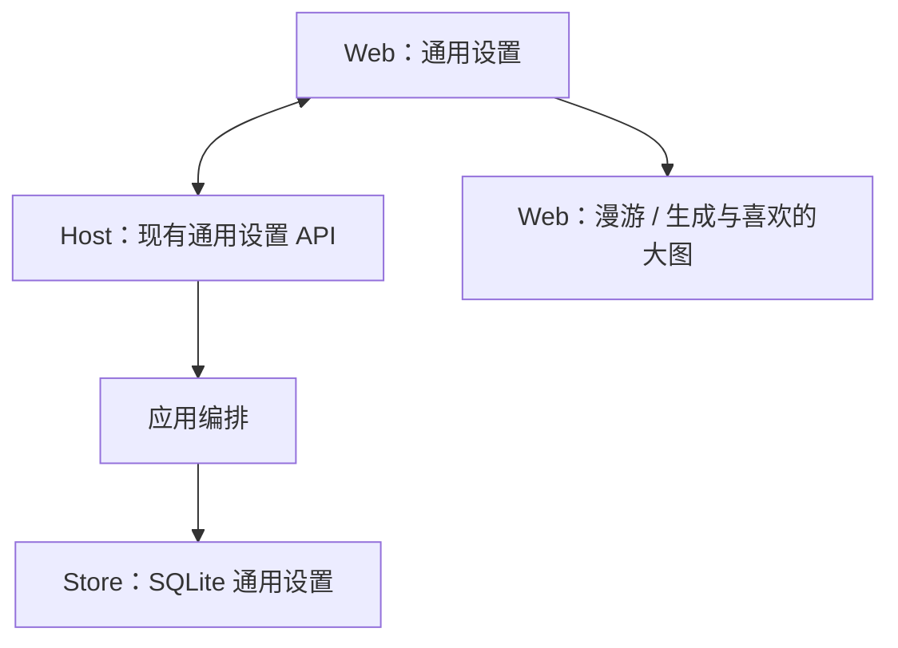
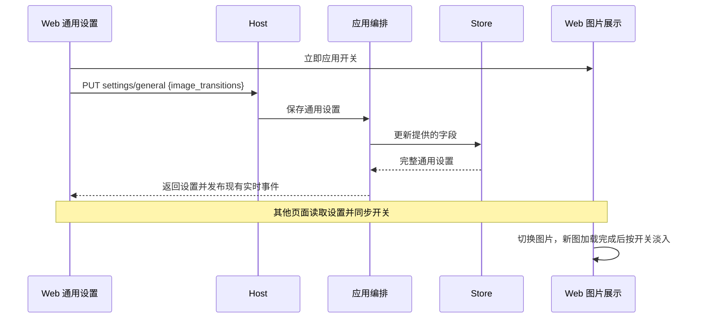

# 图片切换动效

## 概述

图片切换增加默认开启的轻量淡入效果，可在设置 → 通用关闭并持久保存。

## 架构

## 职责边界

| 接口 / 组成 | 变更 |
| --- | --- |
| GET/PUT /api/settings/general | 新增 image_transitions: boolean，默认 true；PUT 可单独保存，未提供的主题、语言和效果设置保持。 |
| Store.GeneralSettings.get/save | general_settings 单行表新增对应字段；备份后加列，保留已有主题与语言。 |
| Web：通用设置 | 增加「图片切换动效」开关，复用共享 shadcn 控件，切换立即生效；保存失败恢复原值并提示。 |
| Web：图片展示 | 漫游与生成 / 喜欢的大图共用轻量动效处理；不改变生成、推荐或任务模块。 |

沿用现有 general_settings 实时事件同步其他页面，设置不额外保存浏览器 storage 副本。

## 调用和数据流

## 重点关注

- 使用约 180ms 的淡入，动画只作用于图片，不带动操作栏、锚点面板或图片信息；保留毛玻璃处理。
- 适用于键盘、触屏、按钮及自动播放切图，以及普通 / 沉浸模式；网格初次加载和首次打开大图不额外播放切图动画。
- 同一图片的反馈或界面刷新不触发动画；快速连续切换取消上一次动效，加载失败不播放。
- 关闭立即停止当前切图动效，后续直接显示；系统开启「减少动态效果」时也不播放，保留用户开关选择。
- 自动播放沿用图加载完成后计时，不额外等待动效；不增加图片下载或 GPU 任务。
- 中英文文案同步；验证少数切图 / 开关 / 保存与刷新场景、类型检查和构建，不做全量测试。发布前备份数据库与前端资源。