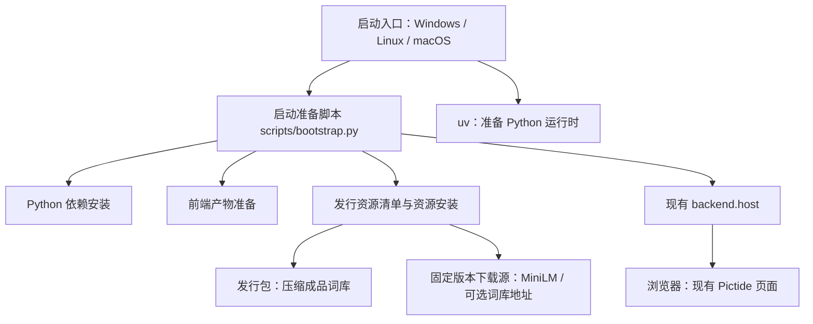
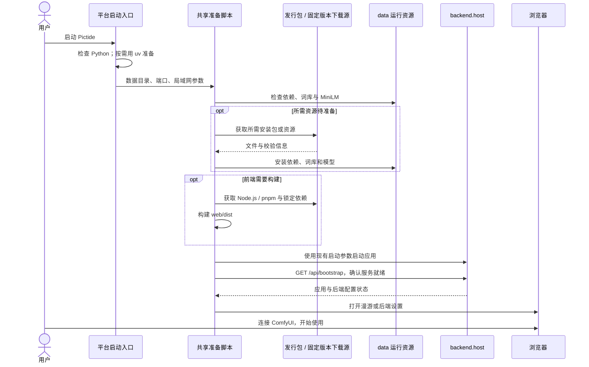

# 启动时自动准备依赖

## 概述

待确认：用户通过各系统现有启动入口，自动补齐 Pictide 的运行环境、前端、词库和推荐模型，服务就绪后打开浏览器。

## 架构

## 职责边界

- `start.cmd/start.ps1`、`start.sh`、`start.command` 保持各系统的唯一入口，解析现有端口、数据目录和局域网参数，准备可用 Python 后交给共享脚本；各系统文档分别说明操作。
- Python 准备优先复用满足项目要求的解释器；需要补齐时下载固定版本 uv，由 uv 安装项目选定的 Python 3.12 运行时。工具、解释器、虚拟环境、安装缓存和临时文件放在所选 `data/`。
- 新增内部命令 `scripts/bootstrap.py --data-dir PATH --port PORT [--lan]`：检查、补齐、验证、启动现有 Host、等待服务就绪并打开浏览器；退出状态跟随应用进程。
- Python 包继续依据 `backend/requirements.txt` 安装，安装完成检查运行依赖；已有可用环境直接复用。
- 前端优先使用发行包的 `web/dist/`；源码目录需要构建时自动准备固定版本 Node.js 和 `web/package.json` 指定的 pnpm，依据锁文件安装并构建。构建工具和依赖使用 `data/`，页面产物使用现有 `web/dist/`。
- 资源清单记录词库包的大小、SHA-256 与可选下载地址，以及 MiniLM 的固定仓库修订和文件列表；启动准备负责获取和安装，候选与推荐模块继续读取现有数据路径。
- 新增发行资源打包命令，从现有候选 SQLite 导出 `tags/correlations/dataset` 及索引，生成压缩词库包与校验信息；用户预设、图片和偏好由用户各自保存。首版发行包携带压缩成品词库，启动时自动安装到新数据目录；提供托管地址后，同一清单也可支持在线下载。
- 候选库已有有效标签数据时沿用；新数据目录安装成品库后，由现有候选服务创建默认预设。现有可编辑预设继续保留。
- MiniLM 自动准备当前编码器要求的 ONNX 与 tokenizer 文件，采用固定修订、沿用现有缓存布局和 CPU 编码路径。
- 服务就绪判断复用 `GET /api/bootstrap`；首次配置后端时打开现有「设置 → 后端」，日常启动打开漫游。新增逻辑属于启动与资源准备，业务 HTTP 接口和模块调用关系保持。
- 生图由用户选择并连接的 ComfyUI 提供；连接与模型选择沿用现有设置页面。此次自动准备范围是 Pictide 自身所需资源。

## 调用和数据流

## 重点关注

- 首次启动展示当前阶段与文件下载进度；后续启动复用已准备的资源。失败时保留可用文件，并显示具体原因和对应操作。
- 所有运行资源遵循用户选定的 `data/`；运行环境安装采用项目私有目录。
- 当前本机候选数据库约 461 MiB，首版应分发预处理后的成品，而用户直接获得可用词库。压缩下载体积以打包测量结果为准。
- 当前项目使用本地 Git 仓库，成品词库的在线托管地址尚待发布。首版可通过携带压缩词库的发行包完成闭环；资源包可以在本地制作并验证，发布位置另行确定。
- 首版准备范围包含 Python、Python 包、前端、MiniLM 和成品词库；ComfyUI 与文生图模型通过现有接入路径配置。
- 验证采用独立数据目录：首次准备、第二次复用、资源下载中断后再次启动，以及现有数据保留。Windows 执行真实启动冒烟；Linux/macOS 做可用范围内的脚本冒烟，并明确原生验证结果。

参考：[uv 自动管理 Python](https://docs.astral.sh/uv/guides/install-python/)、[MiniLM ONNX 资源](https://huggingface.co/Qdrant/all-MiniLM-L6-v2-onnx/tree/main)。
