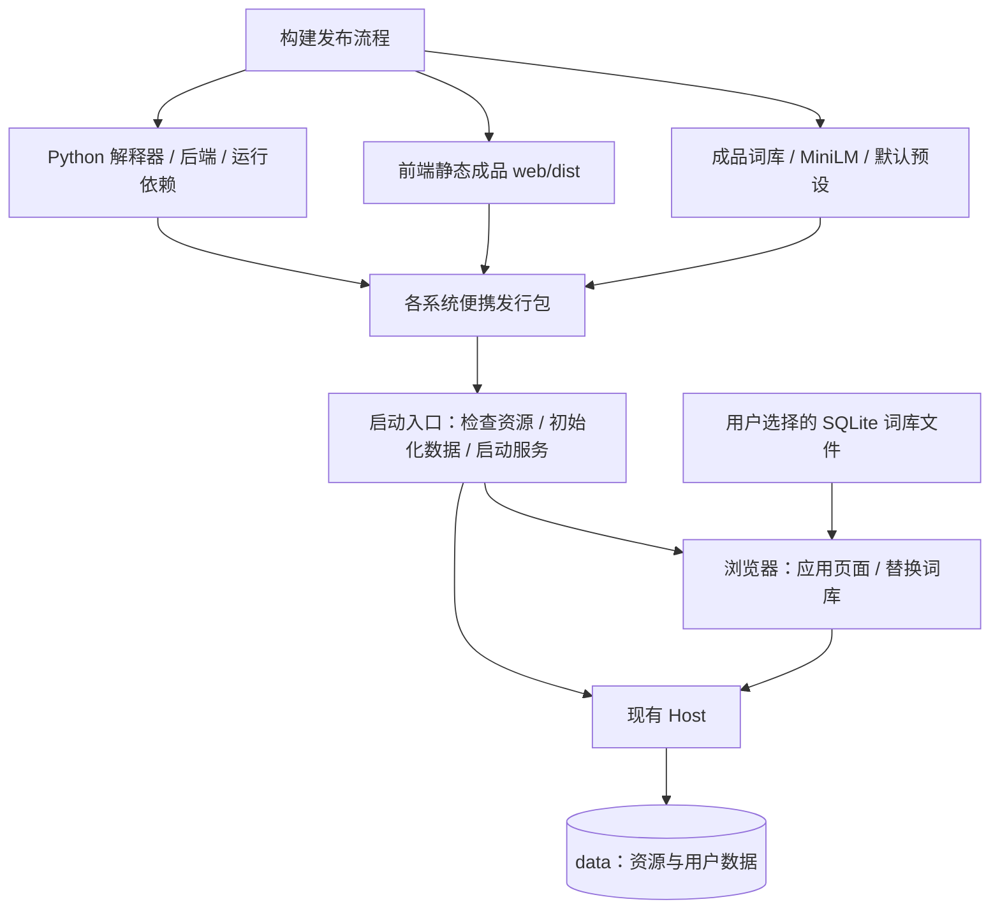
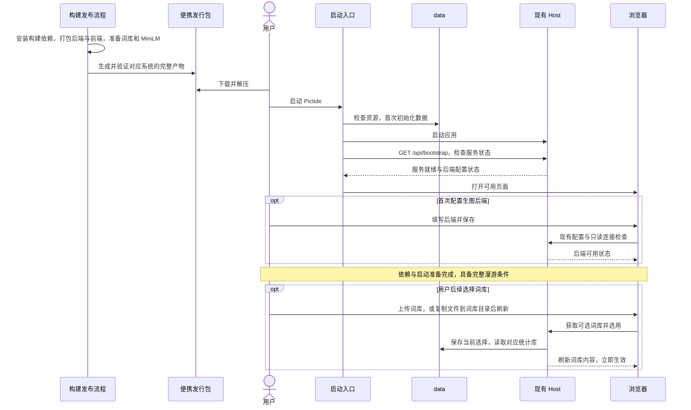

# 开箱即用的便携发行包

## 概述

让用户以最少、最简单的操作完成依赖准备与项目启动，达到能够进行一次完整漫游体验的就绪状态。

发行方向已确认，打包与启动实现待完成；运行环境、前端、词库和推荐模型由构建发布流程准备，用户通过便携发行包直接启动应用。具体入口和词库导入契约见[实施接口](portable-release-implementation.md)。

## 架构

## 职责边界

- 构建发布负责安装开发依赖、构建前端、打包 Python 后端、准备词库和推荐模型、验证产物；用户收到可以直接运行的完整目录式压缩包。
- Python 后端优先采用 PyInstaller 目录式打包，将解释器、Python 包及原生依赖随程序交付；FastEmbed、ONNX Runtime、NumPy 和动态导入在实际产物中验证。
- 前端以已构建的 `web/dist/` 随包提供。Node.js、pnpm、前端依赖安装和编译归属开发构建流程。
- 词库提供预处理成品；资源导出包含 `tags/correlations/dataset` 及所需索引。MiniLM 提供当前编码器要求的固定版本 ONNX 和 tokenizer 文件；默认预设提供可用的候选配置。
- 发行包使用干净的种子资源。首次启动将所需资源初始化到所选 `data/`，后续启动沿用用户的预设、图片、评价和偏好。
- 便携用户可在「提示词 → 词库」上传 `.sqlite3` 或 `.sqlite3.gz`，也可直接把 `.sqlite3` 文件复制到 `data/libraries/`。页面刷新目录后，通过下拉选择立即使用，精简版与完整版本可以并存。
- 词库统计独立存放在 `data/libraries/`，个人预设和当前选择保存在 `data/candidate.sqlite3`；图片、固定词、锚点和偏好继续使用本地记录。现有数据先备份再整理布局；首次初始化和软件升级沿用用户已选择的词库。
- 启动入口负责资源完整性检查、首次数据初始化、启动现有 Host、等待服务就绪并打开浏览器；资源异常显示原因和恢复操作。资源清单记录版本、文件大小和 SHA-256。
- 服务就绪与后端状态复用 `GET /api/bootstrap`。首次使用可进入现有后端设置，配置完成后具备开始漫游的条件；正常启动打开漫游页面。
- 生图能力由用户提供的 ComfyUI 与文生图模型承担。此次交付聚焦 Pictide 自身的依赖准备与启动，后端连接采用现有配置和只读检查路径。
- Windows、Linux、macOS 按操作系统和 CPU 架构分别构建、验证和交付；各系统用户指南分别说明启动操作。
- 源码启动脚本继续服务开发与调试，依赖安装和构建步骤放在开发者路径。词库目录与选择属于待实现的发行需求，具体接口在实施前提交确认；候选、推荐、任务继续通过应用编排协作。

## 调用和数据流

## 重点关注

- 验收终点是“能够开始完整漫游”的就绪状态：应用启动成功、页面可访问、候选词库与默认预设可用、推荐模型可执行，连接已就绪生图后端后具备生成条件。
- 用户操作集中在获取发行包、解压、启动和首次后端配置；依赖安装、前端构建和模型资源准备由发行流程承担。
- 使用仅具备受支持操作系统、浏览器及已就绪 ComfyUI 的干净机器验证；确认 Pictide 所需 Python、原生库、前端、词库和推荐模型均由产物提供。
- 少数冒烟覆盖首次启动、再次启动、既有数据保留与资源异常提示；验证页面、候选生成、MiniLM 编码和后端只读连接。浏览、评价、收藏等交互沿用现有功能验证。
- 词库选择冒烟覆盖上传与目录复制、精简版与完整版本切换、个人预设保留、重启保留选择和异常文件提示；检查软件升级继续使用用户选择的词库。替换文件沿用当前 SQLite 结构。
- 目录式打包便于启动、资源定位和排查问题；记录下载体积、解压占用与应用就绪耗时，围绕依赖准备和启动成本优化。
- 程序依赖、模型、运行数据、缓存和日志遵循项目 `data/` 约定；已有用户数据继续保留。
- 当前已实现源码启动路径；便携发行包完成构建与平台验证后，同步各系统的用户启动说明。

参考：[PyInstaller 打包方式](https://pyinstaller.org/en/stable/operating-mode.html)、[平台构建要求](https://pyinstaller.org/en/stable/index.html)。
